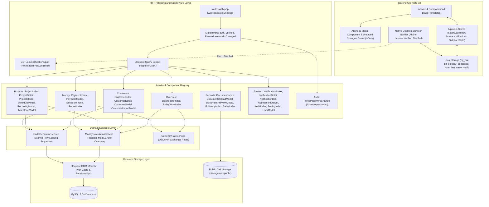

# 10X Agency — Project Coordinator CRM (`PJT CRM`)

<p>
  
  <br>
  <strong>Unified Project Operations, Milestone Tracking & Financial Receivables CRM</strong>
  <br>
  <em>Engineered for agency coordinators, delivery leads, and finance directors.</em>
</p>

<p>
  
  
  
  
  
  
</p>

> [!TIP]
> **Comprehensive Master Technical Reference Available**: For complete technical specifications, architectural evolution history, full database schema & ERD, deep component matrix, and consolidated historical defect registry (ISS-001 through ISS-053), see [**`project.md`**](project.md).

---

## Table of Contents

- [Overview](#overview)
- [Key Features](#key-features)
- [System Architecture Diagram](#system-architecture-diagram)
- [Livewire 4 & Alpine Runtime Conventions](#livewire-4--alpine-runtime-conventions)
- [Directory Layout](#directory-layout)
- [Quickstart & Local Installation](#quickstart--local-installation)
- [Default Seed Credentials](#default-seed-credentials)
- [Livewire 4 Component Matrix](#livewire-4-component-matrix)
- [Financial Engine & Calculations](#financial-engine--calculations)
- [Production Deployment & Server Config](#production-deployment--server-config)
- [Operational Maintenance & Runbook](#operational-maintenance--runbook)
- [License](#license)

---

## Overview

**PJT CRM** is a single-tenant operations and financial management platform designed specifically for digital services agencies. It centralizes client onboarding, project delivery health monitoring, milestone tracking, multi-tier installment receivables, task checklists, client follow-ups, and native desktop notifications into a high-performance reactive full-stack web application.

The platform is engineered on **Laravel 13** and **Livewire 4**, providing single-page application (SPA) reactivity through `wire:navigate` and `Livewire.navigate()`, unified Alpine.js stores, dirty-state modal protection, real-time validation, native browser desktop alerts, and a dedicated Service Layer that enforces financial consistency, concurrency-safe code generation, and coordinator-scoped data security.

---

## Key Features

### 📊 1. Executive Dashboard & Real-Time Overview

* **Top Financial Metric Cards:** Real-time agency financial health indicators:
  * **Total Receivable** `(sum(Installment Amount) where Status != 'Cancelled')`: All active scheduled billing milestones across projects.
  * **Received** `(sum(Payment Receipts))`: Total cash collected to date across all verified payments.
  * **Due** `(max(0, Total Receivable - Received - TDS Deducted))`: Outstanding balance still to be collected.
  * **Overdue** `(sum(Balance) where Status == 'Overdue')`: Delinquent installments requiring immediate follow-up.
  * **This Month** `(sum(Payment Receipts) where Month == Current Month)`: Collections logged within the current calendar month.
* **Project Health Summary:** Real-time breakdown categorizing active projects into **On Track**, **At Risk**, **Delayed**, and **Completed**, with 1-click filtering to the Projects directory.
* **Collection Trend Chart:** 6-month visual revenue sparkline tracking monthly collection totals over the last half year.
* **Today's Work Quick List:** Fast daily triage widget displaying:
  * **Overdue Payments** `(late customer installments with 1-click navigation to project details)`
  * **Follow-ups** `(pending client calls, emails, and meetings scheduled for today)`
  * **Projects Needing Attention** `(deliverables currently flagged as Delayed or At Risk)`.
* **Upcoming Payments & Overdue Payments Widgets:** Live lists tracking installments due in the next few days alongside overdue items needing immediate client follow-up.
* **Sales-wise Performance Table:** Commercial tracking breakdown by salesperson showing **Customers** onboarded, active **Projects**, contracted **Value**, collected **Received**, and **Collection %** `((Received / Value) * 100)`.
* **Operational Alerts:** Proactive warning cards for **AMC / Renewal** `(maintenance contracts expiring within the alert window)` and **Handover Pending** `(delivered projects awaiting client sign-off)`.
* **Live Event Reactivity:** Automatically refreshes KPI cards, triage queues, and tables without full browser reloads when payments, projects, or customers are saved.

### 🔔 2. Notification Center & Desktop Alerts

* **Slide-Over Notification Drawer:** Accessible via the topbar bell icon, featuring real-time unread badges, filter tabs (**All** vs. **Unread**), 1-click single mark-as-read, and bulk **Mark all as read**.
* **Native Desktop Browser Alerts:** Automatically checks for new reminders and delivers native operating system desktop notification banners every 30 seconds with direct deep-linking on click.
* **Notification Detail View:** Inspect full alert details, jump to linked customer or project dossiers, and toggle read status.
* **Topbar Bell Counter:** Live unread notification counter updated automatically as activities occur.

### 🔒 3. User Roles, Security & Password Management

* **Role-Based Access Control (RBAC):**
  * **Administrator (`Admin`)**: Unrestricted global governance over system settings, staff accounts, alert thresholds, customer deletions, and executive reports.
  * **Manager (`Manager`)**: Supervisory oversight over assigned teams and downline coordinators with full schedule, project, customer, and report visibility.
  * **Project Coordinator (`Coordinator`)**: Scoped to assigned customer accounts, projects, schedules, receipts, tasks, and follow-ups; executive financial reports are restricted.
  * **Sales Representative (`Sales`)**: Client onboarding attribution and target monitoring; scoped strictly to self-attributed customer profiles and basic project overviews (financial ledgers, payment schedules, and money columns remain hidden).
* **Mandatory First-Time Password Change:** Automatically intercepts logins and redirects newly created staff or administratively reset accounts to the **/change-password** screen before granting access.
* **Password Complexity Rules:** Enforces a minimum of 8 characters containing at least 1 uppercase letter, 1 lowercase letter, and 1 numeric digit.

### 🎯 4. Today's Work Command Center

* **Daily Priority Metric Cards:** Top counter blocks highlighting:
  * **Overdue** `(installments past due date + grace period with balance remaining)`
  * **Due in X days** `(upcoming installments falling due within the alert window)`
  * **Follow-ups** `(conversations, calls, and meetings scheduled for today)`
  * **My Open Tasks** `(checklist items assigned to you that are not yet marked done)`.
* **Actionable Work Queues:**
  * **Overdue Payments**: Delinquent installments listed with days late and an inline **+ Payment** button to record settlements immediately without leaving the triage view.
  * **Upcoming Payments**: Client installments scheduled for the next few days.
  * **Follow-up Calls & Messages**: Scheduled touchpoints with customer contact details and quick note logging.
  * **Projects Needing Attention**: Active projects requiring coordinator intervention due to delay reasons or milestone risks.

### 📁 5. Customer Directory & Client Profiles

* **Customer Directory Table:** Filterable list displaying **Customer**, primary **Contact**, assigned **Salesperson**, **City / State**, active **Projects**, total contract **Value**, outstanding **Due**, and **Status**.
* **Flexible Sole Proprietor & Corporate Profiles:** Supports corporate clients with GST/PAN tax details alongside individual clients without a company name.
* **Deterministic Display Fallback:** Automatically displays company name when available, or cleanly falls back to **"{Contact Name} (Client)"** (or customer code) across all tables, search dropdowns, and activity feeds.
* **Sales Targets & Quotas:** Tracks onboarding attribution and monitors collection progress against monthly quotas configured in user settings `(% Achieved = (Received / Target) * 100)`.
* **Bulk Import & CSV Export:** Upload customer lists via spreadsheet CSV file or direct copy-paste with automated duplicate checking, or stream filtered client records to Excel-compatible CSV.

### 🚀 6. Project Coordination, Milestones & Maintenance

* **Project Directory Table:** Complete work order list showing **Project**, **Customer**, delivery **Health** (On Track, At Risk, Delayed, Completed), work **Status** (Onboarding, In Progress, Review / UAT, Delivered, On Hold, Cancelled), assigned **Coordinator**, contracted **Value**, **Received**, **Due**, and target **Delivery Date**.
* **Delivery Health Monitoring:** Visible health tags with mandatory delay reasons to highlight delivery roadblocks early.
* **Auto-Split (30/40/30) Schedule Wizard:** 1-Click payment term calculation dividing total project value into standard agency installments:
  * **Advance (30%)**: Upfront retainer upon signing
  * **Mid-Project (40%)**: Billed upon interim delivery milestone
  * **Final Delivery (30%)**: Remaining completion balance (with exact penny matching)
  * Automatically maps due dates to milestones or staggers them (+0, +15, +30 days) from project start.
* **Milestone Checklist:** Interactive milestone tracker with due dates, payment trigger linking, and 1-click completion checkmarks.
* **Annual Maintenance Contracts (AMC):** Dedicated contract duration tracking with automated renewal warnings before expiration.
* **Handover Governance:** Post-delivery checklist and formal client handover notes.

### 💳 7. Money, Payments & Installment Schedules

* **Payments Ledger:** Comprehensive receipts table tracking **Receipt #**, **Project / Customer**, installment **Term**, payment **Amount**, **TDS Deducted**, **Total Credited**, **Paid on** date, and **Mode & Reference** (Cash, UPI, NEFT, RTGS, Cheque, Card).
* **Payment Schedule Master View:** Centralized chronological timeline tracking **Upcoming**, **Overdue**, **Collected**, and **Total Scheduled** installments across all agency projects.
* **Automatic Installment Status Transitions:**
  * **Paid**: Fully cleared when `Received + TDS Deducted >= Installment Amount`
  * **Partial**: Partially settled when payments are logged but a balance remains
  * **Overdue**: Automatically marked late when `Today > Due Date + Grace Days` and balance is unpaid
  * **Pending**: Scheduled upcoming term with zero payments logged
  * **Cancelled**: Voided installment excluded from active receivables.
* **Zero-Default TDS Handling:** Normalized tax inputs credit withheld TDS directly against invoice balances alongside received cash.
* **Dual Currency Display:** Instant navbar toggle between Indian Rupees (`₹`) and US Dollars (`$`) with real-time conversion across all monetary views.

### 📋 8. Tasks, Follow-ups, Documents & Settings

* **My Tasks Checklist:** Personal task manager with priority tags (**Low**, **Medium**, **High**, **Urgent**), due dates, and late indicators.
* **Client Follow-ups Logger:** Multi-channel interaction tracker (**Call**, **Email**, **Meeting**, **WhatsApp**, **Note**) with scheduled next action dates and reminders.
* **Document Vault:** Secure file manager supporting contracts, KYC documents, invoices, and delivery proofs up to 10 MB with instant in-browser lightbox previews for PDFs and images.
* **Activity Log:** Reverse-chronological timeline recording all team creates, edits, receipts, uploads, and deletions.
* **Settings & User Administration:** Configure company information, adjust alert lead times (payment, AMC, follow-up windows), manage staff profiles, and generate 1-click temporary credentials for password resets.

---

## System Architecture Diagram



---

## Livewire 4 & Alpine Runtime Conventions

To prevent DOM race conditions, detachment of form event listeners, or unexpected database exceptions, the following engineering standards are strictly enforced across the application:

1. **Bundled Alpine Runtime**:
   Livewire 4 bundles Alpine.js out of the box. `resources/js/app.js` must **not** import `alpinejs` or call `Alpine.start()`, as running dual Alpine engines breaks `wire:submit` and `wire:model` bindings.
2. **Global Event Broadcasting (`Livewire.dispatch`)**:
   Global layout-level modals (e.g. `<livewire:customers.customer-modal/>` or `<livewire:payments.payment-modal/>`) reside outside the DOM hierarchy of page tables. Triggers must use `Livewire.dispatch('event-name', payload)` instead of Alpine `$dispatch` to broadcast across independent component trees.
3. **SPA Transitions (`Livewire.navigate`)**:
   Navigating between views from clickable table rows must invoke `Livewire.navigate('url')` rather than full-page `window.location` browser reloads. This maintains active Alpine store states (`$store.currency`, `$store.notifications`) without flickering.
4. **In-App Confirmation Modal System (`<x-confirm-modal>`)**:
   Destructive actions (deletions, logouts, unlinking, mark-all-read) and form modal discards use the unified in-app confirmation component (`<x-confirm-modal/>`) rather than native browser `confirm()` or `wire:confirm`. The component provides hardware-accelerated frosted glass backdrop blur (`backdrop-filter: blur(8px)`), distinct contextual operation icons (danger, warning, logout, info), customizable actions, and outside-click collision guards (`data-confirm-modal`).
5. **Modal Unsaved Changes Guard (`isDirty`)**:
   The `<x-modal>` component listens for DOM `@input` and `@change` events to mark forms as dirty. Attempting to dismiss an unsubmitted form via outside click, `Escape`, or Cancel triggers the in-app confirmation modal (`<x-confirm-modal>`) asking the user to confirm discarding unsaved changes. The "Keep Editing" button cleanly dismisses the confirmation dialog without triggering event loop collisions or closing the form.
6. **Real-Time Blur Validation**:
   Inputs utilize `wire:model.blur` combined with `$this->validateOnly($propertyName)` inside the `updated()` lifecycle hook. Invalid inputs display an active red border (`border-red-500! bg-red-50/20!`) and inline error labels beneath the field without rendering disruptive alert banners.
7. **Filter Visibility & Dynamic Clear Action**:
   Filter action buttons (e.g. "Clear filters" or "Reset filters") are conditionally displayed across data index tables only when active filters, status scopes, or search strings are applied.
8. **Navigation & Dynamic Back History**:
   Secondary views and detail pages use `window.history.length > 1 ? window.history.back() : window.location.href = '...'` to navigate back to the user's previous filtered list state instead of hardcoded route jumps.
9. **Schema Null vs. Default Synchronization**:
   For database columns defined as `NOT NULL DEFAULT 0.00` (e.g., `projects.cost`, `projects.amc_amount`, `payments.tds`, `users.target`), Livewire components explicitly convert empty strings (`""`) to `0.00` before persistence, preventing MySQL `1048 Column cannot be null` errors.

---

## Directory Layout

```text
├── .agents/                                # AI workspace configuration & project skills
│   ├── mcp_config.json                     # Laravel Boost MCP server configuration
│   └── skills/                             # Domain skills (codewise, laravel-best-practices, livewire, etc.)
├── app/
│   ├── Http/
│   │   ├── Controllers/
│   │   │   ├── Api/
│   │   │   │   └── NotificationPollController.php  # Lightweight 30s endpoint for desktop notification polling
│   │   │   ├── Auth/                               # Laravel Breeze authentication controllers
│   │   │   └── ProfileController.php               # User profile editing and password updates
│   │   └── Middleware/
│   │       └── EnsurePasswordIsChanged.php         # Intercepts logins with must_change flag
│   ├── Livewire/
│   │   ├── Audit/
│   │   │   └── AuditIndex.php                      # System activity log timeline viewer
│   │   ├── Auth/
│   │   │   └── ForcePasswordChange.php             # Dedicated password update screen for flagged users
│   │   ├── Components/
│   │   │   ├── GlobalSearch.php                    # Universal debounced search dropdown
│   │   │   ├── NotificationBell.php                # Topbar unread count polling badge
│   │   │   └── NotificationDrawer.php              # Slide-over flyout panel for notifications
│   │   ├── Customers/
│   │   │   ├── CustomerDetail.php                  # Tabbed customer profile (Overview, Projects, Payments, Docs, Followups)
│   │   │   ├── CustomerImportModal.php             # Bulk CSV upload and spreadsheet paste modal
│   │   │   ├── CustomerIndex.php                   # Customer directory, filtering, pagination, and CSV export
│   │   │   └── CustomerModal.php                   # Unified create and edit modal for customers
│   │   ├── Dashboard/
│   │   │   └── DashboardIndex.php                  # Executive KPI cards, health breakdown, triage, and trend analytics
│   │   ├── Documents/
│   │   │   ├── DocumentIndex.php                   # Global document repository with category filtering and deletion
│   │   │   ├── DocumentPreviewModal.php            # Lightbox preview modal for PDFs and images
│   │   │   └── DocumentUploadModal.php             # Multi-entity file upload modal with validation
│   │   ├── Followups/
│   │   │   └── FollowupIndex.php                   # Touchpoint feed, overdue alert banner, and interaction logger
│   │   ├── Notifications/
│   │   │   ├── NotificationDetail.php              # Dedicated notification view with target navigation
│   │   │   └── NotificationIndex.php               # Notification inbox with deep linking and mark-as-read actions
│   │   ├── Payments/
│   │   │   ├── PaymentIndex.php                    # Receipt ledger, mode filtering, balance tracking, and CSV export
│   │   │   └── PaymentModal.php                    # Receipt recorder with auto-balance calculation and term binding
│   │   ├── Projects/
│   │   │   ├── ProjectDetail.php                   # Project delivery matrix, timeline, schedule, and document tabs
│   │   │   ├── ProjectIndex.php                    # Work orders directory, health filtering, and overdue rollups
│   │   │   ├── ProjectMilestoneModal.php           # Dynamic milestone ordering and checklist manager
│   │   │   ├── ProjectModal.php                    # Project contract creator/editor with AMC and handover fields
│   │   │   ├── ProjectRecurringModal.php           # Monthly retainer recurring installment generator
│   │   │   └── ProjectScheduleModal.php            # Installment scheduler (fixed, milestone-linked, recurring)
│   │   ├── Reports/
│   │   │   └── ReportIndex.php                     # Collection rate, monthly sparkline, mode bars, aging, and variance
│   │   ├── Sales/
│   │   │   └── SalesIndex.php                      # Salesperson revenue attribution, targets, and comparative table
│   │   ├── Schedule/
│   │   │   └── ScheduleIndex.php                   # Master chronological installment timeline and CSV export
│   │   ├── Settings/
│   │   │   ├── SettingIndex.php                    # Operational threshold configuration, password manager, and user list
│   │   │   └── UserModal.php                       # Staff and sales account creator/editor with quota and credential provisioning
│   │   ├── Tasks/
│   │   │   └── TaskIndex.php                       # Coordinator checklist manager with priority flags and late indicators
│   │   └── Today/
│   │       └── TodayWorkIndex.php                  # Daily operational triage for overdue payments, calls, and risks
│   ├── Models/                                     # 14 Eloquent Models with relationships & casts
│   │   ├── ActivityLog.php                         # System activity log model (mapped to activity_logs)
│   │   └── ...
│   └── Services/
│       ├── CodeGeneratorService.php                # Concurrency-safe atomic counter sequence generator
│       ├── CurrencyRateService.php                 # Exchange rate configuration and conversion service
│       └── MoneyCalculationService.php             # Central financial calculation engine
├── database/
│   ├── migrations/                                 # 17 structured table migrations
│   └── seeders/
│       ├── DatabaseSeeder.php
│       └── UsersSeeder.php                         # Seeds default Administrator, Coordinator, and Manager accounts
├── public/
│   ├── assets/logo.png                             # Static brand identity asset
│   └── css/crm-style.css                           # Complete CSS layout & design palette
├── resources/
│   ├── css/app.css                                 # Tailwind CSS setup
│   ├── js/app.js                                   # Clean JS entry without manual Alpine imports
│   └── views/
│       ├── components/                             # Blade UI components (money, kpi-card, health-badge, modal)
│       ├── layouts/
│       │   ├── app.blade.php                       # Master responsive application layout with slide-over drawer & notifier
│       │   ├── guest.blade.php                     # Clean layout for login and password change
│       │   └── partials/sidebar.blade.php          # 14-module navigation sidebar with live counters
│       └── livewire/                               # Paired Blade templates for all Livewire components
├── boost.json                              # Laravel Boost agent and skill registry
└── routes/
    ├── auth.php                            # Breeze authentication routes
    └── web.php                             # Authenticated routes mapping all Livewire modules & polling API
```

---

## Quickstart & Local Installation

### 1. Prerequisites

* **PHP:** `^8.3` (running PHP 8.4) with `pdo_mysql`, `mbstring`, `fileinfo`, `openssl`, `tokenizer`, `xml` extensions
* **Database:** MySQL `8.0+` or MariaDB `10.4+`
* **Composer:** `v2.x`
* **Node.js:** `v18.x` or higher (with NPM)

### 2. Clone and Install Dependencies

```bash
git clone <repository-url> pjt-crm
cd pjt-crm

composer install
npm install
```

### 3. Environment Setup

Create the environment configuration file and generate the application encryption key:

```bash
cp .env.example .env
php artisan key:generate
```

### 4. Database Configuration

Open `.env` and configure your database connection parameters:

```dotenv
DB_CONNECTION=mysql
DB_HOST=127.0.0.1
DB_PORT=3306
DB_DATABASE=pjt_crm
DB_USERNAME=root
DB_PASSWORD=your_secure_password
```

### 5. Run Migrations & Seed Default Accounts

Execute all database migrations and seed the initial administrative accounts:

```bash
php artisan migrate:fresh
php artisan db:seed --class=UsersSeeder
```

### 6. Establish Public Storage Symlink

Create the public storage symlink for uploaded contracts, KYC, and invoice documents:

```bash
php artisan storage:link
```

### 7. Run Local Development Servers

Start the Laravel development server:

```bash
php artisan serve
```

In a separate terminal window, start the Vite asset compiler:

```bash
npm run dev
```

Navigate to **`http://127.0.0.1:8000`** in your browser.

---

## Default Seed Credentials

Following database seeding, log in using any of the following accounts:

| Role | Email | Default Password | Permissions Scope |
|:---|:---|:---|:---|
| **Admin** | `admin@the10xagency.in` | `Sample@1123` | Unrestricted access: User Administration, System Settings, Customer Deletion |
| **Coordinator** | `coordinator@the10xagency.in` | `Sample@1123` | Account-scoped access: Customers, Assigned Projects, Payments, Uploads, Tasks |
| **Manager** | `manager@the10xagency.in` | `Sample@1123` | Supervisory access: Downline coordinator project oversight and activity tracking |

> **Security Notice:** Update default passwords immediately via **Settings (`/settings`)** upon initial deployment.

---

## Livewire 4 Component Matrix

All operational modules are built as dedicated Livewire 4 full-page components and modals:

| Module Group | Module Name | Route Name | Livewire Class | Key Sub-Components & Modals |
|:---|:---|:---|:---|:---|
| **Overview** | **1. Dashboard** | `dashboard` | `Dashboard\DashboardIndex` | `x-kpi-card`, `x-health-badge`, `spark` bar chart, reactive mutation listeners |
| | **2. Today's Work** | `today.index` | `Today\TodayWorkIndex` | Actionable queue, overdue alert badges, inline `+ Payment` modal trigger |
| **Customers** | **3. Customers** | `customers.index` | `Customers\CustomerIndex` | `CustomerDetail`, `CustomerModal`, `CustomerImportModal` |
| | **4. Projects** | `projects.index` | `Projects\ProjectIndex` | `ProjectDetail`, `ProjectModal`, `ProjectScheduleModal`, `ProjectRecurringModal`, `ProjectMilestoneModal` |
| | **5. My Tasks** | `tasks.index` | `Tasks\TaskIndex` | Priority checklist, due date late flags, sanitized selects |
| **Money** | **6. Payments** | `payments.index` | `Payments\PaymentIndex` | `PaymentModal` with auto-balance calculation, non-null TDS defaults |
| | **7. Payment Schedule** | `schedule.index` | `Schedule\ScheduleIndex` | Master timeline, trigger badges, CSV export, live recalculations |
| | **8. Reports** | `reports.index` | `Reports\ReportIndex` | Executive analytics: collection rate % `((received / scheduled) * 100)`, trailing 6-month sparkline `(monthly sum(payments))`, mode bars `(sum(payments) grouped by mode)`, aging bars `(overdue terms bucketed: 0–30, 31–60, 61–90, 90+ days)`, and delivery variance table `(milestone_% - collection_%)` |
| **Records** | **9. Documents** | `documents.index` | `Documents\DocumentIndex` | `DocumentUploadModal` (public disk root), `DocumentPreviewModal` (lightbox) |
| | **10. Follow-ups** | `followups.index` | `Followups\FollowupIndex` | Touchpoint feed, overdue alert banner, scoped project relations |
| | **11. Sales Team** | `sales.index` | `Sales\SalesIndex` | Shared `UserModal` for quota tracking and credential management |
| **System** | **12. Notifications** | `notifications.index`<br>`notifications.show` | `Notifications\NotificationIndex`<br>`Notifications\NotificationDetail` | `Components\NotificationBell`, `Components\NotificationDrawer`, deep linking |
| | **13. Activity Log** | `audit.index` | `Audit\AuditIndex` | Color-coded action timeline, user attribution (`ActivityLog`) |
| | **14. Settings** | `settings.index` | `Settings\SettingIndex` | `UserModal`, password complexity manager, threshold configurations |
| **Auth** | **Password Change** | `password.change` | `Auth\ForcePasswordChange` | Mandatory first-time password change screen triggered by `EnsurePasswordIsChanged` |

---

## Financial Engine, Business Logic & Calculations

All financial accounting and workflow automations align directly with the metrics, badges, and tables displayed across the application interface:

### 1. Financial Metrics & Calculations

* **Total Receivable**:
  * **Formula**: `Total Receivable = sum(Installment Amount) [where Status != 'Cancelled']`
  * **UI Location**: Displayed on **Dashboard** as **Total Receivable** and on **Payment Schedule** as **Total scheduled**.
  * **Meaning**: Total active billing commitments across all contracted client milestones.

* **Received**:
  * **Formula**: `Received = sum(Payment Receipts)`
  * **UI Location**: Displayed on **Dashboard** as **Received**, on **Payments** as **Total Amount**, and on **Payment Schedule** as **Collected**.
  * **Meaning**: All verified client payments logged across NEFT, RTGS, UPI, Cash, Cheque, and Card.

* **TDS Deducted**:
  * **Formula**: `TDS Deducted = sum(TDS on Receipts)`
  * **UI Location**: Displayed on **Payments** header and table column, and on **Reports** as **TDS deducted**.
  * **Meaning**: Tax withheld by clients at source under Indian tax regulations, credited directly against invoice balances.

* **Due**:
  * **Formula**: `Due = max(0, Total Receivable - Received - TDS Deducted)`
  * **UI Location**: Displayed on **Dashboard** as **Due**, on **Customers** as **total due**, and on **Projects** as **Due**.
  * **Meaning**: Outstanding monetary balance owed by clients, clamped to `0.00` to prevent negative numbers.

* **Overdue**:
  * **Formula**: `Overdue = sum(Installment Balance) [where Status == 'Overdue']`
  * **UI Location**: Displayed on **Dashboard**, **Today's Work**, **Payment Schedule**, and **Reports** as **Overdue**.
  * **Meaning**: Late payments past due date and grace period that require immediate client follow-up.

* **Collection Rate**:
  * **Formula**: `Collection Rate % = (Received / Total Receivable) * 100`
  * **UI Location**: Displayed on **Reports** as **Collection rate**, on **Dashboard** as **% collected**, and on **Sales Team** as **Collection %**.
  * **Meaning**: Overall realization efficiency of contracted revenue into collected cash.

### 2. Installment Status Transitions

Installments automatically update their visual status badge in the **Payment Schedule** and **Project Detail** tabs based on actual payments:
1. **`Paid`** (Green): `Received + TDS Deducted >= Installment Amount - 0.01` (fully cleared).
2. **`Partial`** (Amber): `0 < Received + TDS Deducted < Installment Amount - 0.01` (partially settled with balance remaining).
3. **`Overdue`** (Red): `Today > Due Date + Grace Days` AND `Due > 0` (past due date requiring collection).
4. **`Pending`** (Gray): `Today <= Due Date + Grace Days` AND `Received + TDS Deducted == 0` (future installment).
5. **`Cancelled`** (Muted): Voided term excluded from active receivables.

### 3. Auto-Split (30/40/30) Schedule Wizard

Available inside the **Schedule** modal on any project, this wizard divides the contracted **Project Value** into standard agency milestone terms with exact penny settlement:
* **Advance (30%)**: `round(Project Value * 0.30, 2)` (upfront retainer upon signing)
* **Mid-Project (40%)**: `round(Project Value * 0.40, 2)` (interim milestone billing)
* **Final Delivery (30%)**: `Project Value - Advance - Mid-Project` (remaining balance upon project completion)
* **Due Date Synchronization**: If delivery milestones exist, terms inherit their due dates; if milestones are not yet defined, terms automatically stagger (+0 days, +15 days, +30 days) from the project start date.

### 4. Concurrency-Safe Sequence Engine & Counter Auto-Healing (`CodeGeneratorService`)

* **Formula**: `next_counter = max(current_counter, max(db_suffix)) + 1`
* **Working**:
  1. Issues an exclusive row-level lock: `SELECT value FROM counters WHERE name = ? FOR UPDATE`.
  2. Queries the target table for the highest existing numerical suffix (`MAX(CAST(SUBSTRING(code, prefix_length + 1) AS UNSIGNED))`).
  3. If the counter value has fallen behind existing records (due to seeders or manual SQL inserts), it automatically updates the counter ceiling to match reality before generating the next formatted code (e.g. `CUS-0005`, `PJT-0008`, `RCP-0004`). This permanently prevents `500 UniqueConstraintViolationException` errors.

### 5. Customer Identity & Fallback Display Rule (`Customer` Model)

* **Formula**:
  * When `company` is provided: `Company Name` (e.g. *"Apex Global Logistics Pvt Ltd"*)
  * When `company` is absent: `Contact Person (Client)` (e.g. *"Rajesh Khanna (Client)"*)
  * When both are empty: `Customer Code` (e.g. *"CUS-0008"*)
* **Working**: Centralized in the `display_name` Eloquent accessor (`$customer->display_name`), ensuring clean, non-empty labels across all tables, modal dropdown selects, global search results, and activity audit logs.

### 6. Admin-Mediated Password Reset Workflow (`SettingIndex`)

* **Formula**: `Temporary Password = "Temp" . Current Year . "@" . 4-Digit Secure Random PIN` (e.g. `"Temp2026@4892"`)
* **Working**: Generates a compliant temporary password on-demand from the Settings user list, resets failed login counters (`fail_count = 0`), clears lockout timestamps (`locked_until = null`), flags `must_change = true`, records an audit log entry, and dispatches an in-app alert to the user.

---

## Production Deployment & Server Config

### Optimization Commands

Before going live, compile frontend assets and cache all configuration, views, and routes:

```bash
npm run build
php artisan config:cache
php artisan route:cache
php artisan view:cache
```

### Nginx Virtual Host Configuration

```nginx
server {
    listen 80;
    server_name project.the10xagency.in;
    return 301 https://$host$request_uri;
}

server {
    listen 443 ssl http2;
    server_name project.the10xagency.in;
    root /var/www/pjt-crm/public;

    ssl_certificate /etc/letsencrypt/live/project.the10xagency.in/fullchain.pem;
    ssl_certificate_key /etc/letsencrypt/live/project.the10xagency.in/privkey.pem;

    client_max_body_size 15M;
    index index.php;
    charset utf-8;

    add_header X-Frame-Options "SAMEORIGIN";
    add_header X-Content-Type-Options "nosniff";
    add_header Referrer-Policy "same-origin";

    location / {
        try_files $uri $uri/ /index.php?$query_string;
    }

    location = /favicon.ico { access_log off; log_not_found off; }
    location = /robots.txt  { access_log off; log_not_found off; }

    error_page 404 /index.php;

    location ~ \.php$ {
        fastcgi_pass unix:/var/run/php/php8.2-fpm.sock;
        fastcgi_param SCRIPT_FILENAME $realpath_root$fastcgi_script_name;
        include fastcgi_params;
    }

    location ~ /\.(?!well-known).* {
        deny all;
    }
}
```

---

## Operational Maintenance & Runbook

### 1. Application Cache & Optimization
After deploying code updates or modifying environment configurations, clear and rebuild application caches:
```bash
php artisan optimize:clear
php artisan config:cache
php artisan route:cache
php artisan view:cache
```

### 2. Frontend Asset Recompilation
When modifying Blade templates, Tailwind classes, or Alpine components:
```bash
# Production production build
npm run build

# Local live-reload development
npm run dev
```

### 3. Public File Storage Verification
Ensure user-uploaded KYC documents, contracts, and proposals are publicly accessible:
```bash
php artisan storage:link
```
Verify that `storage/app/public` exists and web server has read/write permissions on `storage/` and `bootstrap/cache/`:
```bash
chmod -R 775 storage bootstrap/cache
```

### 4. Sequence Generator & Counter Synchronization
Entity identifiers (`CUS-XXXX`, `PJT-XXXX`, `RCP-XXXX`) utilize row-locking with automated ceiling self-healing. If seeders or manual SQL records are inserted directly into the database, `CodeGeneratorService` automatically reconciles the counter table to `max(counter, highest existing suffix) + 1` upon the next create request without manual intervention.

### 5. Desktop Notification Polling Verification
Verify the lightweight 30-second polling endpoint responds with valid JSON for the authenticated user session:
```bash
# Inspect API route list
php artisan route:list --path=api/notifications/poll
```
In the browser network tab, verify `GET /api/notifications/poll` returns status `200 OK` with payload `{"unread_count": N, "notifications": [...]}`.

---

## License

This project is proprietary software belonging to **10X Agency**. Unauthorized copying, modification, or distribution is strictly prohibited.
