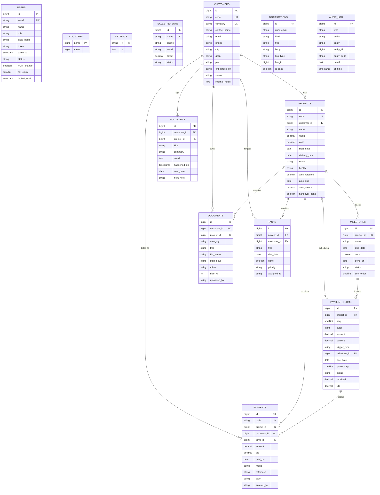
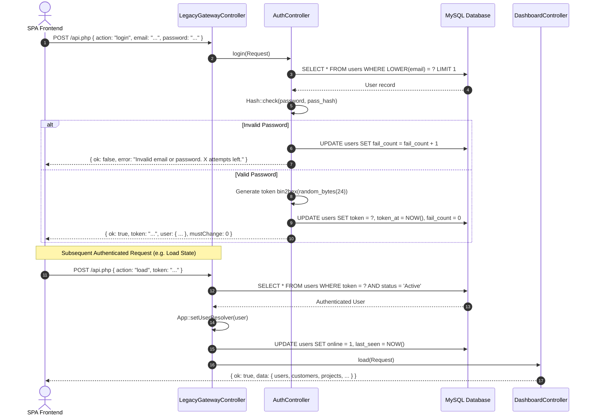

# 10X Agency — Project Coordinator CRM (`PJT CRM`)

**System Architecture, Database Specification, API Contracts & Implementation Guide**

---

## 1. System Executive Summary & Architecture

### 1.1 Platform Purpose & Scope

**PJT CRM** is a purpose-built, single-tenant operations and financial management system designed specifically for
digital agencies. It bridges the gap between sales handoff, delivery coordination, milestone execution, and receivables
collection. The system provides role-based access for two user tiers:

* **Administrators (`Admin`)**: Possess unrestricted governance over system settings, global alert thresholds, user
  management, salesperson commission targets, and destructive entity cascades (customer/project deletion).
* **Project Coordinators (`Coordinator`)**: Manage day-to-day client onboarding, project health and delivery milestones,
  multi-tier installment schedules, incoming payment receipts, document uploads, and scheduled follow-ups.

### 1.2 System Architecture Diagram

The platform is structured as a decoupled web application where a lightweight, reactive Vanilla JavaScript Single Page
Application (SPA) communicates over asynchronous JSON protocols with a Laravel backend application service layer.

```mermaid
graph TD
    subgraph Client Layer [Client Layer (Browser)]
        UI[Vanilla JS Reactive SPA]
        State[In-Memory Store: DB, DASH, ME]
        Storage[LocalStorage: Session Token, Currency Preference]
        UI --> State
        State --> Storage
    end

    subgraph Entry Points [HTTP Routing & Middleware]
        WebRoute["routes/web.php<br/>GET / (Serves app.blade.php)"]
        LegacyRoute["routes/web.php<br/>POST /api.php (Legacy Action Gateway)"]
        RestRoute["routes/api.php<br/>POST /api/v1/* (RESTful Resource Endpoints)"]
        CsrfExempt["CSRF Whitelist Verification"]
        AuthMiddleware["App\\Http\\Middleware\\CrmTokenAuth"]
    end

    subgraph Controller Dispatch Layer
        AppViewCtrl["AppViewController"]
        LegacyGateway["LegacyGatewayController"]
        ApiControllers["Specialized Domain Controllers<br/>(Auth, Cust, Proj, Pay, Doc, etc.)"]
    end

    subgraph Domain Services Layer
        MoneyService["MoneyCalculationService<br/>(Financial Aggregations & Status Automations)"]
        CodeService["CodeGeneratorService<br/>(Atomic Row-Locking Sequence Engine)"]
        DocService["DocumentService<br/>(Base64 Decoding, Sanitization & Storage)"]
        AuditService["AuditNotificationService<br/>(Audit Trails & Coordinator Broadcasts)"]
        ExportService["ReportExportService<br/>(UTF-8 BOM Streaming Engine)"]
    end

    subgraph Persistence Layer
        Eloquent["Eloquent ORM Models"]
        MySQL[("MySQL 8.0+ Database")]
        DiskStorage[("Local Disk / Symbolic Link Storage<br/>(storage/app/public)")]
    end

    UI -->|GET /| WebRoute
    UI -->|POST /api.php payload: action, token| LegacyRoute
    UI -->|RESTful Calls with X-CRM-Token| RestRoute

    WebRoute --> AppViewCtrl
    LegacyRoute --> CsrfExempt --> LegacyGateway
    RestRoute --> AuthMiddleware --> ApiControllers

    LegacyGateway --> ApiControllers
    ApiControllers --> DomainServicesLayer
    DomainServicesLayer --> Eloquent
    DomainServicesLayer --> DiskStorage
    Eloquent --> MySQL
```

### 1.3 Architectural Migration Context

Originally authored as a procedural, flat-file Core PHP script (`index.php`, `api.php`, `config.php`), the platform was
migrated to **Laravel 11+** without altering external API payload contracts, client JavaScript behavior, UI
presentation, or database referential integrity.

* **Dispatching Backward Compatibility**: The legacy procedural pattern `POST /api.php` with
  `{ action: 'actionName', token: '...', ... }` is routed through `LegacyGatewayController@dispatch`, preserving 100%
  interoperability with the frontend client.
* **Modernized RESTful Availability**: Parallel `/api/v1/*` routes exist for direct standard HTTP integration.
* **Decoupled Business Rules**: Complex financial math, atomic sequential numbering, and streaming exports reside
  strictly inside isolated Service classes, preventing controller bloat and preventing drift across differing
  presentation channels.

---

## 2. Directory Structure & File Map

The codebase follows standard Laravel directory layout, isolating agency-specific CRM rules within dedicated domains:

```text
pjt-crm/
├── app/
│   ├── Http/
│   │   ├── Controllers/
│   │   │   ├── Api/
│   │   │   │   ├── AuthController.php          # Authentication, session tokens, password resets
│   │   │   │   ├── CustomerController.php      # Customer lifecycle, mutations, bulk CSV import
│   │   │   │   ├── DashboardController.php     # System state hydration (load) & dashboard aggregation
│   │   │   │   ├── DocumentController.php      # Base64 binary processing, MIME verification, deletion
│   │   │   │   ├── ExportController.php        # CSV report generator streaming endpoints
│   │   │   │   ├── FollowupController.php      # Client interaction records & proactive date tracking
│   │   │   │   ├── LegacyGatewayController.php # Dispatches legacy action-based calls from /api.php
│   │   │   │   ├── MilestoneController.php     # Project delivery milestones & sort ordering
│   │   │   │   ├── NotificationController.php  # Mark read / clear notifications for coordinators
│   │   │   │   ├── PaymentController.php       # Receipts, terms, installments, recurring schedules
│   │   │   │   ├── ProjectController.php       # Project CRUD, health states, handover checklists
│   │   │   │   ├── SalesPersonController.php   # Internal sales team registry & target monitoring
│   │   │   │   ├── SettingController.php       # Global alert thresholds & persistent audit feed
│   │   │   │   ├── TaskController.php          # Coordinator personal checklists & prioritization
│   │   │   │   └── UserController.php          # Internal user administration (Admin only)
│   │   │   └── Web/
│   │   │       └── AppViewController.php       # Serves single-page Blade shell (app.blade.php)
│   │   └── Middleware/
│   │       └── CrmTokenAuth.php                # Validates tokens via header, body, or query
│   ├── Models/
│   │   ├── AuditLog.php                        # Append-only activity logs table
│   │   ├── Counter.php                         # Atomic sequence generation counters
│   │   ├── Customer.php                        # Customer entity and relationship maps
│   │   ├── Document.php                        # Uploaded document metadata records
│   │   ├── Followup.php                        # Interaction logs and future conversation dates
│   │   ├── Milestone.php                       # Project milestones and completion stamps
│   │   ├── Notification.php                    # System notifications indexed by user email
│   │   ├── Payment.php                         # Financial receipts with modes and bank references
│   │   ├── PaymentTerm.php                     # Payment installment schedules & balance tracking
│   │   ├── Project.php                         # Project entity with monetary and AMC fields
│   │   ├── SalesPerson.php                     # Sales registry for onboarding attribution
│   │   ├── Setting.php                         # Key-value global configuration store
│   │   ├── Task.php                            # Actionable checklist items
│   │   └── User.php                            # Authenticated staff accounts & security flags
│   └── Services/
│       ├── AuditNotificationService.php        # Safe audit logging & coordinator broadcast triggers
│       ├── CodeGeneratorService.php            # Transaction-safe sequential identifier generator
│       ├── DocumentService.php                 # Filesystem base64 binary decoder & storage manager
│       ├── MoneyCalculationService.php         # Arithmetic engine, aging calculations & overdue cron
│       └── ReportExportService.php             # Streaming CSV exports equipped with UTF-8 BOM
├── config/
│   ├── crm.php                                 # System-wide operational constants & alert defaults
│   └── filesystems.php                         # Public storage driver configurations
├── database/
│   ├── migrations/
│   │   ├── 2026_01_01_000001_create_users_table.php
│   │   ├── 2026_01_01_000002_create_counters_table.php
│   │   ├── 2026_01_01_000003_create_settings_table.php
│   │   ├── 2026_01_01_000004_create_sales_persons_table.php
│   │   ├── 2026_01_01_000005_create_customers_table.php
│   │   ├── 2026_01_01_000006_create_projects_table.php
│   │   ├── 2026_01_01_000007_create_milestones_table.php
│   │   ├── 2026_01_01_000008_create_payment_terms_table.php
│   │   ├── 2026_01_01_000009_create_payments_table.php
│   │   ├── 2026_01_01_000010_create_documents_table.php
│   │   ├── 2026_01_01_000011_create_followups_table.php
│   │   ├── 2026_01_01_000012_create_tasks_table.php
│   │   ├── 2026_01_01_000013_create_notifications_table.php
│   │   └── 2026_01_01_000014_create_audit_logs_table.php
│   └── seeders/
│       ├── DatabaseSeeder.php
│       └── UserSeeder.php                      # Seeds default Administrator and Coordinator
├── public/
│   ├── assets/
│   │   └── logo.png                            # Static brand identity asset
│   ├── css/
│   │   └── crm-style.css                       # Complete application design & responsive layout
│   └── js/
│       └── crm-app.js                          # SPA client architecture & reactive state manager
├── resources/
│   └── views/
│       └── app.blade.php                       # Single-page application mounting point
├── routes/
│   ├── api.php                                 # RESTful v1 endpoints
│   └── web.php                                 # Root view route & legacy /api.php dispatcher
└── storage/
    └── app/
        └── public/                             # Local disk storage linked to public/storage
```

---

## 3. Database Schema & Data Modeling

### 3.1 Entity-Relationship Diagram (ERD)



### 3.2 Comprehensive Data Dictionary

#### 1. `users`

Tracks authorized administrative and coordinator accounts, security locking states, and session tokens.
| Column | Type | Attributes | Description |
| :--- | :--- | :--- | :--- |
| `id` | `BIGINT UNSIGNED` | `PRIMARY KEY, AUTO_INCREMENT` | Unique identifier. |
| `name` | `VARCHAR(80)` | `NOT NULL` | Full name of the user. |
| `email` | `VARCHAR(160)` | `NOT NULL, UNIQUE` | Unique sign-in email address. |
| `phone` | `VARCHAR(30)` | `NULLABLE` | Contact telephone number. |
| `role` | `ENUM('Admin','Coordinator')` | `NOT NULL, DEFAULT 'Coordinator'` | Permission tier. |
| `designation` | `VARCHAR(60)` | `NULLABLE` | Corporate role title. |
| `city` | `VARCHAR(60)` | `NULLABLE` | Operating base location. |
| `status` | `ENUM('Active','Inactive')` | `NOT NULL, DEFAULT 'Active'` | Activity state. |
| `online` | `TINYINT(1)` | `NOT NULL, DEFAULT 0` | Real-time presence indicator. |
| `last_seen` | `TIMESTAMP` | `NULLABLE` | Last API request timestamp. |
| `joined` | `DATE` | `NULLABLE` | Joining date. |
| `pass_hash` | `VARCHAR(255)` | `NOT NULL` | Bcrypt hashed password. |
| `must_change` | `TINYINT(1)` | `NOT NULL, DEFAULT 0` | Flag forcing password change upon next login. |
| `token` | `VARCHAR(80)` | `NULLABLE, INDEX` | 48-character hex session token. |
| `token_at` | `TIMESTAMP` | `NULLABLE` | Session issuance timestamp. |
| `reset_hash` | `VARCHAR(128)` | `NULLABLE, INDEX` | SHA-256 hash of password reset token. |
| `reset_expires`| `TIMESTAMP` | `NULLABLE` | Expiration timestamp of reset token (2 hours). |
| `reset_used` | `TINYINT(1)` | `NOT NULL, DEFAULT 0` | Flag invalidating token post-consumption. |
| `fail_count` | `SMALLINT UNSIGNED`| `NOT NULL, DEFAULT 0` | Consecutive failed login counter. |
| `locked_until` | `TIMESTAMP` | `NULLABLE` | Expiration timestamp of account lockout. |
| `created_at` | `TIMESTAMP` | `NULLABLE` | Standard Laravel timestamp. |
| `updated_at` | `TIMESTAMP` | `NULLABLE` | Standard Laravel timestamp. |

#### 2. `counters`

Provides concurrency-safe, non-colliding sequential numbers for entities.
| Column | Type | Attributes | Description |
| :--- | :--- | :--- | :--- |
| `name` | `VARCHAR(50)` | `PRIMARY KEY` | Counter identifier (e.g., `customer`, `project`, `payment`). |
| `value` | `BIGINT UNSIGNED` | `NOT NULL, DEFAULT 0` | Monotonically increasing sequence value. |

#### 3. `settings`

Key-value store holding runtime configuration parameters.
| Column | Type | Attributes | Description |
| :--- | :--- | :--- | :--- |
| `k` | `VARCHAR(60)` | `PRIMARY KEY` | Setting identifier (e.g., `payment_alert_days`, `company_name`). |
| `v` | `TEXT` | `NULLABLE` | Serialized or string value. |

#### 4. `sales_persons`

Internal sales registry used for revenue attribution and commission monitoring.
| Column | Type | Attributes | Description |
| :--- | :--- | :--- | :--- |
| `id` | `BIGINT UNSIGNED` | `PRIMARY KEY, AUTO_INCREMENT` | Unique identifier. |
| `name` | `VARCHAR(80)` | `NOT NULL, UNIQUE` | Salesperson name. |
| `phone` | `VARCHAR(30)` | `NULLABLE` | Contact telephone number. |
| `email` | `VARCHAR(160)` | `NULLABLE` | Contact email address. |
| `target` | `DECIMAL(14,2)` | `NOT NULL, DEFAULT 0.00` | Monthly collection quota target. |
| `status` | `ENUM('Active','Inactive')` | `NOT NULL, DEFAULT 'Active'` | Activity state. |
| `created_at` | `TIMESTAMP` | `NULLABLE` | Standard Laravel timestamp. |
| `updated_at` | `TIMESTAMP` | `NULLABLE` | Standard Laravel timestamp. |

#### 5. `customers`

Core business entity representing onboarded client organizations.
| Column | Type | Attributes | Description |
| :--- | :--- | :--- | :--- |
| `id` | `BIGINT UNSIGNED` | `PRIMARY KEY, AUTO_INCREMENT` | Unique identifier. |
| `code` | `VARCHAR(20)` | `NOT NULL, UNIQUE` | System code (e.g., `CUS-0001`). |
| `company` | `VARCHAR(160)` | `NOT NULL, UNIQUE` | Company/brand entity name. |
| `contact_name`| `VARCHAR(80)` | `NULLABLE` | Primary client point of contact. |
| `email` | `VARCHAR(160)` | `NULLABLE` | Primary contact email address. |
| `phone` | `VARCHAR(30)` | `NULLABLE` | Primary contact telephone number. |
| `alt_phone` | `VARCHAR(30)` | `NULLABLE` | Alternate telephone number. |
| `city` | `VARCHAR(60)` | `NULLABLE` | City of operations. |
| `state` | `VARCHAR(60)` | `NULLABLE` | State or province. |
| `address` | `TEXT` | `NULLABLE` | Street address. |
| `gstin` | `VARCHAR(20)` | `NULLABLE` | GST Identification Number (India). |
| `pan` | `VARCHAR(15)` | `NULLABLE` | Permanent Account Number (India). |
| `billing_name`| `VARCHAR(160)` | `NULLABLE` | Legal billing entity name. |
| `billing_addr`| `TEXT` | `NULLABLE` | Registered billing address. |
| `source` | `VARCHAR(60)` | `NULLABLE` | Inbound channel (e.g., `Referral`, `Inbound Ads`). |
| `industry` | `VARCHAR(60)` | `NULLABLE` | Operating vertical. |
| `onboarded_by`| `VARCHAR(80)` | `NULLABLE, INDEX` | Attribution link to `sales_persons.name`. |
| `status` | `ENUM('Active','On Hold','Completed','Churned')` | `NOT NULL, DEFAULT 'Active'` | Lifecycle state. |
| `internal_notes`| `TEXT` | `NULLABLE` | Coordinator-only confidential observations. |
| `created_by` | `VARCHAR(80)` | `NULLABLE` | Name of user who created the record. |
| `created_at` | `TIMESTAMP` | `NULLABLE` | Standard Laravel timestamp. |
| `updated_at` | `TIMESTAMP` | `NULLABLE` | Standard Laravel timestamp. |

#### 6. `projects`

Work orders and contracts delivered for customers.
| Column | Type | Attributes | Description |
| :--- | :--- | :--- | :--- |
| `id` | `BIGINT UNSIGNED` | `PRIMARY KEY, AUTO_INCREMENT` | Unique identifier. |
| `code` | `VARCHAR(20)` | `NOT NULL, UNIQUE` | System code (e.g., `PJT-0001`). |
| `customer_id` | `BIGINT UNSIGNED` | `NOT NULL, FOREIGN KEY` | References `customers.id` (`ON DELETE CASCADE`). |
| `name` | `VARCHAR(160)` | `NOT NULL` | Project title. |
| `description` | `TEXT` | `NULLABLE` | Scope of work details. |
| `project_type`| `VARCHAR(60)` | `NULLABLE` | Domain classification (e.g., `Web`, `Mobile`, `SEO`). |
| `coordinator` | `VARCHAR(80)` | `NULLABLE` | Staff coordinator managing delivery. |
| `value` | `DECIMAL(14,2)` | `NOT NULL, DEFAULT 0.00` | Agreed contract value. |
| `cost` | `DECIMAL(14,2)` | `NOT NULL, DEFAULT 0.00` | Estimated internal cost for margin calculations. |
| `start_date` | `DATE` | `NULLABLE` | Contract commencement date. |
| `delivery_date`| `DATE` | `NULLABLE` | Target delivery/launch deadline. |
| `actual_end` | `DATE` | `NULLABLE` | Formal sign-off delivery date. |
| `status` | `ENUM('Onboarding','In Progress','On Hold','Delivered','Cancelled')` | `NOT NULL, DEFAULT 'Onboarding'` |
Delivery pipeline state. |
| `health` | `ENUM('On Track','At Risk','Delayed','Completed')` | `NOT NULL, DEFAULT 'On Track'` | Execution confidence
status. |
| `delay_reason`| `VARCHAR(200)` | `NULLABLE` | Explanation required when `Delayed` or `At Risk`. |
| `amc_required`| `TINYINT(1)` | `NOT NULL, DEFAULT 0` | Flags maintenance contract requirement. |
| `amc_start` | `DATE` | `NULLABLE` | AMC operational start date. |
| `amc_end` | `DATE` | `NULLABLE` | AMC expiration date. |
| `amc_amount` | `DECIMAL(14,2)` | `NOT NULL, DEFAULT 0.00` | Periodic renewal fee. |
| `renew_alert_days`| `SMALLINT UNSIGNED`| `NOT NULL, DEFAULT 7` | Lead time days before alert triggers. |
| `handover_done`| `TINYINT(1)` | `NOT NULL, DEFAULT 0` | Sign-off verification checklist completed flag. |
| `handover_notes`| `TEXT` | `NULLABLE` | Handover and sign-off remarks. |
| `notes` | `TEXT` | `NULLABLE` | Operational log entries. |
| `created_by` | `VARCHAR(80)` | `NULLABLE` | Creator username. |
| `created_at` | `TIMESTAMP` | `NULLABLE` | Standard Laravel timestamp. |
| `updated_at` | `TIMESTAMP` | `NULLABLE` | Standard Laravel timestamp. |

#### 7. `milestones`

Sequential delivery checkpoints for project progress tracking.
| Column | Type | Attributes | Description |
| :--- | :--- | :--- | :--- |
| `id` | `BIGINT UNSIGNED` | `PRIMARY KEY, AUTO_INCREMENT` | Unique identifier. |
| `project_id` | `BIGINT UNSIGNED` | `NOT NULL, FOREIGN KEY` | References `projects.id` (`ON DELETE CASCADE`). |
| `name` | `VARCHAR(120)` | `NOT NULL` | Milestone label. |
| `due_date` | `DATE` | `NULLABLE` | Scheduled milestone completion date. |
| `done` | `TINYINT(1)` | `NOT NULL, DEFAULT 0` | Completion indicator flag. |
| `done_on` | `DATE` | `NULLABLE` | Date marked completed. |
| `status` | `ENUM('Pending','In Progress','Done','Blocked')` | `NOT NULL, DEFAULT 'Pending'` | Workflow state. |
| `sort_order` | `SMALLINT UNSIGNED`| `NOT NULL, DEFAULT 0` | Manual display position sequence. |
| `notes` | `TEXT` | `NULLABLE` | Checkpoint deliverables notes. |
| `created_at` | `TIMESTAMP` | `NULLABLE` | Standard Laravel timestamp. |
| `updated_at` | `TIMESTAMP` | `NULLABLE` | Standard Laravel timestamp. |

#### 8. `payment_terms`

Scheduled installments governing cash receivables.
| Column | Type | Attributes | Description |
| :--- | :--- | :--- | :--- |
| `id` | `BIGINT UNSIGNED` | `PRIMARY KEY, AUTO_INCREMENT` | Unique identifier. |
| `project_id` | `BIGINT UNSIGNED` | `NOT NULL, FOREIGN KEY` | References `projects.id` (`ON DELETE CASCADE`). |
| `seq` | `SMALLINT UNSIGNED`| `NOT NULL, DEFAULT 1` | Installment serial sequence number. |
| `label` | `VARCHAR(120)` | `NOT NULL` | Human-readable descriptor (e.g., `Advance 30%`). |
| `amount` | `DECIMAL(14,2)` | `NOT NULL, DEFAULT 0.00` | Scheduled gross amount. |
| `percent` | `DECIMAL(6,2)` | `NOT NULL, DEFAULT 0.00` | Percentage of overall project value. |
| `trigger_type`| `ENUM('fixed','milestone','recurring')` | `NOT NULL, DEFAULT 'fixed'` | Due date condition trigger. |
| `milestone_id`| `BIGINT UNSIGNED` | `NULLABLE, FOREIGN KEY` | References `milestones.id` (`ON DELETE SET NULL`). |
| `due_date` | `DATE` | `NULLABLE` | Deadline for payment. |
| `grace_days` | `SMALLINT UNSIGNED`| `NOT NULL, DEFAULT 0` | Tolerance window before marking overdue. |
| `status` | `ENUM('Pending','Partial','Paid','Overdue','Cancelled')` | `NOT NULL, DEFAULT 'Pending'` | Auto-computed
collection state. |
| `received` | `DECIMAL(14,2)` | `NOT NULL, DEFAULT 0.00` | Aggregated cash received. |
| `tds` | `DECIMAL(14,2)` | `NOT NULL, DEFAULT 0.00` | Aggregated tax withheld. |
| `notes` | `TEXT` | `NULLABLE` | Installment-specific notes. |
| `created_at` | `TIMESTAMP` | `NULLABLE` | Standard Laravel timestamp. |
| `updated_at` | `TIMESTAMP` | `NULLABLE` | Standard Laravel timestamp. |

#### 9. `payments`

Immutable financial receipts verifying inbound cash.
| Column | Type | Attributes | Description |
| :--- | :--- | :--- | :--- |
| `id` | `BIGINT UNSIGNED` | `PRIMARY KEY, AUTO_INCREMENT` | Unique identifier. |
| `code` | `VARCHAR(20)` | `NOT NULL, UNIQUE` | Unique receipt number (e.g., `RCP-0001`). |
| `project_id` | `BIGINT UNSIGNED` | `NOT NULL, FOREIGN KEY` | References `projects.id` (`ON DELETE CASCADE`). |
| `customer_id`| `BIGINT UNSIGNED` | `NOT NULL, FOREIGN KEY` | References `customers.id` (`ON DELETE CASCADE`). |
| `term_id` | `BIGINT UNSIGNED` | `NULLABLE, FOREIGN KEY` | References `payment_terms.id` (`ON DELETE SET NULL`). |
| `amount` | `DECIMAL(14,2)` | `NOT NULL, DEFAULT 0.00` | Net cash credited. |
| `tds` | `DECIMAL(14,2)` | `NOT NULL, DEFAULT 0.00` | Tax deducted at source on receipt. |
| `paid_on` | `DATE` | `NOT NULL` | Bank transaction date. |
| `mode` | `ENUM('Cash','UPI','NEFT','RTGS','Cheque','Card','Other')` | `NOT NULL, DEFAULT 'NEFT'` | Settlement
mechanism. |
| `reference` | `VARCHAR(80)` | `NULLABLE` | UTR, transaction hash, or cheque number. |
| `bank` | `VARCHAR(80)` | `NULLABLE` | Settling bank name. |
| `note` | `TEXT` | `NULLABLE` | Remarks or purchase order reference. |
| `entered_by` | `VARCHAR(80)` | `NOT NULL` | Coordinator account identity. |
| `created_at` | `TIMESTAMP` | `NULLABLE` | Standard Laravel timestamp. |
| `updated_at` | `TIMESTAMP` | `NULLABLE` | Standard Laravel timestamp. |

#### 10. `documents`

Asset repository records tracking physical files stored on disk.
| Column | Type | Attributes | Description |
| :--- | :--- | :--- | :--- |
| `id` | `BIGINT UNSIGNED` | `PRIMARY KEY, AUTO_INCREMENT` | Unique identifier. |
| `customer_id`| `BIGINT UNSIGNED` | `NULLABLE, FOREIGN KEY` | References `customers.id` (`ON DELETE CASCADE`). |
| `project_id` | `BIGINT UNSIGNED` | `NULLABLE, FOREIGN KEY` | References `projects.id` (`ON DELETE CASCADE`). |
| `category` | `ENUM('Contract','KYC/GST','Invoice','Proposal','Quotation','Delivery Proof','AMC','Other')` |
`NOT NULL, DEFAULT 'Other'` | Document classification. |
| `title` | `VARCHAR(200)` | `NOT NULL` | Human-readable document name. |
| `file_name` | `VARCHAR(200)` | `NOT NULL` | Original client filename. |
| `stored_as` | `VARCHAR(255)` | `NOT NULL` | Local storage disk name (`d{id}_{random}.ext`). |
| `mime` | `VARCHAR(120)` | `NOT NULL, DEFAULT 'application/octet-stream'` | MIME media identifier. |
| `size_kb` | `INT UNSIGNED` | `NOT NULL, DEFAULT 0` | File weight in kilobytes. |
| `uploaded_by`| `VARCHAR(80)` | `NOT NULL` | Coordinator responsible for upload. |
| `created_at` | `TIMESTAMP` | `NULLABLE` | Standard Laravel timestamp. |
| `updated_at` | `TIMESTAMP` | `NULLABLE` | Standard Laravel timestamp. |

#### 11. `followups`

Touchpoint logs tracking customer conversations and future touchpoints.
| Column | Type | Attributes | Description |
| :--- | :--- | :--- | :--- |
| `id` | `BIGINT UNSIGNED` | `PRIMARY KEY, AUTO_INCREMENT` | Unique identifier. |
| `customer_id`| `BIGINT UNSIGNED` | `NOT NULL, FOREIGN KEY` | References `customers.id` (`ON DELETE CASCADE`). |
| `project_id` | `BIGINT UNSIGNED` | `NULLABLE, FOREIGN KEY` | References `projects.id` (`ON DELETE SET NULL`). |
| `kind` | `ENUM('Call','Email','Meeting','WhatsApp','Note')` | `NOT NULL, DEFAULT 'Call'` | Communication channel. |
| `summary` | `VARCHAR(300)` | `NOT NULL` | High-level takeaway synopsis. |
| `detail` | `TEXT` | `NULLABLE` | Comprehensive conversation transcription. |
| `happened_on`| `TIMESTAMP` | `NOT NULL, DEFAULT CURRENT_TIMESTAMP` | Interaction time. |
| `next_date` | `DATE` | `NULLABLE` | Scheduled next interaction date. |
| `next_note` | `VARCHAR(200)` | `NULLABLE` | Action required on next touchpoint. |
| `created_by` | `VARCHAR(80)` | `NULLABLE` | Username of logging coordinator. |
| `created_at` | `TIMESTAMP` | `NULLABLE` | Standard Laravel timestamp. |
| `updated_at` | `TIMESTAMP` | `NULLABLE` | Standard Laravel timestamp. |

#### 12. `tasks`

Coordinator checklist management items.
| Column | Type | Attributes | Description |
| :--- | :--- | :--- | :--- |
| `id` | `BIGINT UNSIGNED` | `PRIMARY KEY, AUTO_INCREMENT` | Unique identifier. |
| `project_id` | `BIGINT UNSIGNED` | `NULLABLE, FOREIGN KEY` | References `projects.id` (`ON DELETE CASCADE`). |
| `customer_id`| `BIGINT UNSIGNED` | `NULLABLE, FOREIGN KEY` | References `customers.id` (`ON DELETE CASCADE`). |
| `title` | `VARCHAR(200)` | `NOT NULL` | Description of actionable item. |
| `due_date` | `DATE` | `NULLABLE` | Actionable completion deadline. |
| `done` | `TINYINT(1)` | `NOT NULL, DEFAULT 0` | Completion boolean indicator. |
| `priority` | `ENUM('Low','Medium','High','Urgent')` | `NOT NULL, DEFAULT 'Medium'` | Urgency ranking. |
| `assigned_to`| `VARCHAR(80)` | `NULLABLE` | Coordinator assignee username. |
| `created_by` | `VARCHAR(80)` | `NULLABLE` | Creator username. |
| `created_at` | `TIMESTAMP` | `NULLABLE` | Standard Laravel timestamp. |
| `updated_at` | `TIMESTAMP` | `NULLABLE` | Standard Laravel timestamp. |

#### 13. `notifications`

Internal inbox alerts dispatched to coordinators and administrators.
| Column | Type | Attributes | Description |
| :--- | :--- | :--- | :--- |
| `id` | `BIGINT UNSIGNED` | `PRIMARY KEY, AUTO_INCREMENT` | Unique identifier. |
| `user_email` | `VARCHAR(160)` | `NOT NULL, INDEX` | Recipient staff email address. |
| `kind` | `VARCHAR(40)` | `NOT NULL` | Event classification (`payment`, `customer`, `followup`). |
| `title` | `VARCHAR(200)` | `NOT NULL` | Alert title. |
| `body` | `VARCHAR(300)` | `NOT NULL` | Alert description message. |
| `link_type` | `VARCHAR(20)` | `NULLABLE` | Navigation target (`project`, `customer`). |
| `link_id` | `BIGINT UNSIGNED` | `NULLABLE` | Target entity primary key ID. |
| `is_read` | `TINYINT(1)` | `NOT NULL, DEFAULT 0` | Read status. |
| `created_at` | `TIMESTAMP` | `NULLABLE` | Standard Laravel timestamp. |
| `updated_at` | `TIMESTAMP` | `NULLABLE` | Standard Laravel timestamp. |

#### 14. `audit_log`

Immutable system audit feed tracking system modifications.
| Column | Type | Attributes | Description |
| :--- | :--- | :--- | :--- |
| `id` | `BIGINT UNSIGNED` | `PRIMARY KEY, AUTO_INCREMENT` | Unique identifier. |
| `who` | `VARCHAR(80)` | `NOT NULL` | Staff member username. |
| `action` | `VARCHAR(60)` | `NOT NULL` | Verb (`create`, `update`, `delete`, `payment`, `upload`). |
| `entity` | `VARCHAR(40)` | `NOT NULL` | Model (`customer`, `project`, `payment`, `term`, `user`). |
| `entity_id` | `BIGINT UNSIGNED` | `NULLABLE` | Affected record ID. |
| `entity_code`| `VARCHAR(20)` | `NULLABLE` | Code identifier (e.g., `CUS-0012`, `PJT-0004`). |
| `detail` | `TEXT` | `NULLABLE` | Operational diff or contextual description. |
| `at_time` | `TIMESTAMP` | `NOT NULL, DEFAULT CURRENT_TIMESTAMP` | Occurrence timestamp. |

---

## 4. Domain Logic & Business Rules

### 4.1 Financial Engine Formulations (`MoneyCalculationService`)

Financial accounting logic is strictly centralized within `App\Services\MoneyCalculationService`. Controllers never
calculate balances directly.

$$\text{Scheduled Gross} = \sum_{t \in \text{Terms}, \, t.\text{status} \neq \text{'Cancelled'}} t.\text{amount}$$

$$\text{Cash Received} = \sum_{p \in \text{Payments}} p.\text{amount}$$

$$\text{Withheld TDS} = \sum_{p \in \text{Payments}} p.\text{tds}$$

$$\text{Project Balance Due} = \max\left(0.00, \; \text{Scheduled Gross} - \text{Cash Received} - \text{Withheld TDS}\right)$$

$$\text{Collection Rate (\%)} = \begin{cases} \text{round}\left(\frac{\text{Cash Received}}{\text{Scheduled Gross}} \times 100, 1\right) & \text{if } \text{Scheduled Gross} > 0 \\ 0.0 & \text{otherwise} \end{cases}$$

### 4.2 Installment State Transition Machine

Installment settlement states (`payment_terms.status`) are evaluated whenever payments are booked, deleted, or when
system-wide overdue checks run:


* **Paid Condition**: Evaluated with a floating-point delta allowance ($0.01$) to handle rounding:
  $$\text{Condition: } (t.\text{received} + t.\text{tds}) \ge (t.\text{amount} - 0.01)$$
* **Overdue Condition**:
  $$\text{Condition: } t.\text{status} \in \{\text{'Pending'}, \text{'Partial'}\} \land (t.\text{due\_date} + t.\text{grace\_days}) < \text{CURDATE}()$$
* **Auto-Recalibration**: `refreshOverdueStatus()` dynamically promotes overdue terms to `'Overdue'` and demotes terms
  back to `'Pending'`/`'Partial'` if the coordinator pushes the `due_date` forward.

### 4.3 Aging Buckets Engine

Receivables past their grace window are segmented into four aging buckets:
$$\text{Days Overdue} = \left\lfloor \frac{\text{CurrentTimestamp} - \text{Timestamp}(t.\text{due\_date})}{86400} \right\rfloor$$

$$\text{Bucket}(t) = \begin{cases} \text{'0-30 days'}, & \text{if } \text{Days Overdue} \le 30 \\ \text{'31-60 days'}, & \text{if } 31 \le \text{Days Overdue} \le 60 \\ \text{'61-90 days'}, & \text{if } 61 \le \text{Days Overdue} \le 90 \\ \text{'90+ days'}, & \text{if } \text{Days Overdue} > 90 \end{cases}$$

### 4.4 Sequential Code Generation Engine (`CodeGeneratorService`)

Sequential identifiers are generated using MySQL row-level locking over the `counters` table to prevent race conditions
during concurrent onboarding:

```sql
START TRANSACTION;
INSERT
IGNORE INTO counters (name, value) VALUES ('customer', 0);
UPDATE counters
SET value = value + 1
WHERE name = 'customer';
SELECT value
FROM counters
WHERE name = 'customer' FOR UPDATE;
COMMIT;
```

The resulting value is left-padded to 4 digits: `CUS-` + `0042` = `CUS-0042`.

---

## 5. Security & Authentication Architecture

### 5.1 Token-Based Stateful Authentication

1. **Login Negotiation**: The user posts `{ email, password }` to the API.
2. **Credential Verification**: Validates email existence, checks if `status == 'Active'`, verifies `pass_hash` using
   `Hash::check()`.
3. **Session Token Issuance**: On successful credential verification, an unguessable 48-character token is issued:
   $$\text{Token} = \text{bin2hex}(\text{random\_bytes}(24))$$
   The token is saved to `users.token`, and `users.token_at` is set to the current timestamp.
4. **Middleware Inspection (`CrmTokenAuth`)**:
   Every incoming request passes through the token inspection layer. The token is checked via:
    * JSON Payload: `request()->input('token')`
    * HTTP Header: `request()->header('X-CRM-Token')`
    * Query String: `request()->query('token')`
5. **Session Expiration**: Tokens expire after 7 days (`config('crm.session_ttl') = 604800` seconds).
6. **Presence Verification**: Every authenticated request updates `users.online = 1` and `users.last_seen = NOW()`.

### 5.2 Brute-Force Defense State

* **Max Attempts**: 5 consecutive incorrect password submissions (`config('crm.max_login_fails')`).
* **Lockout Window**: 30 minutes (`config('crm.lock_minutes')`).
* **Lockout Logic**:
  ```php
  if ($user->locked_until && Carbon::parse($user->locked_until)->isFuture()) {
      $remainingMinutes = ceil(now()->diffInMinutes($user->locked_until));
      return response()->json([
          'ok' => false, 
          'error' => "Too many failed attempts. The account is locked for {$remainingMinutes} minute(s)."
      ]);
  }
  ```

### 5.3 Password Strength Invariants

Passwords must satisfy four structural requirements:

1. Minimum 8 characters in length: $\text{strlen}(p) \ge 8$.
2. At least one uppercase letter: $\text{preg\_match}(/[A-Z]/, p)$.
3. At least one lowercase letter: $\text{preg\_match}(/[a-z]/, p)$.
4. At least one numerical digit: $\text{preg\_match}(/[0-9]/, p)$.

### 5.4 Document Upload Validation & Storage

Uploaded documents must comply with security checks inside `DocumentService`:

* **Payload Verification**: Base64 data strings are decoded using strict byte validation: `base64_decode($data, true)`.
* **File Size Ceiling**: Hard limit of 10 MB ($10,240 \text{ KB}$):
  $$\text{Max Bytes} = 10240 \times 1024 = 10,485,760 \text{ bytes}$$
* **Extension Whitelist**: Only approved file types are allowed:
  `pdf, jpg, jpeg, png, gif, webp, doc, docx, xls, xlsx, csv, txt, ppt, pptx, zip`.
* **Filename Sanitization**: Files are saved with randomized unique names:
  $$\text{Disk Path} = \text{"d"} + \text{ProjectOrCustomerId} + \text{"\_"} + \text{bin2hex}(\text{random\_bytes}(8)) + \text{"."} + \text{Extension}$$
* **Storage Location**: Files are saved to `storage/app/public/` and served via the `public/storage` symbolic link.

---

## 6. API Contracts & Dispatching Catalog

The platform supports two access routes pointing to the same service layer:

* **Legacy Dispatch Gateway**: `POST /api.php`
* **RESTful Version 1**: `POST /api/v1/*`

### 6.1 Authentication Protocol Sequence



### 6.2 Complete Action Catalog (`POST /api.php`)

All requests return standard JSON envelopes using either `{ ok: true, ... }` on success or
`{ ok: false, error: "Reason" }` on failure.

| Action Name         | Access Level  | Primary Inputs                                                                        | Expected Output Envelope                                                                 |
|:--------------------|:--------------|:--------------------------------------------------------------------------------------|:-----------------------------------------------------------------------------------------|
| `ping`              | Public        | None                                                                                  | `{ ok: true, message: string, driver: string, time: ISO8601 }`                           |
| `login`             | Public        | `email`, `password`                                                                   | `{ ok: true, token: string, mustChange: int, user: object }`                             |
| `forgotPassword`    | Public        | `email`                                                                               | `{ ok: true, sent: bool, message: string }`                                              |
| `checkReset`        | Public        | `reset` (raw token)                                                                   | `{ ok: true, name: string, email: string }`                                              |
| `resetPassword`     | Public        | `reset`, `password`                                                                   | `{ ok: true, message: string }`                                                          |
| `me`                | Authenticated | `token`                                                                               | `{ ok: true, user: { id, name, email, role, designation } }`                             |
| `logout`            | Authenticated | `token`                                                                               | `{ ok: true }`                                                                           |
| `changePassword`    | Authenticated | `oldPassword`, `newPassword`                                                          | `{ ok: true, message: string }`                                                          |
| `load`              | Authenticated | `token`                                                                               | `{ ok: true, data: { users, sales, customers, projects, terms, payments, docs, ... } }`  |
| `dashboard`         | Authenticated | `token`                                                                               | `{ ok: true, data: { money, projects, counts, upcoming, overdue, trend, ageing, ... } }` |
| `search`            | Authenticated | `q` (min 2 chars)                                                                     | `{ ok: true, results: [ { type, id, title, sub, badge? } ] }`                            |
| `audit`             | Authenticated | `token`                                                                               | `{ ok: true, data: [ { who, action, entity, entity_code, detail, at } ] }`               |
| `saveCustomer`      | Coordinator   | `data: { id?, company, contactName, phone, email, city, gstin, ... }`                 | `{ ok: true, id: int, code: string, created: bool }`                                     |
| `deleteCustomer`    | Admin         | `id`, `force: bool`                                                                   | `{ ok: true }` (or `{ ok: false, needForce: true, error: msg }`)                         |
| `bulkImport`        | Coordinator   | `rows: [ { company, contactName, phone, email, ... } ]`, `salesPerson`                | `{ ok: true, made: int, skipped: int, errors: array }`                                   |
| `saveProject`       | Coordinator   | `data: { id?, customerId, name, value, cost, status, health, deliveryDate, ... }`     | `{ ok: true, id: int, code: string, created: bool }`                                     |
| `deleteProject`     | Admin         | `id`                                                                                  | `{ ok: true }`                                                                           |
| `saveTerms`         | Coordinator   | `projectId`, `terms: [ { label, amount, trigger, milestoneId, dueDate, graceDays } ]` | `{ ok: true, count: int }`                                                               |
| `generateRecurring` | Coordinator   | `projectId`, `amount`, `months`, `startDate`, `label`                                 | `{ ok: true, count: int }`                                                               |
| `deleteTerm`        | Coordinator   | `id`                                                                                  | `{ ok: true }`                                                                           |
| `savePayment`       | Coordinator   | `data: { projectId, termId?, amount, tds, paidOn, mode, reference, bank, note }`      | `{ ok: true, id: int, code: string, money: { scheduled, received, tds, due } }`          |
| `deletePayment`     | Coordinator   | `id`                                                                                  | `{ ok: true }`                                                                           |
| `saveMilestones`    | Coordinator   | `projectId`, `milestones: [ { id?, name, dueDate, done, status, notes } ]`            | `{ ok: true, count: int, linkedWarn: bool }`                                             |
| `uploadDocument`    | Coordinator   | `customerId?, projectId?, category, title, name, mime, data (base64)`                 | `{ ok: true, id: int, url: string }`                                                     |
| `deleteDocument`    | Coordinator   | `id`                                                                                  | `{ ok: true }`                                                                           |
| `saveFollowup`      | Coordinator   | `data: { customerId, projectId?, kind, summary, detail, nextDate, nextNote }`         | `{ ok: true, id: int }`                                                                  |
| `deleteFollowup`    | Coordinator   | `id`                                                                                  | `{ ok: true }`                                                                           |
| `saveTask`          | Coordinator   | `data: { id?, projectId?, customerId?, title, dueDate, priority, assignedTo }`        | `{ ok: true, id: int, created: bool }`                                                   |
| `toggleTask`        | Coordinator   | `id`                                                                                  | `{ ok: true }`                                                                           |
| `deleteTask`        | Coordinator   | `id`                                                                                  | `{ ok: true }`                                                                           |
| `saveSales`         | Coordinator   | `data: { id?, name, phone, email, target, status }`                                   | `{ ok: true, id: int, created: bool }`                                                   |
| `deleteSales`       | Admin         | `id`                                                                                  | `{ ok: true }`                                                                           |
| `saveUser`          | Admin         | `data: { id?, name, email, phone, role, designation, city, status, password? }`       | `{ ok: true, id: int, created: bool, tempPassword?: string }`                            |
| `deleteUser`        | Admin         | `id`                                                                                  | `{ ok: true }`                                                                           |
| `notifRead`         | Authenticated | `id?` (0 for all)                                                                     | `{ ok: true }`                                                                           |
| `saveSettings`      | Admin         | `paymentAlertDays`, `amcAlertDays`, `followupAlertDays`, `companyName`                | `{ ok: true }`                                                                           |
| `export`            | Coordinator   | `kind` (`customers`, `payments`, `overdue`, `schedule`, `sales`)                      | Binary stream (`text/csv` with UTF-8 BOM attachment)                                     |

---

## 7. Frontend Client Architecture (`public/js/crm-app.js`)

The user interface operates as a high-performance Vanilla JavaScript SPA with zero external framework dependencies (No
React, Vue, or Angular).

### 7.1 Client Lifecycle & Bootstrapping

1. **Entry Check**: Evaluates `location.search` for password reset parameters (`?reset=...`). If found, displays
   `renderReset()`.
2. **Session Verification**: Reads token credentials from `localStorage.getItem("pjt_session_v1")`.
3. **Hydration (`refresh(true)`)**: Dispatches `action=load` to retrieve the entire state model (`DB`) in a single
   network round-trip.
4. **DOM Painting**: Invokes `renderShell()` to mount sidebar and topbar navigation, followed by `render()` to mount the
   active view (`VIEW`).
5. **Background Polling**: Initializes an active interval timer (`CONFIG.POLL_MS = 60000`) checking for data updates,
   unread notifications, and presence states.

### 7.2 Real-Time Dual Currency System

Amounts are stored natively in Indian Rupees (INR, `₹`). The client supports live display conversion to US Dollars (USD,
`$`) using an in-memory exchange divisor:

* **Default Exchange Constant**: $1 \text{ USD} = 83 \text{ INR}$.
* **Conversion Logic**:
  ```javascript
  function money(value, isShort = false) {
      let n = Number(value || 0);
      if (CUR === "USD") {
          n = n / 83.0;
          if (isShort && Math.abs(n) >= 1000) return "$" + (n / 1000).toFixed(1) + "K";
          return "$" + n.toLocaleString("en-US", { maximumFractionDigits: n < 100 ? 2 : 0 });
      }
      if (isShort && Math.abs(n) >= 100000) return "₹" + (n / 100000).toFixed(1) + "L";
      return "₹" + n.toLocaleString("en-IN", { maximumFractionDigits: 0 });
  }
  ```
* **Immutability Guarantee**: Toggling currency re-renders the DOM view without altering database values or mutation
  payloads.

### 7.3 Centralized DOM Event Delegation

To avoid memory leaks during dynamic DOM view destruction and re-rendering, `public/js/crm-app.js` registers single
event listeners at the `#content` container level using data-attribute selectors:

* `data-customer="id"`: Navigates to Customer Detail view.
* `data-project="id"`: Navigates to Project Detail view.
* `data-pay="projectId" data-term="termId"`: Opens Payment Receipt modal.
* `data-preview="docId"`: Opens Document Viewer modal (with auto-detecting `<iframe>` or ``).
* `data-toggletask="taskId"`: Toggles task completion state.

---

## 8. Deployment, Operations & Runbook

### 8.1 System Prerequisites

* **Runtime**: PHP 8.2 or later with extensions: `pdo_mysql`, `mbstring`, `openssl`, `tokenizer`, `xml`, `ctype`,
  `fileinfo`.
* **Database**: MySQL 8.0+ or MariaDB 10.4+.
* **Web Server**: Nginx or Apache HTTP Server with `mod_rewrite` enabled.
* **Package Manager**: Composer 2.x.

### 8.2 Production Deployment Setup

```bash
# 1. Clone repository to web root
cd /var/www
git clone <repository_url> pjt-crm
cd pjt-crm

# 2. Install backend dependencies strictly without dev packages
composer install --no-dev --optimize-autoloader

# 3. Establish environmental configurations
cp .env.example .env
php artisan key:generate

# 4. Configure database connectivity in .env:
# DB_HOST=127.0.0.1
# DB_DATABASE=dfbskukq_pjt_crm
# DB_USERNAME=dfbskukq_pjt_crm
# DB_PASSWORD=your_secure_password

# 5. Run database migrations
php artisan migrate --force

# 6. Seed default system users
php artisan db:seed --class=UserSeeder --force

# 7. Symlink storage for document asset downloads
php artisan storage:link

# 8. Set filesystem write permissions for web server
chown -R www-data:www-data storage bootstrap/cache
chmod -R 775 storage bootstrap/cache

# 9. Warm up production route and config caches
php artisan config:cache
php artisan route:cache
php artisan view:cache
```

### 8.3 Web Server Configuration (Nginx)

```nginx
server {
    listen 80;
    listen [::]:80;
    server_name project.the10xagency.in;
    return 301 https://$host$request_uri;
}

server {
    listen 443 ssl http2;
    listen [::]:443 ssl http2;
    server_name project.the10xagency.in;
    root /var/www/pjt-crm/public;

    ssl_certificate /etc/letsencrypt/live/project.the10xagency.in/fullchain.pem;
    ssl_certificate_key /etc/letsencrypt/live/project.the10xagency.in/privkey.pem;

    client_max_body_size 12M;

    index index.php app.blade.php;
    charset utf-8;

    # Security Headers
    add_header X-Frame-Options "SAMEORIGIN";
    add_header X-Content-Type-Options "nosniff";
    add_header Referrer-Policy "same-origin";

    location / {
        try_files $uri $uri/ /index.php?$query_string;
    }

    # Direct resolution of legacy API calls
    location = /api.php {
        try_files $uri /index.php?$query_string;
    }

    location = /favicon.ico { access_log off; log_not_found off; }
    location = /robots.txt  { access_log off; log_not_found off; }

    error_page 404 /index.php;

    location ~ \.php$ {
        fastcgi_pass unix:/var/run/php/php8.2-fpm.sock;
        fastcgi_param SCRIPT_FILENAME $realpath_root$fastcgi_script_name;
        include fastcgi_params;
    }

    location ~ /\.(?!well-known).* {
        deny all;
    }
}
```

---

## 9. AI Development & Maintenance Protocols

To preserve stability and avoid regressions when updating or extending this codebase, adhere to these operational rules:

1. **Preserve API Response Envelopes**:
   Do not modify JSON response root signatures. The frontend client explicitly expects:
   ```json
   { "ok": true, "data": { ... } }
   ```
   or:
   ```json
   { "ok": false, "error": "Human-readable failure message" }
   ```
   Returning uncaught exceptions or Laravel's default error pages (`{ "message": "...", "exception": "..." }`) will
   crash the frontend JavaScript state machine.

2. **Centralize Financial Calculations in `MoneyCalculationService`**:
   Never calculate project balances, installment terms, received totals, or aging buckets directly inside controllers.
   Always use `MoneyCalculationService` to ensure calculations match across dashboards, customer views, project screens,
   and CSV exports.

3. **Wrap Audit and Notification Calls in Safe Exception Handlers**:
   Audit log writes and coordinator notifications must be non-blocking. Database transactions must never roll back
   simply because an audit log insert failed:
   ```php
   try {
       $this->auditService->log(...);
   } catch (\Throwable $e) {
       // Log to Laravel logger, never rethrow
       \Log::warning("Failed writing audit record: " . $e->getMessage());
   }
   ```

4. **Maintain Atomic Sequencing Invariants**:
   Never generate entity codes by reading `Model::max('id') + 1`. This creates race conditions under concurrent
   requests. Always use `CodeGeneratorService::generate('entity', 'PREFIX-')` to ensure atomic incrementing with
   row-level database locks.

5. **Keep `/api.php` Excluded from CSRF**:
   The Vanilla JS SPA communicates directly with `/api.php` without an initial CSRF token exchange. Any modifications to
   Laravel's CSRF middleware configuration must keep `api.php` in the exception list to prevent `419 Page Expired`
   errors during login or data operations.
