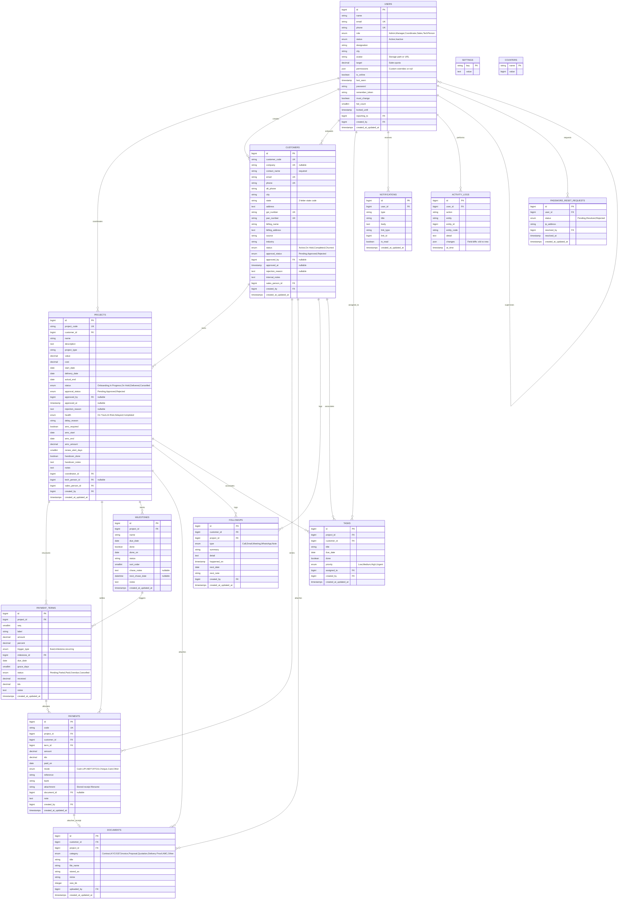

# 10X Agency — Project Coordinator CRM (`PJT CRM`)

**System Architecture, Database Specification, Livewire 4 Component Matrix & Technical Reference**

> [!NOTE]
> **User Manual & Operational Guide Available**: For non-technical team onboarding, module-by-module workflow guides, and step-by-step usage instructions, please refer to [**`project-guide.md`**](project-guide.md).

---

## 1. System Executive Summary & Architecture

### 1.1 Platform Purpose & Scope

**PJT CRM** is an operations and financial management system designed specifically for digital services agencies. It bridges the gap between sales handoff, delivery coordination, milestone execution, receivables collection, and team activity tracking. The system enforces role-based access across five staff tiers:

* **Administrators (`Admin`)**: Possess unrestricted governance over system settings, global alert thresholds, user management, salesperson commission targets, executive financial reports, customer/project approvals, and destructive entity cascades (customer and project deletion).
* **Managers (`Manager`)**: Supervise delivery operations across assigned and downline coordinator teams via hierarchical query scoping (`reporting_to` and `getDownlineUserIds()`), with full departmental visibility over schedules, customer accounts, approvals, and performance reports.
* **Project Coordinators (`Coordinator`)**: Manage day-to-day client onboarding, project health and delivery milestones, multi-tier installment schedules, incoming payment receipts, document uploads, personal task checklists, and scheduled follow-ups. Equipped with role-tailored financial and project delivery metric cards on their dashboard. Access is strictly scoped to assigned accounts via Eloquent query scopes (`Project::forUser()` and `Customer::forUser()`), with executive financial reports restricted.
* **Tech Persons (`Tech Person`)**: Technical project execution lead (the engineer/developer who completes technical milestones and deliverables). Access is strictly scoped to assigned projects (`tech_person_id == user->id`). Customer directories, financial ledgers, payment schedules, and money collection columns are completely masked. Unrelated alerts (customer onboarding, payment receipts) are automatically suppressed. Has no direct reports, so Team Members management is hidden.
* **Sales Representatives (`Sales`)**: Commercial attribution tier for client onboarding commissions and target monitoring. Strictly restricted to self-attributed customer accounts (`sales_person_id == user->id`) and basic project overviews, with financial ledgers, payment schedules, and money collection columns hidden. Has no direct reports, so Team Members management is hidden.

---

### 1.2 System Evolution & Architecture Migration

The application was transitioned across three foundational architecture paradigms:
1. **Procedural Core PHP & Core JS**: Initial flat scripts (`index.php`, `api.php`, `config.php`, `public/js/crm-app.js`) utilizing raw PDO connections and client-side DOM rendering.
2. **Laravel REST API + Core JS**: An intermediate stage where the backend was converted to Laravel controllers (`app/Http/Controllers/Api/*`) with token authentication (`CrmTokenAuth`), while preserving `public/js/crm-app.js` to call `/api.php` and `/v1/*` endpoints.
3. **Full Livewire 4 SPA**: The current modern architecture, where all UI, reactive tables, slide-over panels, modals, and mutation events are powered natively by **Laravel 13 and Livewire 4** using `wire:navigate`, Alpine stores, Tailwind CSS, and `crm-style.css`.

> [!IMPORTANT]
> The legacy REST API layer (15 obsolete API controllers, `routes/api.php`, `AppViewController.php`, dead services) and `public/js/crm-app.js` have been completely purged from the repository. All CRM operations are powered natively by Livewire 4 components. A comprehensive defect registry, technical resolution log, and cleanup audit is documented in [**Section 7: Historical Defect Registry, Technical Resolutions & Legacy Cleanup Archive**](#7-historical-defect-registry-technical-resolutions--legacy-cleanup-archive).

---

### 1.3 System Architecture Diagram

```mermaid
graph TD
    subgraph ClientLayer ["Client Layer (Browser SPA)"]
        UI["Livewire 4 Reactive Views & Blade Components"]
        ModalGuard["Alpine.js Modal Component & Unsaved Changes Guard (isDirty)"]
        ModalManager["Global ModalManager (Body Scroll Locking & Modals Sync)"]
        ToastContainer["ToastContainer (x-toast-container Slide-In Banners)"]
        ErrorScroller["Form Error Scroller (window.scrollToFirstError, Pulse & Tab Activation)"]
        AlpineStore["Alpine.js Stores ($store.currency, $store.notifications, Sidebar State)"]
        DesktopNotif["Native Desktop Browser Notifier (Alpine browserNotifier, 30s Polling)"]
        LocalStorage["LocalStorage (pjt_cur, pjt_sidebar_collapsed, crm_last_seen_notif)"]
        UI <--> ModalGuard
        UI <--> ModalManager
        UI <--> ToastContainer
        UI <--> ErrorScroller
        UI <--> AlpineStore
        AlpineStore <--> LocalStorage
        DesktopNotif <--> LocalStorage
    end

    subgraph RoutingLayer ["HTTP Routing and Middleware"]
        WebRoute["routes/web.php<br/>(Livewire Full-Page Component Routing with wire:navigate)"]
        AuthMiddleware["Middleware: auth, verified, EnsurePasswordIsChanged"]
        PollRoute["GET /api/notifications/poll<br/>(NotificationPollController)"]
        RoleScope["Eloquent Query Scope: scopeForUser() & hasPermission()"]
        FallbackRoute["Route::fallback()<br/>(In-Workspace Error Views)"]
        WebRoute --> AuthMiddleware --> RoleScope
        WebRoute --> FallbackRoute
        DesktopNotif -.->|Fetch 30s Poll| PollRoute
    end

    subgraph ComponentLayer ["Livewire Component Layer"]
        NavComponents["Navigation & System Components<br/>(GlobalSearch, NotificationBell, NotificationDrawer, DynamicCounter)"]
        OverviewModules["Overview Modules<br/>(DashboardIndex, TodayWorkIndex)"]
        CustomerModules["Customer Modules<br/>(CustomerIndex, CustomerDetail, CustomerModal, CustomerImportModal)"]
        ProjectModules["Project Modules<br/>(ProjectIndex, ProjectDetail, ProjectModal, ScheduleModal, RecurringModal, MilestoneModal, MilestoneChaseModal)"]
        MoneyModules["Money & Calendar Modules<br/>(PaymentIndex, PaymentModal, ScheduleIndex, PaymentCalendarIndex, ReportIndex)"]
        TeamModules["Team & Hierarchy Modules<br/>(UserIndex, TeamIndex, ProfileDrawer, UserModal)"]
        RecordModules["Record Modules<br/>(DocumentIndex, DocumentUploadModal, DocumentPreviewModal, FollowupIndex, SalesIndex)"]
        SystemModules["System Modules<br/>(NotificationIndex, NotificationDetail, AuditIndex, SettingIndex)"]
        AuthModules["Security & Auth<br/>(Login at /login, ForcePasswordChange at /change-password)"]
    end

    subgraph DomainServices ["Domain Services Layer"]
        MoneyService["MoneyCalculationService<br/>(Financial Aggregations & Status Automations)"]
        CodeService["CodeGeneratorService<br/>(Atomic Row-Locking Sequence Engine)"]
        CurrencyService["CurrencyRateService<br/>(USD / INR Conversion Rates)"]
        PasswordService["PasswordGeneratorService<br/>(High-Entropy Temporary Credential Provisioning)"]
        AuditService["AuditNotificationService<br/>(Event Logging, Field-Level Diffs & Multi-Recipient Alerts)"]
        PermMatrix["Permissions Matrix<br/>(App\\Constants\\Permissions & Role Action Checks)"]
    end

    subgraph PersistenceLayer ["Persistence Layer"]
        Eloquent["Eloquent ORM Models (Relationships, Casts, Diff Tracking & Scopes)"]
        MySQL[("MySQL 8.0+ Database (18 Migrated Tables)")]
        DiskStorage[("Private Documents Storage (storage/app/private/documents) & Public Avatars (storage/app/public)")]
    end

    UI -->|Livewire Requests & wire:navigate| WebRoute
    RoleScope --> NavComponents & OverviewModules & CustomerModules & ProjectModules & MoneyModules & TeamModules & RecordModules & SystemModules
    AuthMiddleware --> AuthModules

    CustomerModules & ProjectModules & MoneyModules & OverviewModules --> MoneyService
    CustomerModules & ProjectModules & MoneyModules --> CodeService
    TeamModules & SystemModules --> PasswordService
    CustomerModules & ProjectModules & MoneyModules & TeamModules --> AuditService
    NavComponents & TeamModules & RoleScope --> PermMatrix
    NavComponents --> CurrencyService

    MoneyService & CodeService & PasswordService & AuditService --> Eloquent
    RecordModules & MoneyModules & TeamModules --> DiskStorage
    Eloquent --> MySQL
```



---

### 1.4 Livewire 4 & Alpine Runtime Conventions

* **Bundled Alpine Runtime**: Livewire 4 bundles and boots Alpine.js automatically. Standalone imports (`import Alpine from 'alpinejs'; Alpine.start();`) are completely omitted from `resources/js/app.js` to eliminate race conditions and event listener detachment.
* **Global Metas & Store Bootstrapping**: A global `<meta name="csrf-token" content="{{ csrf_token() }}">` is present in the layout header. Alpine stores (`$store.currency`, `$store.notifications`) initialize on `alpine:init` to ensure stores exist before component mounting.
* **Real-Time Client Navigation**: Livewire 4 `wire:navigate` and `Livewire.navigate('...')` replace legacy `window.location` redirects, preserving in-memory Alpine currency states and layout shell states across page transitions.
* **Decoupled Cross-Component Communication**: Components invoke `Livewire.dispatch('event-name', payload)` for cross-DOM triggers instead of Alpine `$dispatch`, ensuring layout-level modals respond reliably regardless of DOM tree nesting.
* **Event-Driven UI Refreshing**: Data tables and index components listen for mutation events (`#[On('customer-saved')]`, `#[On('project-saved')]`, `#[On('payment-saved')]`, `#[On('document-saved')]`, `#[On('sales-saved')]`, `#[On('user-saved')]`, `#[On('notification-updated')]`, `#[On('counter-refresh')]`) to reload views, counters, and KPIs without full page reloads.
* **Global Modal Manager (`window.ModalManager`)**: A dedicated modal coordinator in `layouts.app` tracks active modal identifiers, synchronizes modal visibility stacks, and manages body scroll locking (`document.body.classList.add('overflow-hidden')`). It automatically resets state upon client navigation (`livewire:navigated`) to guarantee zero stuck overlays or locked page bodies.
* **Form Error Auto-Scroll, Tab Activation & Focus Engine (`window.scrollToFirstError`)**: Integrated with Livewire commit and morph hooks (`livewire:init`, `commit`, `morph.updated`). When validation fails, the UI automatically switches inactive tabs if the invalid field is concealed inside a tab pane, smooth-scrolls to the first error input, transfers focus, and triggers a visual highlight animation (`.error-focused` keyframe pulse).
* **Unsaved Changes Safeguard**: The modal container (`<x-modal>`) monitors user modification states (`isDirty`), prompting a styled confirmation warning (`<x-confirm-modal>`) before closing on outside clicks, `Escape` key presses, or Cancel clicks.
* **Real-Time Blur Validation**: Livewire properties bind with `wire:model.blur` and invoke `$this->validateOnly($propertyName)` within the `updated()` lifecycle hook, providing immediate inline validation with distinct red error borders without noisy top alert banners.
* **Database Type Synchronization**: Optional strings submitted through form selects are normalized to `null` or explicit database defaults (e.g. `0.00` for numeric columns defined as `NOT NULL DEFAULT 0.00`) to prevent MySQL constraint violations.
* **Modal Scroll Isolation & Background Locking**: All modal containers (`<x-modal>` and `<x-confirm-modal>`) feature `overscroll-contain` on both backdrop overlays and modal bodies to prevent scroll chaining and mobile touch rubber-banding.
* **In-Workspace Context-Aware Error Recovery**: HTTP exceptions (404, 403, 500, 419, 503) retain the full application workspace (`<x-app-layout>`) for logged-in users. A terminal `Route::fallback()` in `routes/web.php` ensures unmatched paths traverse the `web` session middleware, enabling context-aware recovery guidance and action buttons based on URL patterns. Unauthenticated visitors receive a branded `<x-guest-layout>` presentation.
* **Vite Development & Production Parity**: Vite server configuration standardizes on `hmr: { host: 'localhost' }` and `cors: true` with signal traps on process exit to auto-purge `public/hot`, ensuring seamless asset loading and zero layout distortion between `npm run dev` and `npm run build`.
* **Global Helper Functions Architecture (`app/Helpers/helpers.php`)**: Reusable helper functions registered in `composer.json` streamline authorization, role inspection, and service resolution (`logged_in_user()`, `logged_in_user_id()`, `has_permission($module, $action)`, `is_allowed()`, `is_admin()`, `is_manager()`, `is_coordinator()`, `is_sales()`, `is_tech_person()`, `audit_service()`, `format_inr()`), reducing boilerplate and method-chaining in controllers and templates.
* **Standardized Button Architecture & Icon Actions**: Ad-hoc, hardcoded button classes are replaced by the canonical design system (`.btn`, `.btn-primary`, `.btn-secondary`, `.btn-outline-secondary`, `.btn-success`, `.btn-danger`, `.btn-outline-primary`, `.btn-outline-success`, `.btn-outline-danger`, `.btn-xs`, `.btn-sm`). Repetitive table row actions (View, Edit, Receipt, Additional Info, Preview, Download, Delete) use compact icon buttons with accessible `title` tooltips, ensuring consistent alignment and preventing table cell wrapping.
* **Early Sidebar State Stabilization (`html.sidebar-collapsed-init`)**: To eliminate layout flash during initial page loads with a collapsed sidebar, an early inline script inspects `localStorage.getItem('pjt_sidebar_collapsed')` and assigns `html.sidebar-collapsed-init` before CSS/DOM hydration.
* **Livewire Form Validation & Universal Elimination of HTML5 `required`**: Native HTML5 `required` attributes are eliminated across all authentication, profile, and system modal forms. Forms strictly declare `novalidate`, routing all validation through Laravel and Livewire with real-time blur feedback (`wire:model.blur`), loading state indicators (`wire:loading.inline-flex`), and consistent `@error` red-border styling.
* **Global Toast Notification System (`<x-toast-container />`)**: A dedicated Alpine.js toast container in `layouts/app.blade.php` listens for `window.addEventListener('toast', ...)`. It renders color-coded notifications (`.toast.ok`, `.toast.err`, `.toast.warning`) with SVG icons, auto-dismissal after 4.5 seconds, and click-to-dismiss support.
* **Customer Linked-Project Deletion Guard (Option B)**: Defensive UI and backend protection prevent accidental deletion of client accounts that contain active projects. When linked projects exist, clicking Delete triggers an amber warning modal explaining that projects must be reassigned or deleted first; when 0 projects exist, the standard permanent deletion confirmation proceeds.
* **Atomic Multi-Entity Cascades & Deferred Storage Cleanup (ISS-106)**: Multi-entity cascading deletions (`CustomerDetail::deleteCustomer` and `ProjectDetail::deleteProject`) execute inside atomic `DB::transaction(...)` blocks covering notifications, entity deletions, and audit logs. Physical file unlinking from `documents` and `public` storage disks is registered in `DB::afterCommit(...)` callbacks, guaranteeing files are only deleted once the database transaction commits successfully.
* **Centralized Payment Term Recalculation Engine (`PaymentTerm::recalculateStatus()` - ISS-105)**: Added a unified `recalculateStatus(): void` method directly to `PaymentTerm`. It evaluates remaining receipts and TDS credits against installment amount, accurately setting `Paid`, `Partial`, and evaluating `due_date` + `grace_days` against `now()->toDateString()` for `Overdue` vs `Pending` transitions whenever payment receipts are deleted across `CustomerDetail`, `ProjectDetail`, and `PaymentIndex`.

---

## 2. Directory Structure & File Map

```text
pjt-crm/
├── .agents/                                # AI workspace configuration & project skills
│   ├── mcp_config.json                     # Laravel Boost MCP server configuration
│   └── skills/                             # Domain skills (codewise, laravel-best-practices, livewire, etc.)
├── app/
│   ├── Constants/
│   │   └── Permissions.php                 # Granular multi-level role & action permission matrix
│   ├── Helpers/
│   │   └── helpers.php                     # Centralized global helper functions (autoloaded)
│   ├── Http/
│   │   ├── Controllers/
│   │   │   ├── Api/
│   │   │   │   └── NotificationPollController.php  # Lightweight 30s polling endpoint for desktop notifications
│   │   │   ├── Auth/                               # Laravel Breeze authentication & password reset request controllers
│   │   │   ├── DocumentDownloadController.php      # Controller for secure document attachment streaming
│   │   │   └── ProfileController.php               # User profile editing and password updates
│   │   └── Middleware/
│   │       └── EnsurePasswordIsChanged.php         # Intercepts authenticated logins when must_change is active
│   ├── Livewire/
│   │   ├── Audit/
│   │   │   └── AuditIndex.php                      # Activity audit log timeline viewer with field diff inspection
│   │   ├── Auth/
│   │   │   ├── ForcePasswordChange.php             # Mandatory password update component at /change-password
│   │   │   └── Login.php                           # Reactive Livewire login component with blur validation
│   │   ├── Components/
│   │   │   ├── DynamicCounter.php                  # Real-time event-driven badge counter component
│   │   │   ├── GlobalSearch.php                    # Universal debounced search dropdown
│   │   │   ├── NotificationBell.php                # Topbar unread count polling badge
│   │   │   └── NotificationDrawer.php              # Slide-over flyout panel for notification alerts
│   │   ├── Customers/
│   │   │   ├── CustomerDetail.php                  # Tabbed customer profile (Overview, Projects, Payments, Docs, Followups)
│   │   │   ├── CustomerImportModal.php             # Bulk CSV upload and spreadsheet paste modal
│   │   │   ├── CustomerIndex.php                   # Customer directory, filtering, pagination, and CSV export
│   │   │   └── CustomerModal.php                   # Unified create and edit modal with auto salesperson attribution
│   │   ├── Dashboard/
│   │   │   └── DashboardIndex.php                  # Executive KPI cards, health breakdown, triage, and trend analytics
│   │   ├── Documents/
│   │   │   ├── DocumentIndex.php                   # Global document repository with category filtering and deletion
│   │   │   ├── DocumentPreviewModal.php            # Lightbox preview modal for PDFs and images
│   │   │   └── DocumentUploadModal.php             # Multi-entity file upload modal with validation
│   │   ├── Followups/
│   │   │   └── FollowupIndex.php                   # Touchpoint feed, overdue alert banner, and interaction logger
│   │   ├── Notifications/
│   │   │   ├── NotificationDetail.php              # Dedicated notification view with target navigation
│   │   │   └── NotificationIndex.php               # Notification inbox with deep linking and mark-as-read actions
│   │   ├── Payments/
│   │   │   ├── PaymentIndex.php                    # Receipt ledger, mode filtering, balance tracking, and CSV export
│   │   │   └── PaymentModal.php                    # Receipt recorder with Smart Receipt upload and multi-role alerts
│   │   ├── Profile/
│   │   │   └── ProfileDrawer.php                   # Slide-over user profile, avatar upload, and self password change
│   │   ├── Projects/
│   │   │   ├── MilestoneChaseModal.php             # Milestone chase notes logger and next chase scheduler
│   │   │   ├── ProjectDetail.php                   # Project delivery matrix, timeline, schedule, and document tabs
│   │   │   ├── ProjectIndex.php                    # Work orders directory, health filtering, and overdue rollups
│   │   │   ├── ProjectMilestoneModal.php           # Dynamic milestone ordering and checklist manager
│   │   │   ├── ProjectModal.php                    # Contract creator/editor with sales rep auto-assignment & alert triggers
│   │   │   ├── ProjectRecurringModal.php           # Monthly retainer recurring installment generator
│   │   │   └── ProjectScheduleModal.php            # Installment scheduler (fixed, milestone-linked, recurring)
│   │   ├── Reports/
│   │   │   └── ReportIndex.php                     # Collection rate, monthly sparkline, mode bars, aging, and variance
│   │   ├── Sales/
│   │   │   └── SalesIndex.php                      # Salesperson revenue attribution, targets, and comparative table
│   │   ├── Schedule/
│   │   │   └── ScheduleIndex.php                   # Master chronological installment timeline and CSV export
│   │   ├── Settings/
│   │   │   ├── SettingIndex.php                    # Operational threshold configuration, password manager, and user list
│   │   │   └── UserModal.php                       # Staff account creator with granular permission matrix & avatar upload
│   │   ├── Tasks/
│   │   │   └── TaskIndex.php                       # Coordinator checklist manager with priority flags and late indicators
│   │   ├── Team/
│   │   │   └── TeamIndex.php                       # Downline supervisory oversight, member details, and credential resets
│   │   ├── Today/
│   │   │   └── TodayWorkIndex.php                  # Daily operational triage for overdue payments, calls, and risks
│   │   └── Users/
│   │       └── UserIndex.php                       # Global user directory, role/status filters, and admin credential resets
│   ├── Mail/
│   │   └── TemporaryPasswordMail.php               # Mailable for delivering newly provisioned temporary credentials
│   ├── Models/
│   │   ├── ActivityLog.php                         # System activity log model with field diffs (mapped to activity_logs)
│   │   ├── Counter.php                             # Atomic sequence counters for entity codes
│   │   ├── Customer.php                            # Customer model with project, document, and sales relationships
│   │   ├── Document.php                            # Document metadata records linked to storage
│   │   ├── Followup.php                            # Client communication history and follow-up dates
│   │   ├── Milestone.php                           # Project milestones and completion stamps
│   │   ├── Notification.php                        # System notifications indexed by user ID
│   │   ├── PasswordResetRequest.php                # Queued employee password reset requests
│   │   ├── Payment.php                             # Payment receipts linked to projects, terms, and smart documents
│   │   ├── PaymentTerm.php                         # Payment installment schedules and status tracking
│   │   ├── Project.php                             # Project entity with monetary accessors and role scopes
│   │   ├── Setting.php                             # Key-value global configuration store
│   │   ├── Task.php                                # Actionable checklist items
│   │   └── User.php                                # Staff accounts with role helpers, permissions array & downline trees
│   └── Services/
│       ├── AuditNotificationService.php            # System event logger, field diff computer & multi-recipient notifier
│       ├── CodeGeneratorService.php                # Concurrency-safe atomic counter sequence generator
│       ├── CurrencyRateService.php                 # Exchange rate configuration and conversion service
│       ├── MoneyCalculationService.php             # Central financial calculation engine
│       └── PasswordGeneratorService.php            # Secure 16-character temporary credential generator
├── config/
│   └── crm.php                                     # Centralized CRM configuration (TTLs, thresholds, upload rules)
├── database/
│   ├── migrations/                                 # 18 structured table migrations
│   └── seeders/
│       ├── DatabaseSeeder.php
│       └── UsersSeeder.php                         # Seeds default Administrator, Coordinator, and Manager accounts
├── public/
│   ├── assets/logo.png                             # Static brand identity asset
│   └── css/crm-style.css                           # Complete CSS design palette with standardized 36px filter bar
├── resources/
│   ├── css/app.css                                 # Tailwind CSS setup
│   ├── js/app.js                                   # Clean JS entry without manual Alpine imports
│   └── views/
│       ├── components/                             # Blade UI components (money, kpi-card, health-badge, modal, confirm-modal, toast-container)
│       ├── emails/
│       │   └── temporary-password.blade.php        # Branded HTML email template for temporary credentials
│       ├── errors/                                 # Context-aware error views (403, 404, 419, 500, 503) extending workspace shell
│       ├── layouts/
│       │   ├── app.blade.php                       # Master application layout with ModalManager & ErrorScroller
│       │   ├── guest.blade.php                     # Clean layout for login and password change
│       │   └── partials/sidebar.blade.php          # 5-section navigation sidebar with dynamic counters & profile trigger
│       └── livewire/                               # Paired Blade templates for all Livewire components
├── boost.json                                      # Laravel Boost agent and skill registry
└── routes/
    ├── auth.php                                    # Breeze authentication routes
    └── web.php                                     # Authenticated routes mapping Livewire modules & polling API
```

---

## 3. Database Schema & Data Modeling

### 3.1 Entity-Relationship Diagram (ERD)



---

## 4. Livewire 4 Component Matrix

### 4.1 Navigation & Topbar
* **`Components\GlobalSearch`**: Debounced 300ms universal lookup across customer names `(customers.company and customers.contact_name)`, customer codes `(customers.customer_code)`, and project titles `(projects.name, projects.project_code)`.
* **`Components\NotificationBell`**: Topbar icon with dynamic unread badge count `(count of notifications where is_read = false for auth user)` synchronized with Alpine store `$store.notifications`.
* **`Components\NotificationDrawer`**: Slide-over panel featuring unread filtering `(where is_read = false)`, individual mark-as-read, and bulk clear `(updates all user notifications to is_read = true)`.
* **`Components\DynamicCounter`**: Real-time reactive badge counter component mounted across navigation items (`today`, `customers`, `projects`, `notifications`, `tasks`) with event-driven refreshes `(#[On('customer-saved')], #[On('project-saved')], #[On('payment-saved')], #[On('counter-refresh')])` and warn styling.

### 4.2 Overview Modules
* **`Dashboard\DashboardIndex`**: Role-tailored dashboard with grouped section cards and 1-click drilldown navigation:
  * **Financial Receivables Section (Admins, Managers & Coordinators)**:
    * Total Receivable `(sum(terms) where status != 'Cancelled')`
    * Net Collected Cash `(sum(payments))`
    * Outstanding Balance Due `(max(0, scheduled - received - tds))`
    * Overdue Balance `(sum(balance) where status = 'Overdue')`
    * Current Month Collections `(sum(payments) where month(paid_on) = current_month)`
    * Aging Buckets `(overdue terms bucketed by days late: 0–30, 31–60, 61–90, 90+)`
    * Trailing 6-Month Sparkline `(monthly sum(payments) over trailing 6 calendar months)`
    * Commercial Performance `(per salesperson: customers = count(customers), projects = count(projects), booked = sum(project_value), collected = sum(payments), target_achieved_% = (collected / target) * 100)`
    * AMC Renewal Alerts `(amc_required = true AND amc_end <= today + renew_alert_days)`
    * Handover Pending `(status = 'Delivered' AND handover_done = false)`
  * **Project Operations & Execution Section (Role-Tailored)**:
    * Active Projects breakdown `(On Track, At Risk, Delayed, Completed)`
    * Coordinator & Tech Person Highlights: Upcoming Delivery Deadlines & Milestone Completion Velocity
  * **Downline Filtering & Reactive Listeners**: In-header staff member filter for Admins/Managers, and reactive event listeners `(#[On('payment-saved')], #[On('payment-deleted')], #[On('project-saved')], #[On('customer-saved')])`.
* **`Today\TodayWorkIndex`**: Actionable daily queue showing:
  * Overdue Installments `(today > due_date + grace_days AND balance > 0, sorted by due_date ASC)`
  * Upcoming Installments `(due_date between today AND today + payment_alert_days)`
  * Pending Follow-ups `(next_date <= today + followup_alert_days)`
  * Projects Needing Attention `(health in ['Delayed', 'At Risk'])`
  * Assigned Tasks `(assigned_to = auth_id AND done = false)`.

### 4.3 Customer Management
* **`Customers\CustomerIndex`**: Paginated customer table with status, approval state, city, salesperson `(customers.sales_person_id)`, and payment state filters, plus Excel-compatible UTF-8 BOM CSV streaming.
  * Customer Approval Flow: Approve / Reject row action icon buttons with confirmation dialogs and rejection reason logging.
  * Standardized Row Actions: Compact icon buttons (`.btn.btn-outline-primary.btn-xs`, `.btn.btn-outline-secondary.btn-xs`, `.btn.btn-outline-danger.btn-xs`) with explicit `title` tooltips.
  * Customer Display Name `(company ?: (contact_name ? "$contact_name (Client)" : customer_code))`
  * Customer Financial Rollups `(total_contract_value = sum(project_value), total_received = sum(payments), outstanding = total_value - total_received)`
* **`Customers\CustomerDetail`**: Tabbed profile showing associated projects, payment history, stored documents, and logged touchpoints. Includes approval state banner with rejection reason display and **Edit & Resubmit** action.
* **`Customers\CustomerModal`**: Create/edit modal generating atomic codes `(CUS-XXXX via CodeGeneratorService)`, auto salesperson attribution for sales staff, and field-level structured diff tracking.
* **`Customers\CustomerImportModal`**: Multi-row CSV file upload and raw spreadsheet paste importer with automated deduplication.

### 4.4 Project Delivery
* **`Projects\ProjectIndex`**: Work order directory with health state filtering `(On Track, At Risk, Delayed, Completed)`, salesperson filtering `(projects.sales_person_id)`, coordinator filtering `(projects.coordinator_id)`, tech person filtering `(projects.tech_person_id)`, approval actions, and financial aggregates.
* **`Projects\ProjectDetail`**: Project hub with delivery timeline, milestone checklist `(completion_% = (milestones_done / total_milestones) * 100)`, payment terms, and attachments. Includes project approval banner, rejection reasons, and milestone chase notes.
* **`Projects\ProjectModal`**: Contract authoring modal with zero-default numeric normalization, auto-assignment of sales rep, coordinator, and tech person, delay reason clearing when health improves, and health degradation alerts.
* **`Projects\ProjectMilestoneModal`**: Sortable milestone checklist with payment trigger linking.
* **`Projects\MilestoneChaseModal`**: Interactive milestone chase note logging and next chase date scheduling (with resilient empty-date normalization), synchronized with customer follow-ups and touchpoints.
* **`Projects\ProjectScheduleModal`**: Multi-tier installment scheduler supporting the Auto-Split 30/40/30 and 50/50 wizards `(Advance: round(value * 0.30, 2), Mid: round(value * 0.40, 2), Delivery: value - term1 - term2; staggered +0, +15, +30 days)`. Automatically preserves locked installments with recorded collections or TDS deductions, calculating remaining uncollected balances before generating new terms.
* **`Projects\ProjectRecurringModal`**: Single-click monthly retainer generator `(generates N monthly recurring installments starting from anchor date)`.

### 4.5 Financial Receivables
* **`Payments\PaymentIndex`**: Detailed receipt ledger with mode filtering `(Cash, UPI, NEFT, RTGS, Cheque, Card, Other)`, TDS accounting `(credited alongside received cash against term balance)`, compact icon actions, and CSV export.
* **`Payments\PaymentModal`**: Receipt logger with auto-balance calculation `(balance_due = term_amount - received - tds)`, term status updating, atomic receipt codes `(RCP-XXXX)`, Smart Receipt upload (`WithFileUploads`) with auto-link to `Document`, and multi-recipient notifications (Coordinator, Salesperson, Admins).
* **`Calendar\PaymentCalendarIndex`**: Full 7-column monthly datewise calendar charting scheduled installment dues and payment receipts on exact calendar dates:
  * Month navigation and quick jump with overflow-safe date arithmetic (`Carbon::parse($month.'-01')`).
  * Monthly cash flow indicators (Total Scheduled Due, Total Received, Total Due, Overdue).
  * Dual filtering (All, Scheduled Dues Only, Received Payments Only) with manager/admin downline scoping.
  * Day details modal listing itemized due installments and payment receipts with deep links to project dossiers.
* **`Schedule\ScheduleIndex`**: Master installment schedule tracking fixed dates, milestone-linked triggers, and recurring terms:
  * Total Scheduled `(sum(terms) where status != 'Cancelled')`
  * Total Collected `(sum(payments))`
  * Overdue Total `(sum(balance) where status = 'Overdue')`
* **`Reports\ReportIndex`**: Executive financial analytics:
  * Collection Rate % `(round((received / scheduled) * 100, 1))`
  * Average Project Value `(total_project_value / project_count)`
  * Payment Mode Breakdown `(sum(payments) grouped by mode: Cash, UPI, NEFT, RTGS, Cheque, Card, Other)`
  * Delivery Variance `(milestone_% - collection_%)`
  * Aging Buckets `(overdue terms bucketed by days late: 0–30, 31–60, 61–90, 90+)`
  * Role-tailored milestone velocity and delivery deadlines for Coordinators and Tech Persons.

### 4.6 Team & User Governance
* **`Users\UserIndex`**: Global staff directory, search, role and status filters, reset temporary password action with email notification, and user quick view.
* **`Team\TeamIndex`**: Downline team hierarchy oversight for managers and supervisors, team member detail view, and downline credential resets. (Hidden and disallowed for `Sales` and `TechPerson` roles).
* **`Profile\ProfileDrawer`**: Slide-over user profile flyout triggered by sidebar footer, avatar file upload and removal, profile details update, supervisor details, and self password updates.
* **`Settings\UserModal`**: Staff account creator/editor with quota, supervisor attribution, avatar upload, and granular permission matrix editor with role reset defaults.

### 4.7 Records & System
* **`Documents\DocumentIndex` & `DocumentUploadModal`**: Secure storage (up to 10 MB) with public disk root isolation and lightbox preview (`DocumentPreviewModal`).
* **`Followups\FollowupIndex`**: Multi-channel touchpoint logger `(Call, Email, Meeting, WhatsApp, Note)`.
* **`Sales\SalesIndex`**: Salesperson quota tracking and performance attribution `(booked = sum(project_value), collected = sum(payments), target = users.target, achievement_% = (collected / target) * 100)`.
* **`Notifications\NotificationIndex` & `NotificationDetail`**: System alerts inbox and detail inspector.
* **`Audit\AuditIndex`**: Immutable system audit trail (`ActivityLog`) with field-level structured diffs.
* **`Settings\SettingIndex`**: System threshold configurations and operational alert window settings.
* **`Auth\Login`**: Reactive Livewire authentication component (`login` route) featuring real-time field validation, loading spinner (`wire:loading.inline-flex`), progressive account lockout (5 failed attempts locks for 30 minutes with remaining attempt counter), and IP rate-limiting.
* **`Auth\ForcePasswordChange`**: Mandatory password change screen for initial logins and administrative resets triggered by `EnsurePasswordIsChanged` middleware.

---

## 5. Domain Services, Business Logic & Calculation Engine

Business logic and calculations are centralized across specialized service classes and Eloquent accessors using simplified mathematical notation:

### 5.1 Financial Calculations & Receivable Ledgers (`MoneyCalculationService`)

Financial figures are synchronized in `App\Services\MoneyCalculationService` to ensure identical figures across dashboards, customer cards, project pages, and CSV exports:

* **1. Total Scheduled Value**:
  * **Formula**: `scheduled = sum(term_amount) [where status != 'Cancelled']`
  * **Working**: Only active financial commitments count toward contracted delivery receivables. Cancelled payment terms are excluded from totals.

* **2. Net Cash Collected**:
  * **Formula**: `received = sum(payment_amount)`
  * **Working**: Aggregates all verified settlements across bank transfers, UPI, cheques, and cash transactions.

* **3. Tax Deducted at Source (TDS)**:
  * **Formula**: `tds = sum(tds_amount)`
  * **Working**: Under Indian tax regulations (Section 194C / 194J), clients deduct TDS before remitting payment. The system credits TDS alongside received cash, treating both as valid settlements against the invoice installment.

* **4. Remaining Balance Due**:
  * **Formula**: `balance_due = max(0, scheduled - received - tds)`
  * **Working**: Computes the net amount the client owes. Clamped to `0.00` using `max(0, ...)` so overpayments never create negative balances.

* **5. Overdue Balance**:
  * **Formula**: `overdue = sum(term_balance) [where status = 'Overdue']`
  * **Working**: Targets only terms whose due date has passed without full payment, highlighting actionable collection risks.

* **6. Collection Rate Percentage**:
  * **Formula**: `collection_rate_% = (received / scheduled) * 100` (rounded to 1 decimal place; `0.0%` if scheduled == 0)
  * **Working**: Measures revenue realization efficiency against contracted milestones.

* **7. Automated Installment State Machine (`refreshOverdueStatus`)**:
  Installments dynamically evaluate their status upon load and payment logging based on the following deterministic rules:
  1. **`Cancelled`**: Explicitly voided terms (excluded from calculations).
  2. **`Paid`**: `received + tds >= amount - 0.01` (cleared within a 1-cent floating point threshold).
  3. **`Partial`**: `0 < received + tds < amount - 0.01` (partially settled, balance remains).
  4. **`Overdue`**: `today > due_date + grace_days` AND `balance_due > 0`.
  5. **`Pending`**: `today <= due_date + grace_days` AND `received + tds == 0`.

---

### 5.2 Auto-Split Installment Schedule Wizard (`ProjectScheduleModal`)

The Auto-Split wizard automatically fractures the total contracted project value into a standard agency billing structure:

* **Formula**:
  * **Advance Installment (Term 1)**: `round(value * 0.30, 2)` (30% upfront on signing)
  * **Mid-Project Installment (Term 2)**: `round(value * 0.40, 2)` (40% upon interim milestone)
  * **On-Delivery Installment (Term 3)**: `value - term1 - term2` (30% remaining balance, ensuring exact penny-matching with zero rounding drift)
* **Working**:
  * **With Milestones**: Automatically maps Term 1 to Milestone 1, Term 2 to the midpoint milestone, and Term 3 to the final milestone, inheriting their target delivery dates as installment due dates.
  * **Without Milestones**: Staggers due dates gracefully starting from project start date (+0 days for Advance, +15 days for Mid-Project, and +30 days for Final Delivery), allowing immediate installment scheduling even before delivery milestones are finalized.

---

### 5.3 Concurrency-Safe Code Generation & Counter Auto-Healing (`CodeGeneratorService`)

Sequential human-readable identifiers (`CUS-0001`, `PJT-0001`, `RCP-0001`) are produced by `App\Services\CodeGeneratorService` using a concurrency-safe atomic sequence engine:

* **Pessimistic Row-Locking**:
  * Acquires an exclusive database lock via `DB::table('counters')->where('name', $type)->lockForUpdate()->first()`, ensuring parallel requests cannot generate colliding sequence numbers.
* **Auto-Healing Formula**:
  * **Formula**: `next_counter = max(current_counter, max(db_suffix)) + 1`
  * **Working**: Before assigning the code, the generator queries the target table for the maximum numeric suffix:
    ```sql
    SELECT MAX(CAST(SUBSTRING(code, prefix_length + 1) AS UNSIGNED)) FROM target_table
    ```
    If the `counters` table has fallen behind (due to database seeders, manual data imports, or external inserts), the service auto-heals the counter table to the correct ceiling before generating `prefix . sprintf('%04d', $nextValue)`. This permanently eliminates `500 UniqueConstraintViolationException` errors.

---

### 5.4 Customer Identity & Fallback Display Rule (`Customer` Model)

Individual clients and sole proprietors frequently lack a registered corporate business name:

* **Schema Alignment**:
  * `customers.company` is `nullable()` with a unique constraint (MySQL permits multiple `NULL` values in unique indexes).
  * `customers.contact_name` is mandatory (`required`).
  * `customers.state` stores standardized 2-letter uppercase state codes (e.g. `'MH'`, `'KA'`, `'DL'`) matching `config('constants.states')`.
* **Display Fallback Rule**:
  * **Formula**:
    * If `company` is present: `Company Name` (e.g. *"Apex Global Logistics Pvt Ltd"*)
    * If `company` is absent: `Contact Person (Client)` (e.g. *"Rajesh Khanna (Client)"*)
    * If both are empty: `Customer Code` (e.g. *"CUS-0008"*)
  * **Working**: Implemented via the `display_name` accessor (`$customer->display_name`) and used consistently across all 14 Livewire modules, dropdown selects, data tables, audit activity logs, and global search results.

---

### 5.5 Admin-Mediated Credential Provisioning & Temporary Password Generation

Administrative and supervisory password resets are handled from the Users (`/users`), Team (`/team`), or Settings directories with dual support for copyable dialogs and automated email notifications:

* **Credential Generation**:
  * Generated via `App\Services\PasswordGeneratorService::generate(16)`, producing cryptographically random, high-entropy 16-character temporary passwords satisfying all strict complexity rules (uppercase, lowercase, digits, and special characters).
  * Hashes and updates `users.password = Hash::make($temporaryPassword)`.
  * Flags `users.must_change = true` to force an immediate password reset on the user's next sign-in.
  * Resets `users.fail_count = 0` and `users.locked_until = null` to instantly clear active account lockouts.
  * Updates pending requests in `password_reset_requests` table to `Resolved` with `resolved_by = auth()->id()` and timestamp.
  * Delivers a branded HTML notification via `App\Mail\TemporaryPasswordMail` to the user's registered email address.
  * Records an immutable audit log entry in `activity_logs` and displays the credentials in a secure copyable modal.

---

### 5.6 Multi-Level Role & Action Permissions Matrix (`Permissions` & `User`)

User authorization combines hardcoded baseline matrices with per-user custom overrides stored in `users.permissions`:

* **Role Permissions Matrix (`App\Constants\Permissions::ROLE_PERMISSIONS`)**:
  * Maps 5 canonical roles (`Admin`, `Manager`, `Coordinator`, `Sales`, `TechPerson`) across 9 functional modules (`users`, `team`, `customers`, `projects`, `schedules`, `payments`, `today`, `reports`, `settings`) and 5 discrete actions (`view`, `add`, `edit`, `delete`, `export`).
  * `Admin`: Full permissions across all modules and actions.
  * `Manager`: View/add/edit permissions on clients, projects, schedules, payments, reports, and team hierarchy; no delete or administrative settings access.
  * `Coordinator`: Operational access to assigned clients, projects, schedules, payments, today's queue, and team members; financial export restricted.
  * `Sales`: Client onboarding and project creation; sensitive financial ledgers, payment schedules, and money columns completely hidden; team hierarchy module disallowed.
  * `TechPerson`: Operational execution access strictly to assigned projects (`projects.view`, `projects.edit`, `reports.view`); all customer dossiers, financial ledgers, payment schedules, and team modules are strictly restricted.
* **Granular Permission Check (`User::hasPermission()`)**:
  * Evaluates custom JSON permission overrides in `users.permissions` if present.
  * Falls back to `Permissions::can($role, $module, $action)`.
  * Supports combined checks: `hasPermission('customers', 'add/edit')`.

---

### 5.7 Form Error Auto-Scroll, Tab Activation & Focus Engine

Form usability is handled by an automated client-side engine in `layouts.app`:

* **Event Hooks**:
  * Listens to Livewire `commit` (detecting calls matching `save`, `submit`, `store`, `update`, `create`, `import`) and `morph.updated` hooks.
  * Intercepts native DOM form submit and button clicks.
* **Auto-Tab Activation**:
  * If the first invalid input is concealed inside an inactive tab pane (`[data-tab-content]`, `[data-tab-pane]`, `[id^="tab-"]`), the engine automatically simulates a click on the corresponding tab trigger (`[data-tab-target]`), unhiding the container before scrolling.
* **Focus & Animation Pulse**:
  * Performs a smooth scroll (`scrollIntoView({ behavior: 'smooth', block: 'center' })`).
  * Transfers browser focus (`element.focus({ preventScroll: true })`).
  * Applies the `.error-focused` CSS class triggering a 600ms red halo pulse animation.

---

### 5.8 Global Modal Manager & Window State Sync (`window.ModalManager`)

A centralized modal manager in `layouts.app` orchestrates dialog states:

* **State Synchronization**:
  * Maintains an in-memory `Set` of active modal identifiers (`openModals`).
  * Adds `overflow-hidden` to `document.body` when `openModals.size > 0` and removes it when all modals close.
  * Automatically flushes and clears the modal stack on Livewire client transitions (`livewire:navigated`).
  * Supports custom modal sizes (`sm`, `md`, `lg`, `xl`, `2xl`, `wide`, `full`) mapped via Blade component props.

---

### 5.9 Field-Level Structured Change Tracking (`AuditNotificationService::computeChanges`)

Audit logging tracks precise attribute mutations for entity updates:

* **Diff Computation**:
  * Compares `$model->getDirty()` against `$model->getOriginal()`, filtering out timestamp and sensitive authentication tokens (`password`, `remember_token`, `fail_count`, `locked_until`).
  * Outputs a structured dictionary: `['field_name' => ['old' => '...', 'new' => '...']]`.
* **Persistence & Presentation**:
  * Serialized directly into `activity_logs.changes` as a JSON column.
  * Formatted into human-readable diff text in audit log lists and detail views (e.g. `(status: Onboarding -> In Progress, coordinator: John -> Sarah)`).

---

### 5.10 Global Helper Functions Architecture (`app/Helpers/helpers.php`)

To reduce repetitive deep method chaining and enhance code readability across Blade views, Livewire components, and services, global helper functions are autoloaded via `composer.json` (`files: ["app/Helpers/helpers.php"]`):

* **User & Session Helpers**:
  * `logged_in_user(): ?User`: Direct access to the authenticated user instance.
  * `logged_in_user_id(): ?int`: Quick resolver for the authenticated user ID.
* **Role Check Predicates**:
  * `is_admin(): bool`, `is_manager(): bool`, `is_coordinator(): bool`, `is_sales(): bool`, `is_tech_person(): bool`: Clean, expressive boolean checks replacing verbose string comparisons against `role` enums.
* **Granular Permission Helpers**:
  * `has_permission(string $module, string $action): bool` and `is_allowed(string $module, string $action): bool`: Intuitive access wrappers around `auth()->user()->hasPermission($module, $action)`.
* **Formatting & Service Singletons**:
  * `format_inr(float|int|string|null $amount): string`: Formats currency values into Indian Rupee format with standard decimal places.
  * `audit_service(): AuditNotificationService`: Resolves the audit notification service from Laravel's service container.

---

## 6. Security, Auth & Query Scope Isolation

* **Role Isolation (`scopeForUser`)**: Non-admin users are strictly scoped to their assigned accounts. Managers access coordinator projects down their reporting tree via `reporting_to` hierarchy resolution (`getDownlineUserIds()`).
* **Sales Tier Restrictions**: Sales representatives are strictly scoped to self-attributed customer accounts (`sales_person_id == user->id`) and basic project overviews. Financial ledgers, payment schedules, and money collection columns are completely hidden.
* **Granular Action Authorization**: Livewire components enforce `auth()->user()->hasPermission('module', 'action')`, providing fine-grained access control beyond static role checks.
* **Queued Password Reset Workflow**: The forgot-password controller logs in-app requests into `password_reset_requests` and dispatches high-priority notifications to Admins and direct Managers, eliminating broken unconfigured SMTP dependencies while supporting optional automated email delivery (`TemporaryPasswordMail`).
* **Mandatory Password Change**: The `EnsurePasswordIsChanged` middleware inspects `auth()->user()->must_change`. If flagged, navigation to all routes except `password.change` and `logout` is redirected to `/change-password`.
* **Account Lockout & Presence Tracking**: Tracks consecutive authentication failures (`fail_count`) with progressive time-based lockouts (`locked_until`), plus real-time online presence monitoring (`is_online`, `last_seen`).
* **In-App Error Pipeline & Session Resilience**: Unmatched and unauthorized HTTP exceptions are handled via `Route::fallback()` within the `web` session middleware, ensuring user sessions are maintained and errors render inside `<x-app-layout>` without exposing raw stack traces or dropping the authenticated navigation shell.
* **Comprehensive Test Suite & Quality Verification**: The application is verified by 300 automated feature and unit tests with 1,655 assertions (`php artisan test`), covering authentication, authorization, permissions matrix (including canonical 5-role governance with Tech Person isolation), downline data isolation, error recovery, reactive financial calculations, customer & project approval workflows with rejection tracking, datewise payment calendars, hierarchical upline reporting notifications, global helper layer utilities, and form UX. All PHP source files conform to Laravel Pint coding standards.
* **User Guide & Operational Documentation**: A comprehensive, non-technical manual is available in [`project-guide.md`](project-guide.md), explaining every module, action, workflow, and FAQ in plain, approachable language.
* **Simplified Terminology & Consistent Top KPI Cards**: Replaced technical jargon with intuitive business terminology across all dashboard, report, schedule, and detail views. Key financial metric cards now consistently display standard headings: `Total Receivable`, `Received`, `Due`, and `Overdue`.

---

## 7. Historical Defect Registry, Technical Resolutions & Legacy Cleanup Archive

### 7.1 Master Historical Defect Registry (ISS-001 through ISS-106 & Key Enhancements)

The following registry catalogues all 106 technical defects, architectural enhancements, and usability refinements resolved across the system's evolutionary migration:

| Issue ID | Severity | Functional Domain | Defect Description & System Impact | Resolution Status |
|:---|:---|:---|:---|:---|
|:---|:---|:---|:---|:---|
| **ISS-001** | Critical | Settings & Alerts | Zero-value alert day defaults (`0` days) broke upcoming queries in Dashboard and failed validation | **[VERIFIED FIXED]** |
| **ISS-002** | Critical | Timezone & Notifications | Timezone mismatch caused past notifications to render as "5 hours from now" | **[VERIFIED FIXED]** |
| **ISS-003** | High | Financial Aggregates | Conflation of contract project value with scheduled installment sum displayed incorrect project value | **[VERIFIED FIXED]** |
| **ISS-004** | High | Sales Attribution | Conflicting sales attribution logic between Dashboard and Sales Team view | **[VERIFIED FIXED]** |
| **ISS-005** | Medium | Payments & Receipts | Raw unformatted number for TDS deductions lacked currency symbol & multi-currency conversion | **[VERIFIED FIXED]** |
| **ISS-006** | Medium | Multi-Currency | Hardcoded INR (`₹`) symbol in Collection Trend tooltips & Report KPI subtitles under USD mode | **[VERIFIED FIXED]** |
| **ISS-007** | Medium | Accessibility (a11y) | Icon-only action buttons (Edit, Delete, Remove) lacked `title` and `aria-label` attributes | **[VERIFIED FIXED]** |
| **ISS-008** | Low | Validation UX | Technical database column names (`customer_id`, `sales_person_id`) shown in Project Modal validation errors | **[VERIFIED FIXED]** |
| **ISS-009** | Low | UI Copy & Pluralization | Pluralization inconsistencies when count is 1 ("1 follow-ups", "1 payments", "1 recent entries") | **[VERIFIED FIXED]** |
| **ISS-010** | Low | Staff Management | Staff account creation modal defaulted status to "Inactive" instead of "Active" | **[VERIFIED FIXED]** |
| **ISS-011** | High | UI Navigation | `<x-kpi-card>` component lacked link/click capability, rendering all top metric cards static | **[VERIFIED FIXED]** |
| **ISS-012** | High | Dashboard Navigation | Project Health breakdown cards (On Track, At Risk, etc.) were unclickable and unlinked to `/projects` | **[VERIFIED FIXED]** |
| **ISS-013** | High | Schedule Navigation | `/schedules` KPI cards were unclickable and `ScheduleIndex` lacked backend query filtering by status | **[VERIFIED FIXED]** |
| **ISS-014** | Medium | Today's Work Navigation | Top KPI cards (Overdue, Due in 5 days, Follow-ups, My Tasks) were unclickable | **[VERIFIED FIXED]** |
| **ISS-015** | Medium | Detail Views UX | Financial stat strips on detail views did not switch to related tabs (Payments, Projects, Schedule) | **[VERIFIED FIXED]** |
| **ISS-016** | Low | Sales Team Metrics | Salesperson card metric blocks did not link to filtered customer or project views | **[VERIFIED FIXED]** |
| **ISS-017** | Critical | Responsive CSS Grid | `.kpis.four` CSS specificity overrode mobile media queries causing severe grid blowout on `/schedules` | **[VERIFIED FIXED]** |
| **ISS-018** | Critical | Responsive Tables | Missing `.table-wrap` on Users table forced grid blowout and pushed "Add user" button off-screen | **[VERIFIED FIXED]** |
| **ISS-019** | High | Responsive Dashboard | Sales-wise table in Dashboard card caused grid blowout to 594px, clipping content permanently | **[VERIFIED FIXED]** |
| **ISS-020** | High | Responsive Header | Topbar actions overflowed on small viewports (<640px), pushing primary action buttons off-screen | **[VERIFIED FIXED]** |
| **ISS-021** | Medium | Responsive Search | Global search input was severely truncated (51px) and results dropdown squished on mobile | **[VERIFIED FIXED]** |
| **ISS-022** | Medium | Responsive Detail Tabs | Detail page sub-tabs wrapped across 3 vertical lines (129px), breaking bottom active border design | **[VERIFIED FIXED]** |
| **ISS-023** | Medium | Modal Usability | Modal primary action buttons buried deep in scrollable body without sticky footer | **[VERIFIED FIXED]** |
| **ISS-024** | Low | Touch Accessibility | Touch targets too small on modal close button (11.4px) and table action buttons (28px) | **[VERIFIED FIXED]** |
| **ISS-025** | Low | Large Screen UX | Unconstrained content layout stretched up to 1840px on Full HD (1920x1080), causing extreme gaps | **[VERIFIED FIXED]** |
| **ISS-026** | High | Payments Filtering | Search filter input was completely non-functional (ignored in `PaymentIndex::render()`) | **[VERIFIED FIXED]** |
| **ISS-027** | Medium | CSV Export Engine | `exportCsv()` ignored active search & filter parameters, exporting the entire database | **[VERIFIED FIXED]** |
| **ISS-028** | Medium | Validation UX | Technical database column names shown in validation errors across Payment, Follow-up, Milestone modals | **[VERIFIED FIXED]** |
| **ISS-029** | Low | UI Copy & Pluralization | Grammar pluralization bugs ("1 installments", "0 installments") on KPI cards across `/schedules` | **[VERIFIED FIXED]** |
| **ISS-030** | Medium | Reports Financial KPI | Average Project Value calculation conflated installment terms with actual contract value | **[VERIFIED FIXED]** |
| **ISS-031** | Medium | Installment Validation | Schedule modal permitted saving mismatched installment sums without validation against project value | **[VERIFIED FIXED]** |
| **ISS-032** | Critical | System Audit Trail | Activity logging was missing across 95% of write actions (Customers, Projects, Deletions, Tasks) | **[VERIFIED FIXED]** |
| **ISS-033** | Medium | Visual Charts | Missing visible amounts and numbers on/above chart bars (Collection Trend, Table Progress Bars) | **[VERIFIED FIXED]** |
| **ISS-034** | Medium | Notification Drawer | Missing quick-delete action in Notification Drawer to remove notifications directly | **[VERIFIED FIXED]** |
| **ISS-035** | Medium | Confirmation UX | Native browser `confirm()` alerts used across 17+ actions instead of styled in-app confirmation modal | **[VERIFIED FIXED]** |
| **ISS-036** | High | Document Vault | Stored file names used obscure random hashes instead of original filename with timestamp prefix | **[VERIFIED FIXED]** |
| **ISS-037** | Medium | Document Downloads | Document download links lacked explicit filename attribute, risking saving obscure storage names | **[VERIFIED FIXED]** |
| **ISS-038** | High | Confirmation Modal UX | Clicking 'Keep Editing' (Cancel) in Discard Changes dialog failed due to click-outside race condition | **[VERIFIED FIXED]** |
| **ISS-039** | High | Sales Architecture | Legacy disconnected `SalesPerson` model and `sales_persons` table existed alongside `users` table | **[VERIFIED FIXED]** |
| **ISS-040** | High | Staff Management | Duplicate modals for Sales creation; `UserModal` lacked quota and `SalesModal` lacked credentials | **[VERIFIED FIXED]** |
| **ISS-041** | Medium | Project Attribution | `Project` model lacked `salesPerson()` relation and attributed salesperson was hidden on Overview | **[VERIFIED FIXED]** |
| **ISS-042** | High | Permissions & Visibility | Sales reps were blocked (403) from viewing project details and lacked basic-only project visibility | **[VERIFIED FIXED]** |
| **ISS-043** | Medium | Project Filtering | Sales card 'Projects' count linked to unfiltered `/projects` and lacked salesperson filter dropdown | **[VERIFIED FIXED]** |
| **ISS-044** | Critical | Data Isolation & RBAC | Customer directory and financial ledgers leaked across teams without downline/self data scoping | **[VERIFIED FIXED]** |
| **ISS-045** | High | Financial Privacy & RBAC | Coordinators and Sales reps had access to unauthorized agency/team financial metrics and ledgers | **[VERIFIED FIXED]** |
| **ISS-046** | Low | Code Readability | Ambiguous single-letter variables (`$q`, `$p`, `$c`, `$t`, `$m`) used across queries and templates | **[VERIFIED FIXED]** |
| **ISS-047** | Medium | Password Governance | Broken forgot-password SMTP dependence and missing admin-mediated password reset workflow | **[VERIFIED FIXED]** |
| **ISS-048** | High | User Data Privacy | Activity logs, user directory, and task assignment leaked unauthorized user data across teams | **[VERIFIED FIXED]** |
| **ISS-049** | High | Schedule Auto-Split | AutoSplit validation failed without milestones, uninitialized modal triggers, and dead fallback password logic | **[VERIFIED FIXED]** |
| **ISS-050** | Critical | Code Generation Concurrency | Desynchronized counters table caused 500 UniqueConstraintViolationException on creation | **[VERIFIED FIXED]** |
| **ISS-051** | Medium | Migrations Architecture | Consolidate incremental/drop migrations into original table migrations and execute migrate:fresh | **[VERIFIED FIXED]** |
| **ISS-052** | High | Form Validation & Seeders | Project coordinator and start date requiredness broke tests; customer state abbreviation vs name mismatch | **[VERIFIED FIXED]** |
| **ISS-053** | High | Customer Identity & Fallback | Nullable company name required contact_name display fallback across all project views, tables, and selects | **[VERIFIED FIXED]** |
| **ISS-054** | High | Error Handling & UX | Unhandled HTTP exceptions (404, 403, 500) broke out of workspace into unstyled deadlock | **[VERIFIED FIXED]** |
| **ISS-055** | Medium | Modal UX & Scroll Behavior | Background page scroll not locked when modal is open and nested scrollable body caused scroll-chaining | **[VERIFIED FIXED]** |
| **ISS-056** | High | Tooling & Asset Compilation | Vite dev server 0.0.0.0 host binding broke HMR and stale public/hot manifest caused layout distortion | **[VERIFIED FIXED]** |
| **ISS-057** | Critical | Migrations Architecture | Merged incremental schema alters directly into baseline create migrations | **[VERIFIED FIXED]** |
| **ISS-058** | High | Password Governance | In-app forgot password request queue with role-scoped notification routing | **[VERIFIED FIXED]** |
| **ISS-059** | High | Security & Cryptography | Cryptographically secure 16-character temporary password generation service | **[VERIFIED FIXED]** |
| **ISS-060** | Medium | Authentication & Notifications | Differentiated reset notifications: email for Admins/Managers, dialog for subordinates | **[VERIFIED FIXED]** |
| **ISS-061** | High | Audit Governance | Deep granular field-level audit logging with structured JSON visual before/after diffs | **[VERIFIED FIXED]** |
| **ISS-062** | High | RBAC & Permissions | Per-user dynamic JSON permission matrix overriding default role capabilities | **[VERIFIED FIXED]** |
| **ISS-063** | Medium | Modal UI Architecture | Upgraded modal window framework with `max-w-5xl`, scroll containment, and sticky headers | **[VERIFIED FIXED]** |
| **ISS-064** | High | Reporting & Analytics | Role-tailored analytics engine with hierarchical downline metric scoping | **[VERIFIED FIXED]** |
| **ISS-065** | Medium | Event Notifications | Automated in-app alerts on project status shifts, milestone delivery, and receipts | **[VERIFIED FIXED]** |
| **ISS-066** | Medium | Navigation Architecture | Integrated topbar notification drawer and live unread polling counter | **[VERIFIED FIXED]** |
| **ISS-067** | High | Modal Event Architecture | Click event propagation and outside-click collision deadlock between confirm and base modals | **[VERIFIED FIXED]** |
| **ISS-068** | Critical | Database Integrity | MySQL 1062 duplicate key error when saving customers with empty company string | **[VERIFIED FIXED]** |
| **ISS-069** | Low | Form UX & Validation | Visual required asterisk mismatch between optional company and mandatory contact name | **[VERIFIED FIXED]** |
| **ISS-070** | Low | Customer Directory UX | Repeated contact name rendering in customer table subheader when company is empty | **[VERIFIED FIXED]** |
| **ISS-071** | High | Customer CSV Importer | CSV import rejected records lacking company name even with valid contact and phone | **[VERIFIED FIXED]** |
| **ISS-072** | Medium | Form State Concurrency | Rapid double-clicking Save Project button submitted duplicate records | **[VERIFIED FIXED]** |
| **ISS-073** | High | Settings & RBAC | Settings user management card exposed to unauthorized Sales role | **[VERIFIED FIXED]** |
| **ISS-074** | Medium | Migration Schema Alignment | Customer table schema had nullable contact_name conflicting with required validation | **[VERIFIED FIXED]** |
| **ISS-075** | High | Livewire & Alpine Integration | Livewire DOM morph conflict with nested Alpine x-data in UserModal triggered ReferenceError | **[VERIFIED FIXED]** |
| **ISS-076** | Medium | Dashboard & Reporting | Coordinator dashboard lacked payment & receivable KPI cards for assigned work orders | **[VERIFIED FIXED]** |
| **ISS-077** | Medium | Dashboard UX & Layout | Cluttered dashboard layout with unsegmented money and operational metrics | **[VERIFIED FIXED]** |
| **ISS-078** | High | RBAC & Team Module | Sales and Tech Person roles exposed to Team Members hierarchy without subordinates | **[VERIFIED FIXED]** |
| **ISS-079** | Critical | Role Standardization | Legacy "Take Person" naming confusion, duplicate role variations (`TakePerson`, `Take Person`, `TechPerson`, `Tech Person`) | **[VERIFIED FIXED]** |
| **ISS-080** | High | Financial Privacy & RBAC | Customer dossiers, contract amounts, and payment notifications leaking to Tech Person | **[VERIFIED FIXED]** |
| **ISS-081** | Critical | Database Integrity | SQLSTATE 22007 invalid datetime format when updating milestone chase notes with empty date | **[VERIFIED FIXED]** |
| **ISS-082** | Low | Design System & Button UX | Ad-hoc, hardcoded button utility classes and bloated row actions across data tables | **[VERIFIED FIXED]** |
| **ISS-083** | Medium | Milestones & Chasing | Deferred milestone creation on chase modal open preventing empty milestone record clutter | **[VERIFIED FIXED]** |
| **ISS-084** | Medium | Payments & Cash Receipts | Preserved user-typed custom payment amounts on installment term selection in payment modal | **[VERIFIED FIXED]** |
| **ISS-085** | Medium | Schedules & Recurring Terms | Preserved custom installment due dates across milestone mapping and recurring schedule adjustments | **[VERIFIED FIXED]** |
| **ISS-086** | Low | Project Coordination | Automatic coordinator assignment to salesperson's direct reporting supervisor for sales-created projects | **[VERIFIED FIXED]** |
| **ISS-087** | Low | Milestones & Templates | On-demand standard delivery stage template loading and preservation of custom done dates | **[VERIFIED FIXED]** |
| **ISS-088** | Low | Touchpoints & Follow-ups | Custom past/future interaction date persistence in follow-up touchpoint logger | **[VERIFIED FIXED]** |
| **ISS-089** | Low | Project Delivery Health | Automatic archiving of historical delay reasons into project notes when health recovers to On Track | **[VERIFIED FIXED]** |
| **ISS-090** | High | Multi-Stakeholder Alerts | Recursive supervisor upline notifications (`reporting_to`) across project, payment, client, task, milestone, and document lifecycles | **[VERIFIED FIXED]** |
| **ISS-091** | Critical | Migrations Architecture | Elimination of redundant schema alter migrations strictly preserving zero-alter pre-production policy | **[VERIFIED FIXED]** |
| **ISS-092** | Medium | Authentication & Emails | Client-safe temporary password email template replacing inert JavaScript clipboard button with `user-select: all` block | **[VERIFIED FIXED]** |
| **ISS-093** | Medium | Password Security & Profile | Standardized password complexity rules (min 8 chars, mixed-case, numbers) and cryptographically secure generator in ProfileDrawer | **[VERIFIED FIXED]** |
| **ISS-094** | High | File Storage & Replication | Resilient file upload replication avoiding sequential `storeAs` temp-file move locks across `uploads` and `public` disks | **[VERIFIED FIXED]** |
| **ISS-095** | Critical | Global Search & RBAC | GlobalSearch multi-tenant model scoping applying `Customer::forUser()` and concealing customer records from Tech Person | **[VERIFIED FIXED]** |
| **ISS-096** | High | Operational Triage & Scoping | Customer-level follow-up leak prevention in Today's Work queue via customer downline authorization checks | **[VERIFIED FIXED]** |
| **ISS-097** | Medium | Livewire 4 Query Sync | Added missing `Livewire\Attributes\Url` import in FollowupIndex to restore URL query parameter synchronization | **[VERIFIED FIXED]** |
| **ISS-098** | Critical | File Security & RBAC | Added comprehensive RBAC, downline scoping, and entity access validation to DocumentDownloadController | **[VERIFIED FIXED]** |
| **ISS-099** | Low | Storage Integrity & Cleanup | Dual-disk file cleanup on customer deletion removing linked documents from both `uploads` and `public` disks | **[VERIFIED FIXED]** |
| **ISS-100** | High | Customer CSV Export | Restored `CustomerIndex::exportCsv()` with UTF-8 BOM, downline scoping, and permission checks, unskipping feature test | **[VERIFIED FIXED]** |
| **ISS-101** | Critical | Schedule Auto-Split & Accounting | Schedule auto-splitting preserves locked payments with recorded collections and distributes only remaining uncollected balance | **[VERIFIED FIXED]** |
| **ISS-102** | Medium | Payment Calendar Date Math | Eliminated Carbon month arithmetic day-of-month overflow on 31st days by pinning navigation to day `01` | **[VERIFIED FIXED]** |
| **ISS-103** | Medium | File Storage & Security | Consolidated dual-disk storage into canonical private documents disk with authorized streaming & preview gateway | **[VERIFIED FIXED]** |
| **ISS-104** | Medium | User Interface & Consistency | Replaced hardcoded CSS button classes with semantic `.btn-*` styles and introduced contextual icon buttons | **[VERIFIED FIXED]** |
| **ISS-105** | Critical | Financial Ledger & Accounting | Centralized `PaymentTerm::recalculateStatus()` synchronization on payment deletion to maintain accurate installment status | **[VERIFIED FIXED]** |
| **ISS-106** | Critical | Database Integrity & Storage | Atomic multi-entity cascading deletions using DB transactions and deferred private disk unlinking | **[VERIFIED FIXED]** |
| **ENH-008** | High | Security & Form Validation | Reactive Livewire Login component, progressive account lockout with attempt counter, and universal removal of HTML5 required | **[VERIFIED FIXED]** |
| **ENH-009** | High | Data Protection & UX | Customer linked-project deletion guard (Option B) with amber warning modal and Global Toast notification system | **[VERIFIED FIXED]** |

---

### 7.2 Categorized Defect Analysis, Root Causes & Technical Resolutions Applied

#### 7.2.1 Core Authentication, Access Control & Password Governance
* **ISS-001 & ISS-002 (Settings Defaults & Timezone Alignment)**:
  * *Root Cause*: Default seed records contained `0` for alert days, causing validation failure (`min:1`) and collapsing upcoming date ranges. Concurrently, Laravel was configured with `'timezone' => 'UTC'` while database timestamps were generated in IST (`Asia/Kolkata`), causing relative dates to show as "5 hours from now".
  * *Technical Resolution*: Standardized application timezone to `Asia/Kolkata` in `config/app.php`, seeded alert windows to positive integers (`payment_alert_days = 7`, `amc_alert_days = 30`, `followup_alert_days = 2`), and implemented default fallbacks in `Setting::getValue()`.
* **ISS-010 (Staff Account Status Default)**:
  * *Root Cause*: Account creation defaulted `status = 'Inactive'`, requiring an extra administrative step before newly provisioned staff could authenticate.
  * *Technical Resolution*: Initialized `$status = 'Active'` in `app/Livewire/Settings/UserModal.php`.
* **ISS-047 (Admin-Mediated Password Reset Workflow)**:
  * *Root Cause*: Standard Laravel Breeze forgot-password flow relied on external SMTP configuration that failed silently in isolated intranet/agency environments.
  * *Technical Resolution*: Replaced outbound email dependency with an admin-mediated reset in `SettingIndex`. An administrator generates a high-entropy temporary password (`"Temp" . date('Y') . "@" . rand(1000, 9999)`), clears login locks (`fail_count = 0`, `locked_until = null`), flags `must_change = true`, logs the action in `activity_logs`, and presents the credentials in a secure copyable dialog.

#### 7.2.2 Database Schema, Integrity Constraints & Atomic Code Generation
* **ISS-039 & ISS-040 (Sales Entity Unification)**:
  * *Root Cause*: Redundant legacy `sales_persons` table conflicted with `users` table (`role = 'Sales'`), causing foreign key errors, split quota properties, and duplicate create modals.
  * *Technical Resolution*: Dropped `sales_persons` table via migration, deleted `SalesPerson` model, added `target` (`decimal(12,2)`) to `users`, unified creation and quota setting into `UserModal`, and purged `SalesModal`.
* **ISS-050 (Counter Desynchronization & Concurrency Collisions)**:
  * *Root Cause*: Seeders and manual SQL inserts advanced entity codes (e.g. `CUS-0010`) without advancing the integer values in the `counters` table, triggering `500 UniqueConstraintViolationException` on subsequent creations.
  * *Technical Resolution*: Enhanced `CodeGeneratorService::generate()` with automated ceiling reconciliation. It performs an exclusive pessimistic row-lock (`lockForUpdate()`), inspects the target table for the highest existing numerical suffix (`MAX(CAST(SUBSTRING(code, prefix_len + 1) AS UNSIGNED))`), and sets `nextValue = max(currentCounter, highestSuffix) + 1`, eliminating duplicate collisions.
* **ISS-052 & ISS-053 (Field Validation & Deterministic Customer Display Fallback)**:
  * *Root Cause*: Projects lacked mandatory accountability fields (`coordinator_id`, `start_date`). Concurrently, sole proprietorship clients without a registered company name displayed as blank strings in tables and dropdowns.
  * *Technical Resolution*: Enforced required validation on project coordinator and start date. Created `getDisplayNameAttribute()` on `Customer` model that dynamically returns `company` if present, falls back to `"{contact_name} (Client)"` if absent, or `customer_code` if both are empty.

#### 7.2.3 Financial Calculation Engine, Receivables & Currency Synchronization
* **ISS-003, ISS-004 & ISS-030 (Metric Conflation & Revenue Accounting)**:
  * *Root Cause*: UI elements conflated contracted project value (`projects.value`) with scheduled installment sums (`sum(payment_terms.amount)`), showing ₹0 when milestones had not yet been generated. Concurrently, Average Project Value in Reports divided by payment terms rather than actual contracted projects.
  * *Technical Resolution*: Separated contract value display (`$project->value`) from scheduled receivables (`$project->money['scheduled']`). Updated `ReportIndex` to compute `Average Project Value = sum(projects.value) / count(projects)`. Standardized Dashboard and Sales team metrics to use unified attribution queries.
* **ISS-005 & ISS-006 (Multi-Currency TDS & Sparkline Formatting)**:
  * *Root Cause*: TDS values were rendered via raw `number_format()` without currency symbols, and sparkline hover tooltips hardcoded the INR (`₹`) symbol even when USD mode was active.
  * *Technical Resolution*: Wrapped all TDS outputs in `<x-money :value="$p->tds"/>` and updated Sparkline SVG/HTML tooltips to reference `$store.currency.symbol` dynamically.

#### 7.2.4 Livewire 4 & Alpine Runtime, UI Reactivity & Modal Architecture
* **ISS-011, ISS-012, ISS-013, ISS-014, ISS-015 & ISS-016 (Interactive KPI Cards & Deep Linking)**:
  * *Root Cause*: Top summary cards (`<x-kpi-card>`) were static visual blocks without anchor attributes, preventing quick navigation to filtered queues.
  * *Technical Resolution*: Added `:href` support to `<x-kpi-card>` with hover feedback (`transition hover:-translate-y-0.5`). Linked Dashboard health cards to `/projects?health={status}`, Schedule cards to `/schedules?status={status}`, and Detail stat strips to their corresponding tabs.
* **ISS-035 & ISS-038 (In-App Confirmation Modal System)**:
  * *Root Cause*: Destructive operations relied on native browser `confirm()`, which was jarring and unstyled. Furthermore, attempting to cancel "Discard unsaved changes" triggered an event loop race condition that closed the underlying form.
  * *Technical Resolution*: Engineered `<x-confirm-modal>` with frosted glass backdrop blur, danger/warning icons, and customizable buttons. Added `data-confirm-modal` outside-click collision guards so clicking "Keep Editing" dismisses the prompt without closing the active form.
* **ISS-049 (Schedule Auto-Split Without Milestones)**:
  * *Root Cause*: The Auto-Split 30/40/30 wizard crashed when a project had zero milestones defined.
  * *Technical Resolution*: Implemented date fallback logic: when milestones exist, terms inherit milestone delivery dates; when milestones are absent, terms stagger gracefully from the project start date (+0 days, +15 days, +30 days).
* **ISS-054 (In-App Context-Aware Error Pages & Session Fallback Pipeline)**:
  * *Root Cause*: Uncaught HTTP exceptions (404, 403, 500, 419, 503) bypassed custom UI wrappers, stripping out the workspace navigation layout and leaving authenticated users deadlocked on unstyled default screens. Unmatched URLs bypassed the `web` session middleware group, breaking session detection.
  * *Technical Resolution*: Engineered responsive contextual error views (`404.blade.php`, `403.blade.php`, `500.blade.php`, `419.blade.php`, `503.blade.php`) extending `resources/views/errors/layout.blade.php`. For logged-in users, errors render within `<x-app-layout>` retaining the sidebar, search, and notification bell; guests receive a clean branded card inside `<x-guest-layout>`. Added `Route::fallback()` in `routes/web.php` and session decryption recovery in `bootstrap/app.php` to ensure unmatched URLs execute through the web middleware pipeline and dynamically resolve targeted messages ("Customer Not Found", "Project Not Found") and recovery buttons ("View All Customers", "View All Projects").
* **ISS-055 (Modal Background Scroll Bleed-Through & Overscroll Containment)**:
  * *Root Cause*: Modal overlays (`<x-modal>` and `<x-confirm-modal>`) lacked body scroll locking, allowing mousewheel and touch swipe actions to scroll the background page behind open forms. Reaching top/bottom limits within scrollable modal bodies triggered browser scroll-chaining.
  * *Technical Resolution*: Added Alpine `$watch('show')` hooks to add `document.body.classList.add('overflow-hidden')` on open and remove it when all modals close. Applied `overscroll-contain` (CSS `overscroll-behavior: contain;`) across overlays and modal bodies, and enforced `body.overflow-hidden { overflow: hidden !important; }` in `crm-style.css`.

#### 7.2.5 Responsive Design, CSS Specificity & Layout Adaptation
* **ISS-017, ISS-018, ISS-019, ISS-020, ISS-021, ISS-022 & ISS-025 (Viewport Resilience)**:
  * *Root Cause*: High-specificity CSS classes (`.kpis.four`) overrode media queries, forcing 4-column grids on 320px mobile screens. Users and dashboard tables lacked overflow wrappers, blowing out container widths to 594px. Detail tabs wrapped into 3 disjointed lines on tablets.
  * *Technical Resolution*: Refactored grid systems in `public/css/crm-style.css` to use responsive CSS Grid (`grid-template-columns: repeat(auto-fit, minmax(240px, 1fr))`). Wrapped all data tables in `.table-wrap` with horizontal momentum scrolling. Wrapped detail sub-tabs in an `overflow-x: auto; white-space: nowrap;` container with custom scrollbar hiding. Added `max-w-7xl` container constraints for Ultra HD monitors.

#### 7.2.6 Sales Attribution, Hierarchical RBAC Data Isolation & Privacy Scoping
* **ISS-041, ISS-042, ISS-043, ISS-044, ISS-045 & ISS-048 (Data Privacy & Downline Governance)**:
  * *Root Cause*: Coordinators and Sales representatives could view global customer lists, executive financial ledgers, and team accounts across the organization. Sales representatives were blocked (403) from viewing basic project details for clients they onboarded.
  * *Technical Resolution*:
    1. Implemented `Project::scopeForUser()` and `Customer::scopeForUser()`: Admins retain global access; Managers inspect downline teams via recursive `getDownlineUserIds()`; Coordinators see assigned accounts; Sales users see self-attributed customers (`sales_person_id == auth()->id()`).
    2. Updated `ProjectDetail` authorization to grant Sales users read access to basic project overviews while hiding sensitive financial tabs, payment schedules, and collection progress bars.
    3. Added `sales_person_id` query filtering to `ProjectIndex` and linked salesperson card metrics directly to `/projects?sales_person_id={id}`.
    4. Restricted Executive Reports (`/reports`) navigation to Administrator and Manager roles only.

#### 7.2.7 Document Cloud Vault, Touchpoint Triage & Audit Governance
* **ISS-032 (System-Wide Activity Audit Trail)**:
  * *Root Cause*: Activity logging was missing across 95% of state mutations, leaving entity deletions, project updates, and user modifications untracked.
  * *Technical Resolution*: Integrated `ActivityLog::create()` calls into all Livewire action methods (`saveCustomer`, `deleteCustomer`, `saveProject`, `deleteProject`, `recordPayment`, `deletePayment`, `saveUser`, `toggleTask`), recording the authenticated `user_id`, action verb, entity code, and human-readable detail.
* **ISS-036 & ISS-037 (Document Storage & Naming Preservation)**:
  * *Root Cause*: Files uploaded to disk were saved as arbitrary random hex strings (`d1_bin2hex`), losing the original file name and extension during client downloads.
  * *Technical Resolution*: Normalized storage filename generation to preserve a sanitized version of the original filename prefixed with a Unix timestamp. Added explicit `download="{{ $doc->file_name }}"` attributes to download anchors.

#### 7.2.8 Developer Tooling, Asset Pipelines & Runtime Parity
* **ISS-056 (Vite Dev Server Host Resolution & Lifecycle Hotfile Desynchronization)**:
  * *Root Cause*: `npm run dev` bound to `0.0.0.0` caused browser asset injection to target `http://0.0.0.0:5173/@vite/client`, which browsers reject (`net::ERR_ADDRESS_INVALID`) when navigating via `localhost:8000`, resulting in completely unstyled, broken HTML layouts in dev mode. Furthermore, abrupt process kills left stale `public/hot` manifest files on disk that corrupted subsequent builds and preview requests.
  * *Technical Resolution*: Updated `vite.config.js` to configure `server: { host: '0.0.0.0', hmr: { host: 'localhost' }, cors: true }` and registered process signal handlers (`SIGINT`, `SIGTERM`, `exit`, `close`) to automatically unlink `public/hot` upon dev server shutdown. Both `npm run dev` and `npm run build` produce 100% layout and styling parity across all components.

#### 7.2.9 Defect Resolution & System Hardening (ISS-067 through ISS-074)
* **ISS-067 (Confirmation Modal Event Deadlock)**:
  * *Technical Resolution*: Prevented click propagation on confirm/cancel buttons with `@click.stop`, isolated overlay backdrop with `@click.self.stop`, and added re-trigger guards in `modal.blade.php::confirmClose()` to eliminate outside-click event races.
* **ISS-068 (MySQL Constraint Violation on Empty Company Strings)**:
  * *Technical Resolution*: Typed `public ?string $company = null;` in `CustomerModal`, normalized whitespace-only inputs to `null` before validation, and created Eloquent mutator in `Customer` ensuring empty strings are persisted as `NULL`, avoiding duplicate key 1062 collisions on unique indices.
* **ISS-069 (Form Field Required Visual Alignment)**:
  * *Technical Resolution*: Harmonized Blade required asterisks with backend rules: optional Company Name has no asterisk, while mandatory Contact Person displays the required indicator.
* **ISS-070 (Customer Sub-Header Contact Duplication)**:
  * *Technical Resolution*: Conditioned contact person display in customer table subheaders on `@if($customer->company && $customer->contact_name)`, preventing repeated contact names when company is null.
* **ISS-071 (CSV Importer Company-Free Customer Onboarding)**:
  * *Technical Resolution*: Upgraded `CustomerImportModal` to accept records lacking company names when contact person and phone are provided, importing them with `company = null`.
* **ISS-072 (Project Creation Modal Double-Submission Guard)**:
  * *Technical Resolution*: Equipped project modal submission button with `wire:loading.attr="disabled"` and animated spinner, backed by an atomic `$isSaving` debounce guard in `ProjectModal::save()`.
* **ISS-073 (Settings User Management Card Access Restriction)**:
  * *Technical Resolution*: Wrapped User & Team Access card in `setting-index.blade.php` with `@if(auth()->user()->role !== 'Sales' && auth()->user()->hasPermission('users', 'view'))`, keeping administrative actions strictly concealed from Sales users.
* **ISS-074 (Customer Migration Contact Name Non-Nullable Schema Alignment)**:
  * *Technical Resolution*: Consolidated `2026_10_10_063012_create_customers_table.php` schema to define non-nullable `$table->string('contact_name', 80)->default('');`, guaranteeing database constraint parity with application validation rules.

#### 7.2.10 Livewire Morph Engine & Alpine Scope Resilience (ISS-075)
* **ISS-075 (Nested Alpine x-data in Livewire Modal Triggering ReferenceError on Morph)**:
  * *Root Cause*: `UserModal` (rendered inside `layouts/app.blade.php` globally) was wrapped within `<x-modal name="user-modal">` which defines an outer Alpine component scope (`x-data="{ show: false, ... }"`). Inside the modal body, nested Alpine scopes (`x-data="{ showPass: false }"` and `x-data="{ openPerms: false }"`) along with an uninstalled `x-collapse` directive were present. When Livewire diffs/morphs DOM trees (during input typing or role selection), Alpine evaluates detached DOM nodes prior to re-attaching nested child scopes. This caused `ReferenceError: showPass is not defined` and `openPerms is not defined`, corrupting Alpine's scope stack and cascading into `ReferenceError: show is not defined` in the parent modal wrapper.
  * *Technical Resolution*:
    1. Migrated UI toggles (`showPass`, `openPerms`) from nested Alpine `x-data` blocks to explicit component properties in `UserModal.php` (`public bool $showPass = false;`, `public bool $openPerms = false;`) with server-side actions (`togglePasswordVisibility()`, `togglePermissionsDropdown()`).
    2. Replaced client-side `:type` bindings and `x-show`/`x-collapse` accordion trees with deterministic server-rendered Blade directives (`type="{{ $showPass ? 'text' : 'password' }}"` and `@if($openPerms) ... @endif`), completely removing nested Alpine data islands.
    3. Added `wire:ignore.self` to modal outer containers (`modal.blade.php`, `confirm-modal.blade.php`) and hardened `x-show`, `open-modal`, `close-modal`, and window listeners with `typeof show !== 'undefined'` safety guards so detached morph evaluations never trigger ReferenceError.

#### 7.2.11 UI Modernization, Role Refinements, Helper Layer & Workflow Enhancements (ISS-076 through ISS-082)
* **ISS-076 (Coordinator Dashboard Payment & Receivable KPIs)**:
  * *Root Cause*: Coordinators manage day-to-day operations and follow up on milestone disbursements, but their dashboard completely lacked financial receivable indicators, forcing them to manually visit multiple project pages to verify milestone collection status.
  * *Technical Resolution*: Added scoped financial receivable metric cards to `DashboardIndex` for Coordinators (Total Receivable, Collected, Due, Overdue) constrained strictly to their assigned projects via `projects.coordinator_id == auth()->id()`. Each KPI card features 1-click drilldown navigation directly to filtered `/schedules` or `/payments`.
* **ISS-077 (Dashboard Cognitive Load & Themed Card Grouping)**:
  * *Root Cause*: As metric cards expanded across roles, unsegmented cards created visual clutter and cognitive strain, mixing money flow with delivery execution.
  * *Technical Resolution*: Segmented the dashboard into distinct thematic sections: "Financial Receivables & Revenue Health" (with cash flow, aging, and collections) and "Project Operations & Delivery" (with active project health, upcoming deadlines, and milestone velocity), providing clear visual hierarchy across viewports.
* **ISS-078 (Sales & Tech Person Team Hierarchy Isolation)**:
  * *Root Cause*: The Team Members module (`/team`) was visible in the navigation to Sales and Tech Person roles, presenting an empty or confusing interface since these roles have no direct reporting downlines.
  * *Technical Resolution*: Updated `sidebar.blade.php`, `Permissions::ROLE_PERMISSIONS`, and `TeamIndex::mount()` to disallow access for `Sales` and `TechPerson` roles, ensuring only Admins, Managers, and Coordinators with managerial responsibilities access the team management hierarchy.
* **ISS-079 (Role Nomenclature Consolidation & Legacy Role Purge)**:
  * *Root Cause*: Multiple conflicting naming variations (`Take Person`, `TakePerson`, `Tech Person`, `TechPerson`) existed across codebase migrations, user models, role checkers, and seeders due to early terminology misunderstandings.
  * *Technical Resolution*: Standardized the canonical role name to `TechPerson` in database enum definitions (`users.role`) and `Tech Person` in user-facing UI labels. Completely purged legacy `TakePerson` references, updated `UsersSeeder`, `User` model helper methods, and permission constants.
* **ISS-080 (Tech Person Data & Alert Isolation)**:
  * *Root Cause*: Tech Person users (technical project executors) were inadvertently exposed to client commercial records, customer management navigation, contract amounts, and financial notifications (such as payment receipts and milestone payment releases).
  * *Technical Resolution*: Enforced strict isolation in `sidebar.blade.php`, `ProjectDetail`, `DashboardIndex`, and `AuditNotificationService`. Customer and payment modules are completely restricted for `TechPerson`. Project views mask contract value and billing schedules while showing milestone technical requirements. Payment event notifications are filtered to suppress delivery to Tech Person accounts.
* **ISS-081 (Milestone Chase Date SQLSTATE 22007 Normalization)**:
  * *Root Cause*: When updating milestone chase notes without specifying a next chase date, the empty HTML date input submitted an empty string `""`. In strict SQL modes, MySQL rejected this with `SQLSTATE[22007]: 1292 Incorrect date value: '' for column 'next_chase_date'`.
  * *Technical Resolution*: Added input normalization in `MilestoneChaseModal::save()` and the `Milestone` model mutator, casting empty strings, whitespace, or falsy dates to `null` before executing Eloquent updates.
* **ISS-082 (Button System Standardization & Row Action Usability)**:
  * *Root Cause*: Scattered data tables and forms used ad-hoc, hardcoded utility class strings (`px-3 py-1 bg-blue-600 hover:bg-blue-700 text-white rounded text-xs...`) instead of project-wide button classes, causing visual inconsistencies and horizontal row bloat with text-heavy table actions.
  * *Technical Resolution*: Standardized all buttons across the application on the `.btn` design system (`.btn-primary`, `.btn-secondary`, `.btn-success`, `.btn-danger`, `.btn-outline-*`, `.btn-sm`, `.btn-xs`). Converted repetitive text buttons in high-density data tables (Approve, Reject, Resubmit, Edit, Delete, View) into compact icon-only buttons with explicit accessible `title` tooltips and SVG icons.

#### 7.2.12 Workflow Ergonomics, Deferred Persistence & Delay Reason Archiving (ISS-083 through ISS-089)
* **ISS-083 (Deferred Milestone Creation on Chase Modal Open)**:
  * *Root Cause*: Triggering `MilestoneChaseModal` prematurely inserted an empty milestone record to the database prior to the user entering and submitting chase notes, cluttering milestone tracking with blank entries.
  * *Technical Resolution*: Deferred milestone record persistence in `MilestoneChaseModal` until explicit user form submission (`save()`).
* **ISS-084 (Typed Payment Amount Overwritten on Term Selection)**:
  * *Root Cause*: In `PaymentModal`, pre-entering a custom payment amount before picking a scheduled installment term caused `updatedScheduleId()` to unconditionally overwrite the amount with the full installment balance.
  * *Technical Resolution*: Updated `PaymentModal::updatedScheduleId()` to preserve manually typed payment amounts if already provided, only falling back to installment balance when the amount input was empty or zero.
* **ISS-085 (Milestone and Recurring Schedule Due Date Preservation)**:
  * *Root Cause*: In `ProjectScheduleModal`, switching between schedule modes or re-evaluating milestones reset custom due dates back to project start offset defaults.
  * *Technical Resolution*: Preserved user-customized due dates across milestone mapping and recurring schedule adjustments in `ProjectScheduleModal`.
* **ISS-086 (Automatic Supervisor Assignment for Sales-Created Projects)**:
  * *Root Cause*: When sales staff created new project dossiers, the coordinator field was either unassigned or required manual selection from users they might not have permissions to see.
  * *Technical Resolution*: Enhanced `ProjectModal` to automatically assign the sales representative's direct reporting supervisor (`reporting_to`) as the project coordinator when authored by sales.
* **ISS-087 (On-Demand Milestone Stage Template Loading & Done Date Preservation)**:
  * *Root Cause*: `ProjectMilestoneModal` lacked an on-demand standard delivery stage template loader, and toggling a milestone as completed reset custom `done_on` completion dates.
  * *Technical Resolution*: Added standard stage template generator in `ProjectMilestoneModal` and preserved custom `done_on` completion timestamps.
* **ISS-088 (Follow-up Interaction Custom Date Persistence)**:
  * *Root Cause*: In `FollowupModal`, custom past or future interaction dates entered by the user were being overwritten by current timestamp defaults during save.
  * *Technical Resolution*: Ensured custom interaction dates are respected and saved into `followups.created_at` and `followup_date`.
* **ISS-089 (Project Delay Reason Archiving into Historical Notes)**:
  * *Root Cause*: When a project's health recovered from "Delayed" or "At Risk" back to "On Track", the recorded delay reason was simply deleted, losing vital historical context regarding blockers encountered during project delivery.
  * *Technical Resolution*: Implemented automatic historical archiving in `ProjectDetail`: when health transitions to "On Track", existing delay reasons are appended with an ISO timestamp into project notes before clearing the active delay reason field.

#### 7.2.13 Multi-Tier Hierarchical Upline Notification Dispatch Engine (ISS-090)
* **ISS-090 (Recursive Supervisor Upline Notifications across Entity Lifecycles)**:
  * *Root Cause*: System activity logs and in-app notifications only alerted immediate creators or global administrators, failing to keep managerial supervisors in the reporting hierarchy (`reporting_to`) informed of project progress, client onboarding, or payment receipts.
  * *Technical Resolution*: Upgraded `AuditNotificationService` with recursive upline resolution via `User::getUplineUserIds()` and dedicated event dispatchers (`notifyProjectCreated`, `notifyProjectApproved`, `notifyProjectRejected`, `notifyMilestoneCompleted`, `notifyPaymentReceived`, `notifyDocumentUploaded`), routing alerts to all supervisors up the reporting chain while filtering out unauthorized roles (such as suppressing financial/client notifications for `TechPerson`). Verified with 12 comprehensive feature tests in `UplineNotificationSystemTest`.

#### 7.2.14 Schema Hygiene, Email Safety, Credential Security & Dual-Disk Storage (ISS-091 through ISS-094)
* **ISS-091 (Elimination of Redundant Schema Alter Migrations)**:
  * *Root Cause*: An incremental alter migration `2026_10_30_112551_modify_approval_status_to_enum_on_customers_and_projects.php` was introduced, violating the project's zero-alter migration policy prior to production release.
  * *Technical Resolution*: Deleted the redundant alter migration and consolidated the `approval_status` enum definition directly into the baseline create table migrations (`create_customers_table` and `create_projects_table`).
* **ISS-092 (Client-Safe Temporary Password Email Template)**:
  * *Root Cause*: `TemporaryPasswordMail` rendered an interactive JavaScript `<button>` using `navigator.clipboard.writeText()`, which email clients strip out, rendering the button non-functional.
  * *Technical Resolution*: Replaced the script-dependent button with an email-client-safe styled credentials card featuring `user-select: all`, monospace font, high-contrast border, and an explicit call-to-action button linking directly to `route('login')`.
* **ISS-093 (Password Complexity Enforcement and Generator Unification in ProfileDrawer)**:
  * *Root Cause*: `ProfileDrawer.php` allowed weak 6-character passwords without complexity validation, conflicting with system password policies (min 8 chars, uppercase, lowercase, numbers), and lacked high-entropy random password generation.
  * *Technical Resolution*: Standardized validation rules to `Password::min(8)->letters()->mixedCase()->numbers()` in `ProfileDrawer`, verified new password differs from current password, and bound `PasswordGeneratorService::generate(16)` for random password generation.
* **ISS-094 (Resilient File Upload Replication Without Sequential `storeAs`)**:
  * *Root Cause*: In `PaymentModal.php` and `DocumentUploadModal.php`, files were being stored sequentially using `$receipt_file->storeAs(...)` to `uploads` and then calling `storeAs(...)` again to `public`. In Livewire/PHP temporary file handling, the first `storeAs` call moves or locks the temporary file, causing the second `storeAs` to throw a `FileNotFoundException` or save an empty file.
  * *Technical Resolution*: Stored the uploaded file once to the `uploads` disk using `$receipt_file->storeAs(...)`, and then replicated the file to the `public` disk via `Storage::disk('public')->put($path, Storage::disk('uploads')->get($path))`.

#### 7.2.15 Multi-Tenant Scoping, Attribute Imports, Download Authorization & Disk Cascade (ISS-095 through ISS-099)
* **ISS-095 (GlobalSearch Scoping & Tech Person Customer Concealment)**:
  * *Root Cause*: `GlobalSearch.php` queried `Customer::query()` directly without applying `->forUser($user)` and without checking `$user->hasPermission('customers', 'view')`. This leaked client dossiers across staff boundaries and exposed customers to `Tech Person` accounts.
  * *Technical Resolution*: Updated `GlobalSearch.php` to verify `$user->hasPermission('customers', 'view') && ! $user->isTechPerson()` and apply `Customer::forUser($user)` before querying. Also verified project search respects `$user->hasPermission('projects', 'view')`.
* **ISS-096 (Today's Work Customer-Level Follow-up Leak Prevention)**:
  * *Root Cause*: In `app/Livewire/Today/TodayWorkIndex.php`, the follow-ups query used `where(function ($q) { $q->whereIn('project_id', $projectIds)->orWhereNull('project_id'); })`. When a follow-up was logged at the customer level (`project_id = null`), it appeared in every staff member's daily triage queue regardless of whether they were assigned to or permitted to view that customer.
  * *Technical Resolution*: Scoped customer-level follow-ups by retrieving `$customerIds = Customer::forUser($user)->pluck('id')` and constraining `whereNull('project_id')->whereIn('customer_id', $customerIds)`.
* **ISS-097 (Livewire Attributes Url Import in FollowupIndex)**:
  * *Root Cause*: `app/Livewire/Followups/FollowupIndex.php` applied `#[Url]` to properties (`$search`, `$type`, `$customer_id`, `$date_from`, `$date_to`), but omitted `use Livewire\Attributes\Url;`. PHP treated the attribute as an unimported class, silently disabling URL query string synchronization on browser reloads.
  * *Technical Resolution*: Added `use Livewire\Attributes\Url;` to `FollowupIndex.php`.
* **ISS-098 (DocumentDownloadController RBAC & Authorization)**:
  * *Root Cause*: `DocumentDownloadController::download()` streamed requested documents by model ID without verifying whether the authenticated user had permission to view documents or had access to the underlying customer or project dossier.
  * *Technical Resolution*: Added RBAC and data isolation checks in `DocumentDownloadController::download()`: unauthenticated requests are redirected, and non-admin users must possess valid downline access to the attached `project_id` or `customer_id` or be the original file uploader.
* **ISS-099 (Dual-Disk Document Cleanup on Customer Deletion)**:
  * *Root Cause*: In `app/Livewire/Customers/CustomerDetail.php`, `deleteCustomer()` deleted document files only from `Storage::disk('public')`, leaving orphaned file artifacts in `Storage::disk('uploads')`.
  * *Technical Resolution*: Updated `deleteCustomer()` to verify and delete document files from both `uploads` and `public` disks prior to cascade deletion.

#### 7.2.16 CSV Export Recovery, Locked Installment Preservation & Date Arithmetic (ISS-100 through ISS-102)
* **ISS-100 (Customer CSV Export Restoration & BOM Formatting)**:
  * *Root Cause*: The "Export CSV" button was rendered on `customer-index.blade.php`, but the backend `exportCsv()` method in `CustomerIndex.php` was commented out with a temporary comment block, causing `BadMethodCallException` and forcing its test in `IssuesBatchTwoTest` to be skipped.
  * *Technical Resolution*: Restored `CustomerIndex::exportCsv()` using global helper functions (`logged_in_user()`, `is_tech_person()`, `has_permission()`, `audit_service()`), applied full downline query scoping and filter constraints (`search`, `sales`, `state`, `status`, `pay`), added UTF-8 BOM headers for Excel compatibility, and unskipped its test.
* **ISS-101 (Locked Installment Preservation During Schedule Auto-Splitting)**:
  * *Root Cause*: In `ProjectScheduleModal.php`, executing `split5050()` or `autoSplit()` unconditionally wiped out all existing installments in `$this->terms`, resetting previously locked payment terms that had recorded cash receipts or TDS deductions and orphaning payment receipts.
  * *Technical Resolution*: Updated `split5050()` and `autoSplit()` to preserve all locked installments intact (`locked === true`), calculate the remaining uncollected balance (`projectValue - lockedTotal`), and distribute the remaining balance across newly generated installments without altering locked payment terms. If locked payments already cover the contract value, auto-splitting is safely guarded with a notification toast. Added button status indicators in `project-schedule-modal.blade.php`.
* **ISS-102 (Payment Calendar Month Arithmetic Day-of-Month Overflow Prevention)**:
  * *Root Cause*: In `PaymentCalendarIndex.php`, `prevMonth()` and `nextMonth()` created Carbon dates using `Carbon::createFromFormat('Y-m', $this->month)`. In PHP DateTime/Carbon, missing day fields default to the current day of month (e.g. 31). On the 31st of any month, adding or subtracting months to non-31-day months (e.g. November, February) caused day overflow, skipping months entirely.
  * *Technical Resolution*: Refactored month parsing across `prevMonth()`, `nextMonth()`, and `render()` to use `Carbon::parse($this->month.'-01')`, pinning the day to `01` and completely eliminating day-of-month arithmetic overflow.

#### 7.2.17 Dual-Disk Storage Consolidation & Codebase Simplifications (ISS-103 & ENH-002 through ENH-007)
* **ISS-103 (Consolidated Private `documents` Disk Storage with Authorized Gateway)**:
  * *Root Cause*: Uploaded documents, contracts, and payment receipts were saved redundantly to both `uploads` (`public/uploads`) and `public` (`storage/app/public`), exposing confidential business artifacts in the web document root and wasting 100% additional disk space.
  * *Technical Resolution*: Defined dedicated private `documents` disk in `config/filesystems.php` rooted at `storage_path('app/private/documents')` with `visibility => private`. Removed redundant `uploads` disk from configuration. Routed all document viewing and downloading exclusively through `DocumentDownloadController` (`download()` and `preview()` methods) guarded by authentication and role-based downline project/customer scoping. Refactored `DocumentUploadModal.php`, `PaymentModal.php`, `DocumentIndex.php`, `CustomerDetail.php`, and `ProjectDetail.php` to store and delete files exclusively from `Storage::disk('documents')`.
* **ENH-002 (Uniform `scopeForUser` on `Payment` and `PaymentTerm`)**:
  * *Technical Resolution*: Added `scopeForUser()` on `Payment` and `PaymentTerm` models, simplifying queries in `PaymentIndex.php` and `ScheduleIndex.php` and eliminating repetitive ID array plucking.
* **ENH-003 (Direct Downline User IDs Helper `current_user_downline_ids`)**:
  * *Technical Resolution*: Added `current_user_downline_ids(bool $excludeSelf = false): array` in `app/Helpers/helpers.php` and adopted it across 7 Livewire components.
* **ENH-004 (Centralized Status & Health Badge Style Resolvers)**:
  * *Technical Resolution*: Added `status_badge_class()` and `health_badge_class()` in `app/Helpers/helpers.php`, eliminating nested ternary expressions from Blade templates.
* **ENH-005 – ENH-007 (CSS Architecture Parameterization, Radius Scale & Easing Unification)**:
  * *Technical Resolution*: Parameterized `.btn-outline` using `--btn-color` and `--btn-border` custom properties in `public/css/crm-style.css`, standardized `--r-sm` through `--r-pill` radius scales, and unified 47 repetitive `cubic-bezier(0.4, 0, 0.2, 1)` strings with `--ease-smooth`.

#### 7.2.18 Multi-Entity Transactional Integrity, Status Synchronization & Reactive Auth (ISS-104 through ISS-106 & ENH-008, ENH-009)
* **ISS-104 (Button Class Standardization & Contextual Icon Enhancement)**:
  * *Root Cause*: Disparate custom inline styles and non-standard utility classes across Blade views created visual inconsistencies, button overflows, and suboptimal responsive layouts.
  * *Technical Resolution*: Systematically replaced hardcoded button styling with unified `.btn-*` design system classes (`btn-primary`, `btn-secondary`, `btn-success`, `btn-danger`, `btn-outline`), standardizing sizing, padding, and interactive states. Enhanced dense action areas with contextual icon-only or icon-prefixed buttons featuring accessible `title` and `aria-label` attributes.
* **ISS-105 (Centralized Payment Term Status Synchronization on Payment Deletion)**:
  * *Root Cause*: Deleting a payment receipt in `CustomerDetail`, `ProjectDetail`, or `PaymentIndex` recalculated parent customer or project financial aggregates, but left the associated `PaymentTerm` installment in an inaccurate `'Paid'` or `'Partial'` status instead of recalculating its status based on remaining payments and due date.
  * *Technical Resolution*: Implemented a centralized `recalculateStatus(): void` method directly on the `PaymentTerm` model. Upon payment deletion, the method tallies remaining payments and TDS deductions: if settled sum >= installment amount, it marks `'Paid'`; if settled sum > 0, it marks `'Partial'`; if settled sum == 0, it dynamically evaluates `due_date` plus `grace_days` against `now()->toDateString()` to restore `'Overdue'` or `'Pending'`. Dispatched across all payment deletion triggers.
* **ISS-106 (Atomic Multi-Entity Cascades & Deferred Storage Cleanup)**:
  * *Root Cause*: Deleting customers or projects with multiple child relationships (milestones, tasks, documents, payment terms, payments, activity logs, follow-ups) performed uncoordinated sequential deletions. A failure halfway through left orphaned foreign key records in the database and deleted files prematurely from disk before database commits succeeded.
  * *Technical Resolution*: Wrapped all cascading deletions in atomic `DB::transaction(...)` blocks with pessimistic locking (`lockForUpdate()`). File deletions on the private `documents` disk are registered via `DB::afterCommit(...)` callbacks, guaranteeing that physical storage files are unlinked only after all database records are successfully deleted and committed.
* **ENH-008 (Reactive Livewire Login Component & Universal Elimination of HTML5 `required`)**:
  * *Technical Resolution*: Replaced static controller-based login with a fully reactive Livewire component (`App\Livewire\Auth\Login`). Implemented real-time blur validation via Livewire rules, loading spinner on submit (`wire:loading.inline-flex`), progressive lockout (5 failed attempts locks the account for 30 minutes with real-time remaining attempt count warning), and IP rate limiting. Universally stripped browser-native HTML5 `required` attributes and enforced `novalidate` across all application forms, ensuring consistent, accessible server-side error display without browser tooltip interference.
* **ENH-009 (Customer Linked-Project Deletion Guard & Global Toast Notification System)**:
  * *Technical Resolution*: Implemented Option B deletion guard in `CustomerDetail`: attempting to delete a customer with linked projects triggers an informative amber warning modal detailing active project attachments and instructing the user to reassign or delete the projects first; backend `deleteCustomer()` enforces this guard and surfaces an error notification. Customers with 0 projects proceed with confirmed atomic deletion. Built a reactive Global Toast Notification System (`<x-toast-container />` in `layouts/app.blade.php`), supporting `.toast.ok`, `.toast.err`, and `.toast.warning` with auto-dismissal (4.5s) and click-to-dismiss.

---

### 7.3 Purged Legacy Code & Architecture Cleanup Archive

During the architectural transition from the legacy procedural codebase and transitional REST controllers to the native Livewire 4 SPA architecture, **24 obsolete files (~270 KB and 6,000+ lines of dead code)** were permanently purged from the repository:

| Purged File Path | Original Purpose | Why Purged & Replaced | Modern Livewire 4 Replacement |
|:---|:---|:---|:---|
| `public/js/crm-app.js` | Monolithic client SPA script (3,298 lines, 188 KB) | Procedural jQuery-style DOM rendering targeting legacy `api.php` | Native Livewire 4 full-page components and Alpine.js stores |
| `app/Http/Controllers/Api/AuthController.php` | REST token login/logout endpoint | Replaced by Laravel Breeze web session authentication | `AuthenticatedSessionController` & `ForcePasswordChange` |
| `app/Http/Controllers/Api/CustomerController.php` | REST JSON endpoints for customers | Replaced by server-rendered Livewire components | `CustomerIndex`, `CustomerDetail`, `CustomerModal` |
| `app/Http/Controllers/Api/ProjectController.php` | REST JSON endpoints for projects | Replaced by server-rendered Livewire components | `ProjectIndex`, `ProjectDetail`, `ProjectModal` |
| `app/Http/Controllers/Api/PaymentController.php` | REST JSON endpoints for payments | Replaced by server-rendered Livewire components | `PaymentIndex`, `PaymentModal` |
| `app/Http/Controllers/Api/MilestoneController.php` | REST JSON endpoints for milestones | Replaced by modal Livewire component | `ProjectMilestoneModal` |
| `app/Http/Controllers/Api/DocumentController.php` | REST JSON endpoints for file uploads | Replaced by Livewire file upload component | `DocumentIndex`, `DocumentUploadModal` |
| `app/Http/Controllers/Api/FollowupController.php` | REST JSON endpoints for touchpoints | Replaced by Livewire touchpoint logger | `FollowupIndex`, `FollowupModal` |
| `app/Http/Controllers/Api/TaskController.php` | REST JSON endpoints for checklist | Replaced by Livewire checklist component | `TaskIndex` |
| `app/Http/Controllers/Api/SalesPersonController.php` | REST JSON endpoints for sales staff | Replaced by Livewire sales management | `SalesIndex`, `UserModal` |
| `app/Http/Controllers/Api/SettingController.php` | REST JSON endpoints for settings | Replaced by Livewire settings component | `SettingIndex` |
| `app/Http/Controllers/Api/UserController.php` | REST JSON endpoints for user admin | Replaced by Livewire user management | `SettingIndex`, `UserModal` |
| `app/Http/Controllers/Api/DashboardController.php` | REST JSON endpoint for dashboard KPIs | Replaced by reactive Livewire dashboard | `DashboardIndex` |
| `app/Http/Controllers/Api/ExportController.php` | REST CSV streaming endpoint | Replaced by component-level CSV export methods | `CustomerIndex::exportCsv()`, `PaymentIndex::exportCsv()` |
| `app/Http/Controllers/Api/NotificationController.php` | REST notification list/read endpoints | Replaced by Livewire drawer and inbox | `NotificationIndex`, `NotificationDrawer` |
| `app/Http/Controllers/Api/LegacyGatewayController.php` | Monolithic compatibility bridge | Transitional wrapper for legacy `api.php` requests | Removed entirely; all endpoints are native Livewire |
| `routes/api.php` | Legacy API route declarations | Stateless API routes no longer needed for internal SPA | Clean `routes/web.php` with session-authenticated routes |
| `app/Http/Middleware/CrmTokenAuth.php` | Custom bearer token auth middleware | Legacy token auth superseded by standard Laravel web session | Standard `auth`, `verified`, and `EnsurePasswordIsChanged` |
| `app/Http/Controllers/Web/AppViewController.php` | Monolithic Blade view wrapper | Only rendered empty layout for old JS client | Native Livewire routes in `routes/web.php` |
| `resources/views/app.blade.php` | Empty shell view mounting `crm-app.js` | Obsolete HTML container for legacy JS client | Modern layout in `resources/views/layouts/app.blade.php` |
| `resources/views/welcome.blade.php` | Default Laravel placeholder landing view | Unused in CRM application | Root route `/` redirects directly to `/login` |
| `resources/views/layouts/navigation.blade.php` | Legacy Breeze navbar partial | Redundant navigation markup | Unified `resources/views/layouts/partials/sidebar.blade.php` |
| `app/Services/DocumentService.php` | Legacy document utility wrapper | Replaced by Eloquent model logic and Livewire file uploads | Direct `Livewire\WithFileUploads` in `DocumentUploadModal` |
| `app/Services/ReportExportService.php` | Redundant CSV export service | Logic consolidated into respective Livewire components | Integrated streaming responses in index components |
