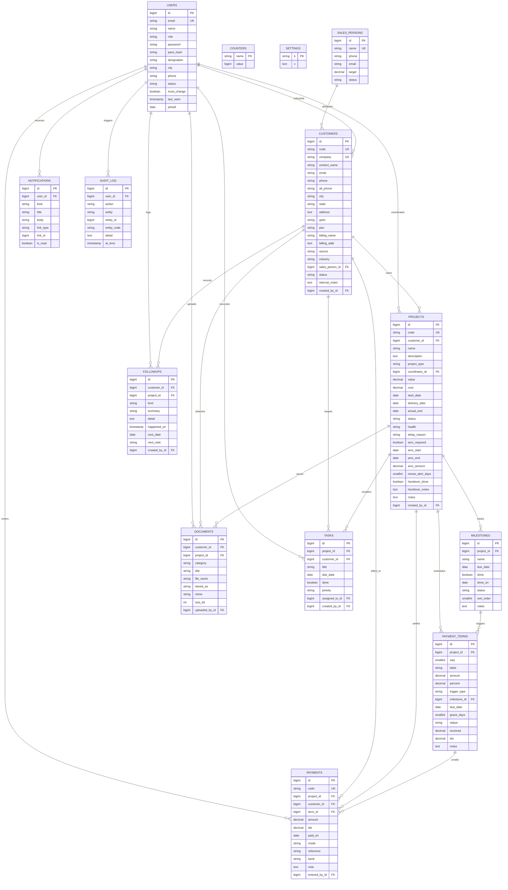
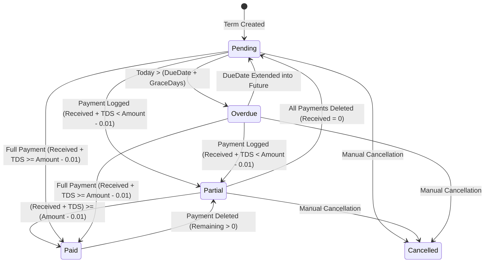

# 10X Agency — Project Coordinator CRM (`PJT CRM`)

**System Architecture, Database Specification, Livewire 4 Component Matrix & Implementation Guide**

---

## 1. System Executive Summary & Architecture

### 1.1 Platform Purpose & Scope

**PJT CRM** is an operations and financial management system designed specifically for digital agencies[cite: 43]. It
bridges the gap between sales handoff, delivery coordination, milestone execution, and receivables collection[cite: 43].
The system provides role-based access for two user tiers[cite: 43]:

* **Administrators (`Admin`)**: Possess unrestricted governance over system settings, global alert thresholds, user
  management, salesperson commission targets, and destructive entity cascades (customer and project deletion)[cite: 43].
* **Project Coordinators (`Coordinator`)**: Manage day-to-day client onboarding, project health and delivery milestones,
  multi-tier installment schedules, incoming payment receipts, document uploads, personal task checklists, and scheduled
  follow-ups[cite: 43]. Access is strictly scoped to assigned accounts via query scopes[cite: 1, 43].

### 1.2 System Architecture Diagram

The platform is built on **Laravel 13** and **Livewire 4**, providing a reactive full-stack single-page application (
SPA) architecture powered by `wire:navigate`, Alpine.js stores, and Tailwind CSS alongside
`crm-style.css`[cite: 3, 4, 43].

```mermaid
graph TD
    subgraph Client Layer [Client Layer (Browser)]
        UI["Livewire 4 Reactive Views & Blade Components"]
        AlpineStore["Alpine.js Stores ($store.currency, Sidebar State)"]
        LocalStorage["LocalStorage (pjt_cur, pjt_sidebar_collapsed)"]
        UI <--> AlpineStore
        AlpineStore <--> LocalStorage
    end

    subgraph Entry Points [HTTP Routing & Middleware]
        WebRoute["routes/web.php<br/>(Livewire Full-Page Component Routing with wire:navigate)"]
        AuthMiddleware["Middleware: auth, verified"]
        RoleScope["Eloquent Query Scope: scopeForUser()"]
    end

    subgraph Livewire Component Layer
        NavComponents["Navigation Components<br/>(GlobalSearch, NotificationBell)"]
        OverviewModules["Overview Modules<br/>(DashboardIndex, TodayWorkIndex)"]
        CustomerModules["Customer Modules<br/>(CustomerIndex, CustomerDetail, CustomerModal, CustomerImportModal)"]
        ProjectModules["Project Modules<br/>(ProjectIndex, ProjectDetail, ProjectModal, ScheduleModal, RecurringModal, MilestoneModal)"]
        MoneyModules["Money Modules<br/>(PaymentIndex, PaymentModal, ScheduleIndex, ReportIndex)"]
        RecordModules["Record Modules<br/>(DocumentIndex, DocumentUploadModal, DocumentPreviewModal, FollowupIndex, SalesIndex, SalesModal)"]
        SystemModules["System Modules<br/>(NotificationIndex, AuditIndex, SettingIndex, UserModal, ProfileController)"]
    end

    subgraph Domain Services Layer
        MoneyService["MoneyCalculationService<br/>(Financial Aggregations & Status Automations)"]
        CodeService["CodeGeneratorService<br/>(Atomic Row-Locking Sequence Engine)"]
        CurrencyService["CurrencyRateService<br/>(USD / INR Conversion Rates)"]
    end

    subgraph Persistence Layer
        Eloquent["Eloquent ORM Models (Relationships & Scopes)"]
        MySQL[("MySQL 8.0+ Database")]
        DiskStorage[("Local Disk Storage (storage/app/public)")]
    end

    UI -->|User Interactions / Events| WebRoute
    WebRoute --> AuthMiddleware --> RoleScope
    RoleScope --> NavComponents & OverviewModules & CustomerModules & ProjectModules & MoneyModules & RecordModules & SystemModules

    CustomerModules & ProjectModules & MoneyModules & OverviewModules --> MoneyService
    CustomerModules & ProjectModules & MoneyModules --> CodeService
    NavComponents --> CurrencyService

    MoneyService & CodeService --> Eloquent
    RecordModules --> DiskStorage
    Eloquent --> MySQL
```

### 1.3 Architectural Migration & Modernization

The platform was migrated from a procedural, flat-file script (`index.php`, `api.php`, `config.php`) to **Laravel 13
with Livewire 4** while maintaining feature parity, visual design, and database relationships[cite: 5, 6, 43]:

* **Full-Stack Component Reactivity**: Livewire 4 full-page components manage lifecycle hooks, pagination (
  `WithPagination`), file uploads (`WithFileUploads`), and event listeners (`#[On]`), replacing manual AJAX polling and
  manual DOM updates with seamless server-driven updates[cite: 43].
* **Real-Time Client Navigation**: Livewire 3/4 `wire:navigate` enables instant transitions without full browser
  reloads, preserving client-side Alpine state[cite: 3].
* **Isolated Business Rules**: Financial logic, sequential code generation, and currency rates reside in dedicated
  domain service classes (`MoneyCalculationService`, `CodeGeneratorService`, `CurrencyRateService`), ensuring consistent
  calculations across all modules[cite: 43].
* **Strict Role Scoping**: Project Coordinators are restricted to their assigned accounts via `scopeForUser()`, ensuring
  complete data isolation between coordinators[cite: 1, 43].

---

## 2. Directory Structure & File Map

```text
pjt-crm/
├── app/
│   ├── Http/
│   │   └── Controllers/
│   │       └── ProfileController.php           # User profile editing and password updates
│   ├── Livewire/
│   │   ├── Audit/
│   │   │   └── AuditIndex.php                  # System audit log timeline viewer
│   │   ├── Components/
│   │   │   ├── GlobalSearch.php                # Universal debounced search dropdown
│   │   │   └── NotificationBell.php            # Topbar unread count polling badge
│   │   ├── Customers/
│   │   │   ├── CustomerDetail.php              # Tabbed customer profile (Overview, Projects, Payments, Docs, Followups)
│   │   │   ├── CustomerImportModal.php         # Bulk CSV upload and spreadsheet paste modal
│   │   │   ├── CustomerIndex.php               # Customer directory, filtering, pagination, and CSV export
│   │   │   └── CustomerModal.php               # Unified create and edit modal for customers
│   │   ├── Dashboard/
│   │   │   └── DashboardIndex.php              # Executive KPI cards, health breakdown, triage, and trend analytics
│   │   ├── Documents/
│   │   │   ├── DocumentIndex.php               # Global document repository with category filtering and deletion
│   │   │   ├── DocumentPreviewModal.php        # Lightbox preview modal for PDFs and images
│   │   │   └── DocumentUploadModal.php         # Multi-entity file upload modal with validation
│   │   ├── Followups/
│   │   │   └── FollowupIndex.php               # Touchpoint feed, overdue alert banner, and interaction logger
│   │   ├── Notifications/
│   │   │   └── NotificationIndex.php           # Notification inbox with deep linking and mark-as-read actions
│   │   ├── Payments/
│   │   │   ├── PaymentIndex.php                # Receipt ledger, mode filtering, balance tracking, and CSV export
│   │   │   └── PaymentModal.php                # Receipt recorder with auto-balance calculation and term binding
│   │   ├── Projects/
│   │   │   ├── ProjectDetail.php               # Project delivery matrix, timeline, schedule, and document tabs
│   │   │   ├── ProjectIndex.php                # Work orders directory, health filtering, and overdue rollups
│   │   │   ├── ProjectMilestoneModal.php       # Dynamic milestone ordering and checklist manager
│   │   │   ├── ProjectModal.php                # Project contract creator/editor with AMC and handover fields
│   │   │   ├── ProjectRecurringModal.php       # Monthly retainer recurring installment generator
│   │   │   └── ProjectScheduleModal.php        # Installment scheduler (fixed, milestone-linked, recurring)
│   │   ├── Reports/
│   │   │   └── ReportIndex.php                 # Collection rate, monthly sparkline, mode bars, aging, and variance
│   │   ├── Sales/
│   │   │   ├── SalesIndex.php                  # Salesperson revenue attribution, targets, and comparative table
│   │   │   └── SalesModal.php                  # Sales representative registration and quota manager
│   │   ├── Schedule/
│   │   │   └── ScheduleIndex.php               # Master chronological installment timeline and CSV export
│   │   ├── Settings/
│   │   │   ├── SettingIndex.php                # Operational threshold configuration, password manager, and user list
│   │   │   └── UserModal.php                   # Staff account creator/editor with temporary password generator
│   │   ├── Tasks/
│   │   │   └── TaskIndex.php                   # Coordinator checklist manager with priority flags and late indicators
│   │   └── Today/
│   │       └── TodayWorkIndex.php              # Daily operational triage for overdue payments, calls, and risks
│   ├── Models/
│   │   ├── AuditLog.php                        # Immutable system activity log
│   │   ├── Counter.php                         # Atomic sequence counters for entity codes
│   │   ├── Customer.php                        # Customer model with project, document, and sales relationships
│   │   ├── Document.php                        # Document metadata records linked to storage
│   │   ├── Followup.php                        # Client communication history and follow-up dates
│   │   ├── Milestone.php                       # Project milestones and completion stamps
│   │   ├── Notification.php                    # System notifications indexed by user ID
│   │   ├── Payment.php                         # Payment receipts linked to projects and terms
│   │   ├── PaymentTerm.php                     # Payment installment schedules and status tracking
│   │   ├── Project.php                         # Project entity with monetary accessors and role scopes
│   │   ├── SalesPerson.php                     # Sales registry for onboarding attribution
│   │   ├── Setting.php                         # Key-value global configuration store
│   │   ├── Task.php                            # Actionable checklist items
│   │   └── User.php                            # Authenticatable staff accounts with role helpers
│   └── Services/
│       ├── CodeGeneratorService.php            # Transaction-safe sequential identifier generator
│       ├── CurrencyRateService.php             # Exchange rate configuration and conversion service
│       └── MoneyCalculationService.php         # Financial calculation engine and overdue status updater
├── database/
│   ├── migrations/                             # Database migrations defining tables and foreign keys
│   └── seeders/
│       ├── DatabaseSeeder.php                  # Master database seeder
│       └── UserSeeder.php                      # Seeds default Administrator and Coordinator accounts
├── public/
│   ├── assets/
│   │   └── logo.png                            # Static brand identity asset
│   └── css/
│       └── crm-style.css                       # Complete application design and responsive layout rules
├── resources/
│   └── views/
│       ├── components/
│       │   ├── health-badge.blade.php          # Reusable project health indicator badge
│       │   ├── kpi-card.blade.php              # Metric card with icons and trends
│       │   ├── modal.blade.php                 # Alpine-driven modal dialog container
│       │   └── money.blade.php                 # Reactive currency formatting component
│       ├── layouts/
│       │   ├── app.blade.php                   # Master layout with mini-sidebar toggle and global modals
│       │   └── partials/
│       │       └── sidebar.blade.php           # 14-module navigation sidebar with live count badges
│       └── livewire/                           # Paired Blade templates for all Livewire components
└── routes/
    ├── auth.php                                # Laravel Breeze authentication routes
    └── web.php                                 # Authenticated routes mapping all 14 Livewire modules
```

---

## 3. Database Schema & Data Modeling

### 3.1 Entity-Relationship Diagram (ERD)



### 3.2 Data Dictionary & Foreign Key Constraints

| Table                     | Column                   | Type                                    | Constraints / Attributes                                                  | Description                                   |
|:--------------------------|:-------------------------|:----------------------------------------|:--------------------------------------------------------------------------|:----------------------------------------------|
| `users`[cite: 43]         | `id`[cite: 43]           | `BIGINT UNSIGNED`[cite: 43]             | `PRIMARY KEY, AUTO_INCREMENT`[cite: 43]                                   | Unique user identity[cite: 43].               |
|                           | `email`[cite: 43]        | `VARCHAR(160)`[cite: 43]                | `NOT NULL, UNIQUE`[cite: 43]                                              | Sign-in email address[cite: 43].              |
|                           | `role`[cite: 43]         | `ENUM('Admin','Coordinator')`[cite: 43] | `NOT NULL, DEFAULT 'Coordinator'`[cite: 43]                               | Role permission level[cite: 43].              |
|                           | `pass_hash`[cite: 43]    | `VARCHAR(255)`[cite: 43]                | `NULLABLE`                                                                | Legacy password hash compatibility[cite: 43]. |
|                           | `password`               | `VARCHAR(255)`                          | `NOT NULL`                                                                | Standard Bcrypt password hash.                |
| `customers`[cite: 43]     | `sales_person_id`        | `BIGINT UNSIGNED`                       | `NULLABLE, FOREIGN KEY -> sales_persons(id) ON DELETE SET NULL`           | Linked sales representative.                  |
|                           | `created_by_id`          | `BIGINT UNSIGNED`                       | `NULLABLE, FOREIGN KEY -> users(id) ON DELETE SET NULL`                   | Creator user ID.                              |
| `projects`[cite: 43]      | `customer_id`[cite: 43]  | `BIGINT UNSIGNED`[cite: 43]             | `NOT NULL, FOREIGN KEY -> customers(id) ON DELETE CASCADE`[cite: 43]      | Parent customer reference[cite: 43].          |
|                           | `coordinator_id`         | `BIGINT UNSIGNED`                       | `NULLABLE, FOREIGN KEY -> users(id) ON DELETE SET NULL`                   | Assigned project coordinator.                 |
|                           | `created_by_id`          | `BIGINT UNSIGNED`                       | `NULLABLE, FOREIGN KEY -> users(id) ON DELETE SET NULL`                   | Creator user ID.                              |
| `milestones`[cite: 43]    | `project_id`[cite: 43]   | `BIGINT UNSIGNED`[cite: 43]             | `NOT NULL, FOREIGN KEY -> projects(id) ON DELETE CASCADE`[cite: 43]       | Target project reference[cite: 43].           |
| `payment_terms`[cite: 43] | `project_id`[cite: 43]   | `BIGINT UNSIGNED`[cite: 43]             | `NOT NULL, FOREIGN KEY -> projects(id) ON DELETE CASCADE`[cite: 43]       | Associated project reference[cite: 43].       |
|                           | `milestone_id`[cite: 43] | `BIGINT UNSIGNED`[cite: 43]             | `NULLABLE, FOREIGN KEY -> milestones(id) ON DELETE SET NULL`[cite: 43]    | Optional linked milestone trigger[cite: 43].  |
| `payments`[cite: 43]      | `project_id`[cite: 43]   | `BIGINT UNSIGNED`[cite: 43]             | `NOT NULL, FOREIGN KEY -> projects(id) ON DELETE CASCADE`[cite: 43]       | Credited project reference[cite: 43].         |
|                           | `term_id`[cite: 43]      | `BIGINT UNSIGNED`[cite: 43]             | `NULLABLE, FOREIGN KEY -> payment_terms(id) ON DELETE SET NULL`[cite: 43] | Optional credited installment[cite: 43].      |
|                           | `entered_by_id`          | `BIGINT UNSIGNED`                       | `NULLABLE, FOREIGN KEY -> users(id) ON DELETE SET NULL`                   | Recording coordinator ID.                     |
| `documents`[cite: 43]     | `customer_id`[cite: 43]  | `BIGINT UNSIGNED`[cite: 43]             | `NOT NULL, FOREIGN KEY -> customers(id) ON DELETE CASCADE`[cite: 43]      | Parent customer reference[cite: 43].          |
|                           | `project_id`[cite: 43]   | `BIGINT UNSIGNED`[cite: 43]             | `NULLABLE, FOREIGN KEY -> projects(id) ON DELETE CASCADE`[cite: 43]       | Optional project reference[cite: 43].         |
|                           | `uploaded_by_id`         | `BIGINT UNSIGNED`                       | `NULLABLE, FOREIGN KEY -> users(id) ON DELETE SET NULL`                   | Uploader user ID.                             |
| `followups`[cite: 43]     | `customer_id`[cite: 43]  | `BIGINT UNSIGNED`[cite: 43]             | `NOT NULL, FOREIGN KEY -> customers(id) ON DELETE CASCADE`[cite: 43]      | Contacted customer reference[cite: 43].       |
|                           | `created_by_id`          | `BIGINT UNSIGNED`                       | `NULLABLE, FOREIGN KEY -> users(id) ON DELETE SET NULL`                   | Author user ID.                               |
| `tasks`[cite: 43]         | `assigned_to_id`         | `BIGINT UNSIGNED`                       | `NULLABLE, FOREIGN KEY -> users(id) ON DELETE SET NULL`                   | Responsible coordinator.                      |
|                           | `created_by_id`          | `BIGINT UNSIGNED`                       | `NULLABLE, FOREIGN KEY -> users(id) ON DELETE SET NULL`                   | Creator user ID.                              |
| `notifications`[cite: 43] | `user_id`                | `BIGINT UNSIGNED`                       | `NOT NULL, FOREIGN KEY -> users(id) ON DELETE CASCADE`                    | Recipient staff account.                      |
| `audit_log`[cite: 43]     | `user_id`                | `BIGINT UNSIGNED`                       | `NULLABLE, FOREIGN KEY -> users(id) ON DELETE SET NULL`                   | Performing user identity.                     |

---

## 4. Domain Logic & Business Rules

### 4.1 Financial Calculation Formulations (`MoneyCalculationService`)

Financial figures are centralized in `MoneyCalculationService` and accessible via the `getMoneyAttribute` accessor on
the `Project` model[cite: 43]:

$$\text{Scheduled Gross} = \sum_{t \in \text{Terms}, \, t.\text{status} \neq \text{'Cancelled'}} t.\text{amount}$$

$$\text{Cash Received} = \sum_{p \in \text{Payments}} p.\text{amount}$$

$$\text{Withheld TDS} = \sum_{p \in \text{Payments}} p.\text{tds}$$

$$\text{Balance Due} = \max\left(0.00, \; \text{Scheduled Gross} - \text{Cash Received} - \text{Withheld TDS}\right)$$

$$\text{Overdue Amount} = \sum_{t \in \text{Terms}, \, t.\text{status} = \text{'Overdue'}} \max\left(0.00, \; t.\text{amount} - t.\text{received} - t.\text{tds}\right)$$

$$\text{Collection Rate (\%)} = \begin{cases} \text{round}\left(\frac{\text{Cash Received}}{\text{Scheduled Gross}} \times 100, 1\right) & \text{if } \text{Scheduled Gross} > 0 \\ 0.0 & \text{otherwise} \end{cases}$$

### 4.2 Installment State Transitions

Installment states (`payment_terms.status`) are calculated automatically based on payment amounts, tax deductions, due
dates, and grace periods[cite: 43]:



* **Paid Condition**: Evaluated with a floating-point tolerance of $0.01$ to prevent rounding discrepancies[cite: 43]:
  $$(t.\text{received} + t.\text{tds}) \ge (t.\text{amount} - 0.01)$$
* **Overdue Evaluation**: Executed automatically via SQL date arithmetic in `refreshOverdueStatus()` without loading
  models into memory:
  $$\text{DATE\_ADD}(t.\text{due\_date}, \, \text{INTERVAL } t.\text{grace\_days} \text{ DAY}) < \text{CURDATE}()$$

### 4.3 Aging Buckets Engine

Overdue receivables are segmented into four distinct aging intervals[cite: 43]:

$$\text{Days Overdue} = \left\lfloor \frac{\text{CurrentDate} - \text{DueDate}}{86400} \right\rfloor$$

$$\text{Bucket}(t) = \begin{cases} \text{'0-30 days'}, & \text{if } \text{Days Overdue} \le 30 \\ \text{'31-60 days'}, & \text{if } 31 \le \text{Days Overdue} \le 60 \\ \text{'61-90 days'}, & \text{if } 61 \le \text{Days Overdue} \le 90 \\ \text{'90+ days'}, & \text{if } \text{Days Overdue} > 90 \end{cases}$$

### 4.4 Concurrency-Safe Identifier Sequencing (`CodeGeneratorService`)

Entity identifiers (`CUS-0001`, `PJT-0001`, `RCP-0001`) are generated sequentially using database-level row locking over
the `counters` table inside a transaction[cite: 43]:

```php
public function generate(string $name, string $prefix = ''): string
{
    return DB::transaction(function () use ($name, $prefix) {
        $counter = DB::table('counters')->where('name', $name)->lockForUpdate()->first();
        if (!$counter) {
            DB::table('counters')->insert(['name' => $name, 'value' => 1]);
            $val = 1;
        } else {
            $val = $counter->value + 1;
            DB::table('counters')->where('name', $name)->update(['value' => $val]);
        }
        return $prefix . str_pad((string)$val, 4, '0', STR_PAD_LEFT);
    });
}
```

---

## 5. Security & Authentication Architecture

### 5.1 Dual-Column Password Authentication

To maintain backward compatibility with legacy password hashes while supporting standard Laravel authentication, the
`User` model overrides `getAuthPassword()`[cite: 43]:

```php
public function getAuthPassword(): string
{
    return $this->pass_hash ?? $this->attributes['password'] ?? '';
}

public function setPasswordAttribute($value): void
{
    $hashed = Hash::needsRehash($value) ? Hash::make($value) : $value;
    $this->attributes['password'] = $hashed;
    $this->attributes['pass_hash'] = $hashed;
}
```

### 5.2 Role Scoping & Data Isolation

Data access for Project Coordinators is scoped to their assigned records using the `scopeForUser()` query
scope[cite: 1, 43]:

```php
public function scopeForUser(Builder $query, ?User $user = null): Builder
{
    $user = $user ?? auth()->user();
    if ($user && $user->role !== 'Admin') {
        return $query->where('coordinator_id', $user->id);
    }
    return $query;
}
```

### 5.3 Password Strength Validation Invariants

New passwords must satisfy four complexity rules[cite: 43]:

1. Minimum length of 8 characters[cite: 43]: $\text{strlen}(p) \ge 8$.
2. At least one uppercase character[cite: 43]: `regex:/[A-Z]/`.
3. At least one lowercase character[cite: 43]: `regex:/[a-z]/`.
4. At least one numerical digit[cite: 43]: `regex:/[0-9]/`.

---

## 6. Complete Module Catalog & Livewire 4 Component Architecture

The CRM consists of 14 integrated modules grouped across 5 navigation sections[cite: 3]:

### 6.1 Module 1: Dashboard (`/dashboard`)

* **Component**: `App\Livewire\Dashboard\DashboardIndex`
* **Features**:
    * 5 KPI cards: Total Receivable, Received (with collection rate %), Due, Overdue (with late installment count), and
      Current Month Collections[cite: 3].
    * Today's Work Mini-Triage: Highlights the top 3 overdue payments, top 3 follow-ups, and top 2 delayed/at-risk
      projects with direct navigation links[cite: 3].
    * Project Health: Visual breakdown across `On Track`, `At Risk`, `Delayed`, and `Completed` with proportional
      percentage bars[cite: 3].
    * 6-Month Collection Trend: Historical monthly collection chart with month labels[cite: 3].
    * Secondary Grids: Upcoming payments, overdue payments, sales attribution table, AMC renewal alerts, and pending
      handover checklists[cite: 3].
    * Horizontal Aging Buckets: Receivables segmented into `0-30`, `31-60`, `61-90`, and `90+` days[cite: 3].

### 6.2 Module 2: Today's Work (`/today`)

* **Component**: `App\Livewire\Today\TodayWorkIndex`
* **Features**:
    * Actionable daily queue showing pending touchpoints, upcoming collections, and urgent recovery tasks[cite: 3].
    * Summary KPIs: Overdue amount, Due Soon amount, Follow-ups count, and Open Tasks count[cite: 3].
    * Overdue Payments: Installment cards showing days overdue and inline `+ Payment` buttons[cite: 3].
    * Upcoming Payments & Follow-up Calls: Grouped cards with color-coded due dates[cite: 3].
    * Projects Needing Attention: Table displaying delayed and at-risk deliverables with delay reasons and amounts
      due[cite: 3].

### 6.3 Module 3: Customers (`/customers`)

* **Components**:
    * `App\Livewire\Customers\CustomerIndex`: Customer directory with multi-field search, sales representative filter,
      city filter, payment status filter (`due`, `over`, `clear`), and CSV export[cite: 3].
    * `App\Livewire\Customers\CustomerDetail`: Tabbed client view containing Overview, Projects, Payments, Documents,
      and Follow-ups[cite: 3].
    * `App\Livewire\Customers\CustomerModal`: Full modal supporting creation and editing across 16 fields (GSTIN, PAN,
      tax details, internal notes)[cite: 3].
    * `App\Livewire\Customers\CustomerImportModal`: Bulk CSV parser supporting spreadsheet pasting and file
      uploads[cite: 3].

### 6.4 Module 4: Projects (`/projects`)

* **Components**:
    * `App\Livewire\Projects\ProjectIndex`: Project directory with health filtering, status filtering, and contract vs.
      balance rollups[cite: 3].
    * `App\Livewire\Projects\ProjectDetail`: Project management workspace with health banners, milestone timelines,
      financial summaries, AMC terms, and handover sign-offs[cite: 3].
    * `App\Livewire\Projects\ProjectModal`: Contract creation and editing modal with internal margin cost
      tracking[cite: 3].
    * `App\Livewire\Projects\ProjectMilestoneModal`: Milestone ordering and checklist management modal[cite: 3].
    * `App\Livewire\Projects\ProjectScheduleModal`: Installment scheduler supporting Fixed Date, Milestone Linked, and
      Recurring modes[cite: 3].
    * `App\Livewire\Projects\ProjectRecurringModal`: Single-click monthly retainer schedule generator[cite: 3].

### 6.5 Module 5: My Tasks (`/tasks`)

* **Component**: `App\Livewire\Tasks\TaskIndex`
* **Features**:
    * Personal checklist execution with priority levels (`Low`, `Medium`, `High`, `Urgent`)[cite: 3].
    * Live status summary (`N pending · N done`)[cite: 5].
    * Task creation form supporting project linking and assignee selection.
    * Overdue deadline tracking with prominent red late-day indicators[cite: 5].
    * Instant task completion toggling and deletion controls[cite: 5].

### 6.6 Module 6: Payments (`/payments`)

* **Components**:
    * `App\Livewire\Payments\PaymentIndex`: Inward payment ledger with payment mode filtering (`Cash`, `UPI`, `NEFT`,
      `RTGS`, `Cheque`, `Card`, `Other`), reference tracking, and CSV export[cite: 3, 5].
    * `App\Livewire\Payments\PaymentModal`: Receipt modal that automatically calculates installment balances upon
      selection[cite: 3, 5].

### 6.7 Module 7: Payment Schedule (`/schedule`)

* **Component**: `App\Livewire\Schedule\ScheduleIndex`
* **Features**:
    * Master chronological schedule tracking all upcoming and overdue installments[cite: 3].
    * Summary KPIs: Upcoming, Overdue, Collected, and Total Scheduled[cite: 3, 5].
    * Urgency-ranked table with late-day badges and trigger indicators[cite: 5].
    * Inline payment button pre-populating project and installment parameters[cite: 5].
    * UTF-8 BOM CSV export for spreadsheet compatibility[cite: 5, 43].

### 6.8 Module 8: Reports (`/reports`)

* **Component**: `App\Livewire\Reports\ReportIndex`
* **Features**:
    * Financial KPIs: Collection Rate, Total Overdue, TDS Deductions, and Average Project Value[cite: 3, 5].
    * Visual Analytics: 6-month historical sparkline, payment mode breakdown bars, overdue aging bars, and project
      health distribution[cite: 3, 5].
    * Milestone vs. Collection Gap Analysis: Table identifying projects where delivery progress outpaces cash
      collections[cite: 3, 5].

### 6.9 Module 9: Documents (`/documents`)

* **Components**:
    * `App\Livewire\Documents\DocumentIndex`: File repository with search, category filtering (`Contract`, `KYC/GST`,
      `Invoice`, `Proposal`, `Quotation`, `Delivery Proof`, `AMC`, `Other`), and deletion permissions[cite: 3, 5].
    * `App\Livewire\Documents\DocumentUploadModal`: File upload modal supporting attachments up to 10 MB[cite: 4, 5].
    * `App\Livewire\Documents\DocumentPreviewModal`: Lightbox viewer for previewing images and PDFs[cite: 3, 5].

### 6.10 Module 10: Follow-ups (`/followups`)

* **Component**: `App\Livewire\Followups\FollowupIndex`
* **Features**:
    * Client communication logs tracking 5 channels (`Call`, `Email`, `Meeting`, `WhatsApp`, `Note`)[cite: 3, 5].
    * Prominent warning banner listing overdue touchpoints[cite: 5].
    * Channel-specific color-coded icons and conversation detail notes[cite: 5].
    * Direct customer navigation and record deletion controls[cite: 5].

### 6.11 Module 11: Sales Team (`/sales`)

* **Components**:
    * `App\Livewire\Sales\SalesIndex`: Commercial team registry tracking customer volume, total contracted value,
      collections, and quota targets[cite: 3, 5].
    * `App\Livewire\Sales\SalesModal`: Modal for managing sales representatives and monthly targets[cite: 5].

### 6.12 Module 12: Notifications (`/notifications`)

* **Components**:
    * `App\Livewire\Notifications\NotificationIndex`: System alert feed with category icons, unread indicators, and
      mark-as-read actions[cite: 3, 5].
    * `App\Livewire\Components\NotificationBell`: Real-time navigation bell displaying unread alert counts[cite: 3].
    * Deep Linking: Clicking an alert navigates directly to the target project or customer[cite: 3, 5].

### 6.13 Module 13: Activity Log (`/audit`)

* **Component**: `App\Livewire\Audit\AuditIndex`
* **Features**:
    * Append-only system audit log tracking logins, creations, updates, deletions, and uploads[cite: 3, 5].
    * Action-specific timeline indicator dots (Green for payments, Red for deletions, Navy for creates, Amber for
      updates)[cite: 5].
    * Full user attribution, entity code badges, and detailed diff notes[cite: 5].

### 6.14 Module 14: Settings & Users (`/settings`)

* **Components**:
    * `App\Livewire\Settings\SettingIndex`: Operational alert thresholds (`payment_alert_days`, `amc_alert_days`,
      `followup_alert_days`), display currency configuration, password updates, and user management[cite: 3, 5].
    * `App\Livewire\Settings\UserModal`: Staff user creation and editing modal with temporary password
      generation[cite: 5].

---

## 7. Frontend Layout, UI Components & Responsive State

### 7.1 Responsive Shell & Mini-Sidebar Architecture

The application layout in `resources/views/layouts/app.blade.php` supports responsive collapsing with persistent
state[cite: 4]:

* **Desktop Collapse**: Toggling the `#burger` button applies the `.collapsed` CSS class, collapsing the sidebar to a
  70px icon-only rail[cite: 4]. State is persisted in `localStorage` under `pjt_sidebar_collapsed`[cite: 4].
* **Mobile Drawer**: On screens $\le 860\text{px}$, the sidebar functions as an off-canvas slide-out drawer (
  `.sidebar.open`) that closes upon outside clicks[cite: 4].
* **Native CSS Layout**: Built with custom variables in `public/css/crm-style.css` using brand colors (Navy `#0b3d91`,
  Green `#5aa236`)[cite: 4].

### 7.2 In-Memory Currency Conversion (`Alpine.store('currency')`)

Amounts are stored natively in Indian Rupees (INR, `₹`) with client-side conversion to US Dollars (USD, `$`) via
Alpine.js[cite: 4]:

```javascript
Alpine.store('currency', {
    cur: localStorage.getItem('pjt_cur') || 'INR',
    rate: 83.0,
    toggle() {
        this.cur = this.cur === 'INR' ? 'USD' : 'INR';
        localStorage.setItem('pjt_cur', this.cur);
    },
    format(val, short = false) {
        let n = Number(val || 0);
        if (this.cur === 'USD') {
            n = n / this.rate;
            if (short && Math.abs(n) >= 1000) return '$' + (n / 1000).toFixed(n % 1000 === 0 ? 0 : 1) + 'K';
            return '$' + n.toLocaleString('en-US', {maximumFractionDigits: n < 100 ? 2 : 0});
        }
        if (short && Math.abs(n) >= 100000) return '₹' + (n / 100000).toFixed(n % 100000 === 0 ? 0 : 1) + 'L';
        return '₹' + n.toLocaleString('en-IN', {maximumFractionDigits: 0});
    }
});
```

---

## 8. Deployment, Operations & Runbook

### 8.1 System Prerequisites

* **PHP**: `^8.2` or later with extensions: `pdo_mysql`, `mbstring`, `fileinfo`, `openssl`, `tokenizer`, `xml`, `ctype`.
* **Database**: MySQL `8.0+` or MariaDB `10.4+`.
* **Web Server**: Nginx or Apache with `mod_rewrite` enabled.
* **Build Tools**: Composer `2.x` and Node.js `18+` (NPM).

### 8.2 Production Deployment Setup

```bash
# 1. Clone repository to server root
git clone <repository_url> /var/www/pjt-crm
cd /var/www/pjt-crm

# 2. Install production dependencies
composer install --no-dev --optimize-autoloader
npm install && npm run build

# 3. Environment configuration
cp .env.example .env
php artisan key:generate

# 4. Configure database connection inside .env:
# DB_HOST=127.0.0.1
# DB_DATABASE=project_manager
# DB_USERNAME=project_user
# DB_PASSWORD=secure_password

# 5. Run database migrations and seed default users
php artisan migrate --force
php artisan db:seed --class=UserSeeder --force

# 6. Establish storage symlink
php artisan storage:link

# 7. Set correct storage permissions
chown -R www-data:www-data storage bootstrap/cache
chmod -R 775 storage bootstrap/cache

# 8. Optimize application caches
php artisan config:cache
php artisan route:cache
php artisan view:cache
```

### 8.3 Web Server Configuration (Nginx)

```nginx
server {
    listen 80;
    server_name project.the10xagency.in;
    return 301 https://$host$request_uri;
}

server {
    listen 443 ssl http2;
    server_name project.the10xagency.in;
    root /var/www/pjt-crm/public;

    ssl_certificate /etc/letsencrypt/live/project.the10xagency.in/fullchain.pem;
    ssl_certificate_key /etc/letsencrypt/live/project.the10xagency.in/privkey.pem;

    client_max_body_size 15M;
    index index.php;
    charset utf-8;

    add_header X-Frame-Options "SAMEORIGIN";
    add_header X-Content-Type-Options "nosniff";
    add_header Referrer-Policy "same-origin";

    location / {
        try_files $uri $uri/ /index.php?$query_string;
    }

    location = /favicon.ico { access_log off; log_not_found off; }
    location = /robots.txt  { access_log off; log_not_found off; }

    error_page 404 /index.php;

    location ~ \.php$ {
        fastcgi_pass unix:/var/run/php/php8.2-fpm.sock;
        fastcgi_param SCRIPT_FILENAME $realpath_root$fastcgi_script_name;
        include fastcgi_params;
    }

    location ~ /\.(?!well-known).* {
        deny all;
    }
}
```

---

## 9. AI Development & Maintenance Protocols

Adhere to the following rules when maintaining or extending this codebase:

1. **Centralize Financial Calculations in `MoneyCalculationService`**:
   Never calculate installment balances, receivables, or overdue states directly inside Blade views or controllers.
   Always invoke `MoneyCalculationService` or the `getMoneyAttribute` accessor on models to ensure consistency across
   views, dashboards, and CSV exports[cite: 43].

2. **Maintain Atomic Sequencing Invariants**:
   Never generate sequential entity codes using `Model::max('id') + 1`, which creates race conditions under concurrent
   requests. Always generate codes using `CodeGeneratorService::generate('entity', 'PREFIX-')` inside database
   transactions with row-level locking[cite: 43].

3. **Enforce Role-Based Query Scoping**:
   Always scope queries for coordinators using `Project::forUser(auth()->user())`. Coordinators must never access or
   manipulate projects, payments, or documents belonging to other coordinators[cite: 1, 43].

4. **Separate Livewire PHP Classes from Blade Views**:
   Never include PHP class definitions or namespace declarations inside `.blade.php` view files. Keep PHP classes in
   `app/Livewire/` and views in `resources/views/livewire/` to avoid fatal class re-declaration errors.

5. **Clean Up Files on Disk During Deletions**:
   When deleting document records or cascading customer deletions, always delete the corresponding file from disk using
   `Storage::disk('public')->delete(\$doc->stored_as)` to prevent orphaned files[cite: 43].
