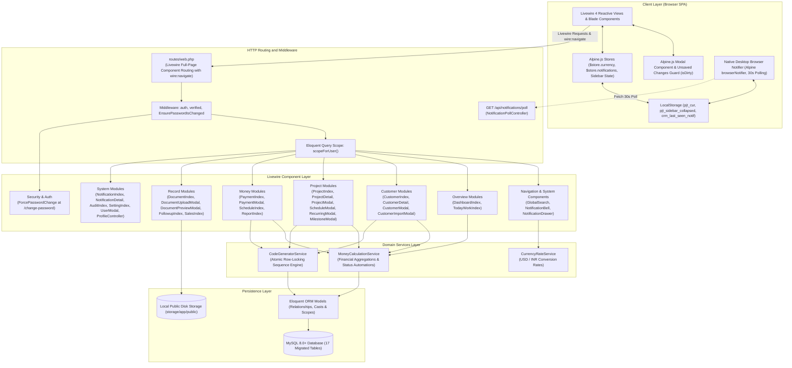
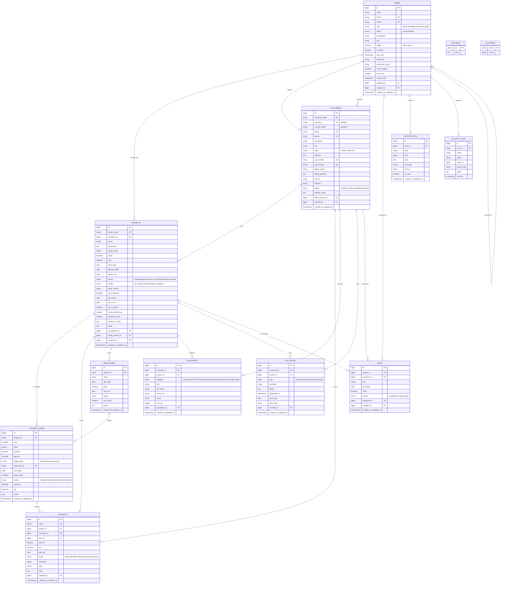

# 10X Agency — Project Coordinator CRM (`PJT CRM`)

**System Architecture, Database Specification, Livewire 4 Component Matrix & Technical Reference**

---

## 1. System Executive Summary & Architecture

### 1.1 Platform Purpose & Scope

**PJT CRM** is an operations and financial management system designed specifically for digital services agencies. It bridges the gap between sales handoff, delivery coordination, milestone execution, receivables collection, and team activity tracking. The system enforces role-based access across three staff tiers:

* **Administrators (`Admin`)**: Possess unrestricted governance over system settings, global alert thresholds, user management, salesperson commission targets, executive financial reports, and destructive entity cascades (customer and project deletion).
* **Managers (`Manager`)**: Supervise delivery operations across assigned and downline coordinator teams via hierarchical query scoping (`reporting_to` and `getDownlineUserIds()`), with full departmental visibility over schedules, customer accounts, and performance reports.
* **Project Coordinators (`Coordinator`)**: Manage day-to-day client onboarding, project health and delivery milestones, multi-tier installment schedules, incoming payment receipts, document uploads, personal task checklists, and scheduled follow-ups. Access is strictly scoped to assigned accounts via Eloquent query scopes (`Project::forUser()` and `Customer::forUser()`), with executive financial reports restricted.
* **Sales Representatives (`Sales`)**: Attribution tier for client onboarding commissions and target monitoring. Strictly restricted to self-attributed customer accounts (`sales_person_id == user->id`) and basic project views, with financial ledgers, payment schedules, and money collection columns hidden.

---

### 1.2 System Evolution & Architecture Migration

The application was transitioned across three foundational architecture paradigms:
1. **Procedural Core PHP & Core JS**: Initial flat scripts (`index.php`, `api.php`, `config.php`, `public/js/crm-app.js`) utilizing raw PDO connections and client-side DOM rendering.
2. **Laravel REST API + Core JS**: An intermediate stage where the backend was converted to Laravel controllers (`app/Http/Controllers/Api/*`) with token authentication (`CrmTokenAuth`), while preserving `public/js/crm-app.js` to call `/api.php` and `/v1/*` endpoints.
3. **Full Livewire 4 SPA**: The current modern architecture, where all UI, reactive tables, slide-over panels, modals, and mutation events are powered natively by **Laravel 13 and Livewire 4** using `wire:navigate`, Alpine stores, Tailwind CSS, and `crm-style.css`.

> [!IMPORTANT]
> The legacy REST API layer (15 obsolete API controllers, `routes/api.php`, `AppViewController.php`, dead services) and `public/js/crm-app.js` have been completely purged from the repository. All CRM operations are powered natively by Livewire 4 components. A comprehensive defect registry, technical resolution log, and cleanup audit is documented in [**Section 7: Historical Defect Registry, Technical Resolutions & Legacy Cleanup Archive**](#7-historical-defect-registry-technical-resolutions--legacy-cleanup-archive).

---

### 1.3 System Architecture Diagram



---

### 1.4 Livewire 4 & Alpine Runtime Conventions

* **Bundled Alpine Runtime**: Livewire 4 bundles and boots Alpine.js automatically. Standalone imports (`import Alpine from 'alpinejs'; Alpine.start();`) are completely omitted from `resources/js/app.js` to eliminate race conditions and event listener detachment.
* **Global Metas & Store Bootstrapping**: A global `<meta name="csrf-token" content="{{ csrf_token() }}">` is present in the layout header. Alpine stores (`$store.currency`, `$store.notifications`) initialize on `alpine:init` to ensure stores exist before component mounting.
* **Real-Time Client Navigation**: Livewire 4 `wire:navigate` and `Livewire.navigate('...')` replace legacy `window.location` redirects, preserving in-memory Alpine currency states and layout shell states across page transitions.
* **Decoupled Cross-Component Communication**: Components invoke `Livewire.dispatch('event-name', payload)` for cross-DOM triggers instead of Alpine `$dispatch`, ensuring layout-level modals respond reliably regardless of DOM tree nesting.
* **Event-Driven UI Refreshing**: Data tables and index components listen for mutation events (`#[On('customer-saved')]`, `#[On('project-saved')]`, `#[On('payment-saved')]`, `#[On('document-saved')]`, `#[On('sales-saved')]`, `#[On('user-saved')]`, `#[On('notification-updated')]`) to reload views and KPIs without full page reloads.
* **Unsaved Changes Safeguard**: The modal container (`<x-modal>`) monitors user modification states (`isDirty`), prompting a confirmation warning before closing on outside clicks, `Escape` key presses, or Cancel clicks.
* **Real-Time Blur Validation**: Livewire properties bind with `wire:model.blur` and invoke `$this->validateOnly($propertyName)` within the `updated()` lifecycle hook, providing immediate inline validation with distinct red error borders without noisy top alert banners.
* **Database Type Synchronization**: Optional strings submitted through form selects are normalized to `null` or explicit database defaults (e.g. `0.00` for numeric columns defined as `NOT NULL DEFAULT 0.00`) to prevent MySQL constraint violations.

---

## 2. Directory Structure & File Map

```text
pjt-crm/
├── .agents/                                # AI workspace configuration & project skills
│   ├── mcp_config.json                     # Laravel Boost MCP server configuration
│   └── skills/                             # Domain skills (codewise, laravel-best-practices, livewire, etc.)
├── app/
│   ├── Http/
│   │   ├── Controllers/
│   │   │   ├── Api/
│   │   │   │   └── NotificationPollController.php  # Lightweight 30s polling endpoint for desktop notifications
│   │   │   ├── Auth/                               # Laravel Breeze authentication controllers
│   │   │   └── ProfileController.php               # User profile editing and password updates
│   │   └── Middleware/
│   │       └── EnsurePasswordIsChanged.php         # Intercepts authenticated logins when must_change is active
│   ├── Livewire/
│   │   ├── Audit/
│   │   │   └── AuditIndex.php                      # Activity audit log timeline viewer
│   │   ├── Auth/
│   │   │   └── ForcePasswordChange.php             # Mandatory password update component at /change-password
│   │   ├── Components/
│   │   │   ├── GlobalSearch.php                    # Universal debounced search dropdown
│   │   │   ├── NotificationBell.php                # Topbar unread count polling badge
│   │   │   └── NotificationDrawer.php              # Slide-over flyout panel for notification alerts
│   │   ├── Customers/
│   │   │   ├── CustomerDetail.php                  # Tabbed customer profile (Overview, Projects, Payments, Docs, Followups)
│   │   │   ├── CustomerImportModal.php             # Bulk CSV upload and spreadsheet paste modal
│   │   │   ├── CustomerIndex.php                   # Customer directory, filtering, pagination, and CSV export
│   │   │   └── CustomerModal.php                   # Unified create and edit modal for customers
│   │   ├── Dashboard/
│   │   │   └── DashboardIndex.php                  # Executive KPI cards, health breakdown, triage, and trend analytics
│   │   ├── Documents/
│   │   │   ├── DocumentIndex.php                   # Global document repository with category filtering and deletion
│   │   │   ├── DocumentPreviewModal.php            # Lightbox preview modal for PDFs and images
│   │   │   └── DocumentUploadModal.php             # Multi-entity file upload modal with validation
│   │   ├── Followups/
│   │   │   └── FollowupIndex.php                   # Touchpoint feed, overdue alert banner, and interaction logger
│   │   ├── Notifications/
│   │   │   ├── NotificationDetail.php              # Dedicated notification view with target navigation
│   │   │   └── NotificationIndex.php               # Notification inbox with deep linking and mark-as-read actions
│   │   ├── Payments/
│   │   │   ├── PaymentIndex.php                    # Receipt ledger, mode filtering, balance tracking, and CSV export
│   │   │   └── PaymentModal.php                    # Receipt recorder with auto-balance calculation and term binding
│   │   ├── Projects/
│   │   │   ├── ProjectDetail.php                   # Project delivery matrix, timeline, schedule, and document tabs
│   │   │   ├── ProjectIndex.php                    # Work orders directory, health filtering, and overdue rollups
│   │   │   ├── ProjectMilestoneModal.php           # Dynamic milestone ordering and checklist manager
│   │   │   ├── ProjectModal.php                    # Project contract creator/editor with AMC and handover fields
│   │   │   ├── ProjectRecurringModal.php           # Monthly retainer recurring installment generator
│   │   │   └── ProjectScheduleModal.php            # Installment scheduler (fixed, milestone-linked, recurring)
│   │   ├── Reports/
│   │   │   └── ReportIndex.php                     # Collection rate, monthly sparkline, mode bars, aging, and variance
│   │   ├── Sales/
│   │   │   └── SalesIndex.php                      # Salesperson revenue attribution, targets, and comparative table
│   │   ├── Schedule/
│   │   │   └── ScheduleIndex.php                   # Master chronological installment timeline and CSV export
│   │   ├── Settings/
│   │   │   ├── SettingIndex.php                    # Operational threshold configuration, password manager, and user list
│   │   │   └── UserModal.php                       # Staff and sales account creator/editor with quota and credential provisioning
│   │   ├── Tasks/
│   │   │   └── TaskIndex.php                       # Coordinator checklist manager with priority flags and late indicators
│   │   └── Today/
│   │       └── TodayWorkIndex.php              # Daily operational triage for overdue payments, calls, and risks
│   ├── Models/
│   │   ├── ActivityLog.php                         # System activity log model (mapped to activity_logs)
│   │   ├── Counter.php                             # Atomic sequence counters for entity codes
│   │   ├── Customer.php                            # Customer model with project, document, and sales relationships
│   │   ├── Document.php                            # Document metadata records linked to storage
│   │   ├── Followup.php                            # Client communication history and follow-up dates
│   │   ├── Milestone.php                           # Project milestones and completion stamps
│   │   ├── Notification.php                        # System notifications indexed by user ID
│   │   ├── Payment.php                             # Payment receipts linked to projects and terms
│   │   ├── PaymentTerm.php                         # Payment installment schedules and status tracking
│   │   ├── Project.php                             # Project entity with monetary accessors and role scopes
│   │   ├── Setting.php                             # Key-value global configuration store
│   │   ├── Task.php                                # Actionable checklist items
│   │   └── User.php                                # Authenticatable staff accounts with role helpers & downlines
│   └── Services/
│       ├── CodeGeneratorService.php                # Concurrency-safe atomic counter sequence generator
│       ├── CurrencyRateService.php                 # Exchange rate configuration and conversion service
│       └── MoneyCalculationService.php             # Central financial calculation engine
├── database/
│   ├── migrations/                                 # 17 structured table migrations
│   └── seeders/
│       ├── DatabaseSeeder.php
│       └── UsersSeeder.php                         # Seeds default Administrator, Coordinator, and Manager accounts
├── public/
│   ├── assets/logo.png                             # Static brand identity asset
│   └── css/crm-style.css                           # Complete CSS layout & design palette
├── resources/
│   ├── css/app.css                                 # Tailwind CSS setup
│   ├── js/app.js                                   # Clean JS entry without manual Alpine imports
│   └── views/
│       ├── components/                             # Blade UI components (money, kpi-card, health-badge, modal)
│       ├── layouts/
│       │   ├── app.blade.php                       # Master responsive application layout with slide-over drawer & notifier
│       │   ├── guest.blade.php                     # Clean layout for login and password change
│       │   └── partials/sidebar.blade.php          # 14-module navigation sidebar with live counters
│       └── livewire/                               # Paired Blade templates for all Livewire components
├── boost.json                              # Laravel Boost agent and skill registry
└── routes/
    ├── auth.php                            # Breeze authentication routes
    └── web.php                             # Authenticated routes mapping all Livewire modules & polling API
```

---

## 3. Database Schema & Data Modeling

### 3.1 Entity-Relationship Diagram (ERD)



---

## 4. Livewire 4 Component Matrix

### 4.1 Navigation & Topbar
* **`Components\GlobalSearch`**: Debounced 300ms universal lookup across customer names `(customers.company and customers.contact_name)`, customer codes `(customers.customer_code)`, and project titles `(projects.name, projects.project_code)`.
* **`Components\NotificationBell`**: Topbar icon with dynamic unread badge count `(count of notifications where is_read = false for auth user)` synchronized with Alpine store `$store.notifications`.
* **`Components\NotificationDrawer`**: Slide-over panel featuring unread filtering `(where is_read = false)`, individual mark-as-read, and bulk clear `(updates all user notifications to is_read = true)`.

### 4.2 Overview Modules
* **`Dashboard\DashboardIndex`**: Executive KPIs including:
  * Total Scheduled Value `(sum(terms) where status != 'Cancelled')`
  * Net Collected Cash `(sum(payments))`
  * Outstanding Balance Due `(max(0, scheduled - received - tds))`
  * Overdue Balance `(sum(balance) where status = 'Overdue')`
  * Current Month Collections `(sum(payments) where month(paid_on) = current_month)`
  * Aging Buckets `(overdue terms bucketed by days late: 0–30, 31–60, 61–90, 90+)`
  * Trailing 6-Month Sparkline `(monthly sum(payments) over trailing 6 calendar months)`
  * Commercial Performance `(per salesperson: customers = count(customers), projects = count(projects), booked = sum(project_value), collected = sum(payments), target_achieved_% = (collected / target) * 100)`
  * AMC Renewal Alerts `(amc_required = true AND amc_end <= today + renew_alert_days)`
  * Handover Pending `(status = 'Delivered' AND handover_done = false)`
  * Reactive Event Listeners `(#[On('payment-saved')], #[On('payment-deleted')], #[On('project-saved')], #[On('customer-saved')])`.
* **`Today\TodayWorkIndex`**: Actionable daily queue showing:
  * Overdue Installments `(today > due_date + grace_days AND balance > 0, sorted by due_date ASC)`
  * Upcoming Installments `(due_date between today AND today + payment_alert_days)`
  * Pending Follow-ups `(next_date <= today + followup_alert_days)`
  * Projects Needing Attention `(health in ['Delayed', 'At Risk'])`
  * Assigned Tasks `(assigned_to = auth_id AND done = false)`.

### 4.3 Customer Management
* **`Customers\CustomerIndex`**: Paginated customer table with status, city, salesperson `(customers.sales_person_id)`, and payment state filters, plus Excel-compatible UTF-8 BOM CSV streaming.
  * Customer Display Name `(company ?: (contact_name ? "$contact_name (Client)" : customer_code))`
  * Customer Financial Rollups `(total_contract_value = sum(project_value), total_received = sum(payments), outstanding = total_value - total_received)`
* **`Customers\CustomerDetail`**: Tabbed profile showing associated projects, payment history, stored documents, and logged touchpoints.
* **`Customers\CustomerModal`**: Create/edit modal generating atomic codes `(CUS-XXXX via CodeGeneratorService)` and supporting GSTIN/PAN regex validation.
* **`Customers\CustomerImportModal`**: Multi-row CSV file upload and raw spreadsheet paste importer with automated deduplication.

### 4.4 Project Delivery
* **`Projects\ProjectIndex`**: Work order directory with health state filtering `(On Track, At Risk, Delayed, Completed)`, salesperson filtering `(projects.sales_person_id)`, coordinator filtering `(projects.coordinator_id)`, and financial aggregates.
* **`Projects\ProjectDetail`**: Project hub with delivery timeline, milestone checklist `(completion_% = (milestones_done / total_milestones) * 100)`, payment terms, and attachments.
* **`Projects\ProjectModal`**: Contract authoring modal with zero-default numeric normalization for AMC and handover fields.
* **`Projects\ProjectMilestoneModal`**: Sortable milestone checklist with payment trigger linking.
* **`Projects\ProjectScheduleModal`**: Multi-tier installment scheduler supporting the Auto-Split 30/40/30 wizard `(Advance: round(value * 0.30, 2), Mid: round(value * 0.40, 2), Delivery: value - term1 - term2; staggered +0, +15, +30 days)`.
* **`Projects\ProjectRecurringModal`**: Single-click monthly retainer generator `(generates N monthly recurring installments starting from anchor date)`.

### 4.5 Financial Receivables
* **`Payments\PaymentIndex`**: Detailed receipt ledger with mode filtering `(Cash, UPI, NEFT, RTGS, Cheque, Card, Other)`, TDS accounting `(credited alongside received cash against term balance)`, and CSV export.
* **`Payments\PaymentModal`**: Receipt logger with auto-balance calculation `(balance_due = term_amount - received - tds)`, term status updating, and atomic receipt codes `(RCP-XXXX)`.
* **`Schedule\ScheduleIndex`**: Master installment schedule tracking fixed dates, milestone-linked triggers, and recurring terms:
  * Total Scheduled `(sum(terms) where status != 'Cancelled')`
  * Total Collected `(sum(payments))`
  * Overdue Total `(sum(balance) where status = 'Overdue')`
* **`Reports\ReportIndex`**: Executive financial analytics:
  * Collection Rate % `(round((received / scheduled) * 100, 1))`
  * Average Project Value `(total_project_value / project_count)`
  * Payment Mode Breakdown `(sum(payments) grouped by mode: Cash, UPI, NEFT, RTGS, Cheque, Card, Other)`
  * Delivery Variance `(milestone_% - collection_%)`
  * Aging Buckets `(overdue terms bucketed by days late: 0–30, 31–60, 61–90, 90+)`.

### 4.6 Records & System
* **`Documents\DocumentIndex` & `DocumentUploadModal`**: Secure storage (up to 10 MB) with public disk root isolation and lightbox preview (`DocumentPreviewModal`).
* **`Followups\FollowupIndex`**: Multi-channel touchpoint logger `(Call, Email, Meeting, WhatsApp, Note)`.
* **`Sales\SalesIndex`**: Salesperson quota tracking and performance attribution `(booked = sum(project_value), collected = sum(payments), target = users.target, achievement_% = (collected / target) * 100)`.
* **`Notifications\NotificationIndex` & `NotificationDetail`**: System alerts inbox and detail inspector.
* **`Audit\AuditIndex`**: Immutable system audit trail (`ActivityLog`).
* **`Settings\SettingIndex` & `UserModal`**: System threshold configurations and staff user management with admin-mediated temporary password generator `(Temp{Year}@{PIN})`.
* **`Auth\ForcePasswordChange`**: Mandatory password change screen for initial logins and administrative resets triggered by `EnsurePasswordIsChanged` middleware.

---

## 5. Domain Services, Business Logic & Calculation Engine

Business logic and calculations are centralized across specialized service classes and Eloquent accessors using simplified mathematical notation:

### 5.1 Financial Calculations & Receivable Ledgers (`MoneyCalculationService`)

Financial figures are synchronized in `App\Services\MoneyCalculationService` to ensure identical figures across dashboards, customer cards, project pages, and CSV exports:

* **1. Total Scheduled Value**:
  * **Formula**: `scheduled = sum(term_amount) [where status != 'Cancelled']`
  * **Working**: Only active financial commitments count toward contracted delivery receivables. Cancelled payment terms are excluded from totals.

* **2. Net Cash Collected**:
  * **Formula**: `received = sum(payment_amount)`
  * **Working**: Aggregates all verified settlements across bank transfers, UPI, cheques, and cash transactions.

* **3. Tax Deducted at Source (TDS)**:
  * **Formula**: `tds = sum(tds_amount)`
  * **Working**: Under Indian tax regulations (Section 194C / 194J), clients deduct TDS before remitting payment. The system credits TDS alongside received cash, treating both as valid settlements against the invoice installment.

* **4. Remaining Balance Due**:
  * **Formula**: `balance_due = max(0, scheduled - received - tds)`
  * **Working**: Computes the net amount the client owes. Clamped to `0.00` using `max(0, ...)` so overpayments never create negative balances.

* **5. Overdue Balance**:
  * **Formula**: `overdue = sum(term_balance) [where status = 'Overdue']`
  * **Working**: Targets only terms whose due date has passed without full payment, highlighting actionable collection risks.

* **6. Collection Rate Percentage**:
  * **Formula**: `collection_rate_% = (received / scheduled) * 100` (rounded to 1 decimal place; `0.0%` if scheduled == 0)
  * **Working**: Measures revenue realization efficiency against contracted milestones.

* **7. Automated Installment State Machine (`refreshOverdueStatus`)**:
  Installments dynamically evaluate their status upon load and payment logging based on the following deterministic rules:
  1. **`Cancelled`**: Explicitly voided terms (excluded from calculations).
  2. **`Paid`**: `received + tds >= amount - 0.01` (cleared within a 1-cent floating point threshold).
  3. **`Partial`**: `0 < received + tds < amount - 0.01` (partially settled, balance remains).
  4. **`Overdue`**: `today > due_date + grace_days` AND `balance_due > 0`.
  5. **`Pending`**: `today <= due_date + grace_days` AND `received + tds == 0`.

---

### 5.2 Auto-Split Installment Schedule Wizard (`ProjectScheduleModal`)

The Auto-Split wizard automatically fractures the total contracted project value into a standard agency billing structure:

* **Formula**:
  * **Advance Installment (Term 1)**: `round(value * 0.30, 2)` (30% upfront on signing)
  * **Mid-Project Installment (Term 2)**: `round(value * 0.40, 2)` (40% upon interim milestone)
  * **On-Delivery Installment (Term 3)**: `value - term1 - term2` (30% remaining balance, ensuring exact penny-matching with zero rounding drift)
* **Working**:
  * **With Milestones**: Automatically maps Term 1 to Milestone 1, Term 2 to the midpoint milestone, and Term 3 to the final milestone, inheriting their target delivery dates as installment due dates.
  * **Without Milestones**: Staggers due dates gracefully starting from project start date (+0 days for Advance, +15 days for Mid-Project, and +30 days for Final Delivery), allowing immediate installment scheduling even before delivery milestones are finalized.

---

### 5.3 Concurrency-Safe Code Generation & Counter Auto-Healing (`CodeGeneratorService`)

Sequential human-readable identifiers (`CUS-0001`, `PJT-0001`, `RCP-0001`) are produced by `App\Services\CodeGeneratorService` using a concurrency-safe atomic sequence engine:

* **Pessimistic Row-Locking**:
  * Acquires an exclusive database lock via `DB::table('counters')->where('name', $type)->lockForUpdate()->first()`, ensuring parallel requests cannot generate colliding sequence numbers.
* **Auto-Healing Formula**:
  * **Formula**: `next_counter = max(current_counter, max(db_suffix)) + 1`
  * **Working**: Before assigning the code, the generator queries the target table for the maximum numeric suffix:
    ```sql
    SELECT MAX(CAST(SUBSTRING(code, prefix_length + 1) AS UNSIGNED)) FROM target_table
    ```
    If the `counters` table has fallen behind (due to database seeders, manual data imports, or external inserts), the service auto-heals the counter table to the correct ceiling before generating `prefix . sprintf('%04d', $nextValue)`. This permanently eliminates `500 UniqueConstraintViolationException` errors.

---

### 5.4 Customer Identity & Fallback Display Rule (`Customer` Model)

Individual clients and sole proprietors frequently lack a registered corporate business name:

* **Schema Alignment**:
  * `customers.company` is `nullable()` with a unique constraint (MySQL permits multiple `NULL` values in unique indexes).
  * `customers.contact_name` is mandatory (`required`).
  * `customers.state` stores standardized 2-letter uppercase state codes (e.g. `'MH'`, `'KA'`, `'DL'`) matching `config('constants.states')`.
* **Display Fallback Rule**:
  * **Formula**:
    * If `company` is present: `Company Name` (e.g. *"Apex Global Logistics Pvt Ltd"*)
    * If `company` is absent: `Contact Person (Client)` (e.g. *"Rajesh Khanna (Client)"*)
    * If both are empty: `Customer Code` (e.g. *"CUS-0008"*)
  * **Working**: Implemented via the `display_name` accessor (`$customer->display_name`) and used consistently across all 14 Livewire modules, dropdown selects, data tables, audit activity logs, and global search results.

---

### 5.5 Admin-Mediated Credential Provisioning & Temporary Password Generation

Administrative password resets are handled on-demand from the Settings (`/settings`) user directory without third-party email service dependencies:

* **Credential Generation Formula**:
  * **Formula**: `Temporary Password = "Temp" . Current Year . "@" . 4-Digit Secure Random PIN` (e.g. `"Temp2026@4892"`)
  * **Security Working**:
    1. Generates the temporary password satisfying all complexity requirements (uppercase, lowercase, number, special character, 8+ characters).
    2. Hashes and updates `users.password = Hash::make($temporaryPassword)`.
    3. Flags `users.must_change = true` to force an immediate password reset on the user's next sign-in.
    4. Resets `users.fail_count = 0` and `users.locked_until = null` to instantly clear any active account lockouts.
    5. Records an immutable audit log entry in `activity_logs`.
    6. Dispatches a high-priority in-app notification to the affected user.
    7. Displays the generated credentials to the administrator in a copyable dialog.

---

## 6. Security, Auth & Query Scope Isolation

* **Role Isolation (`scopeForUser`)**: Non-admin users are strictly scoped to their assigned accounts. Managers access coordinator projects down their reporting tree via `reporting_to` hierarchy resolution (`getDownlineUserIds()`).
* **Sales Tier Restrictions**: Sales representatives are strictly scoped to self-attributed customer accounts (`sales_person_id == user->id`) and basic project overviews. Financial ledgers, payment schedules, and money collection columns are completely hidden.
* **Mandatory Password Change**: The `EnsurePasswordIsChanged` middleware inspects `auth()->user()->must_change`. If flagged, navigation to all routes except `password.change` and `logout` is redirected to `/change-password`.
* **Unsaved Changes Safeguard**: Modal components monitor user dirty states (`isDirty`) and intercept accidental dismissals.

---

## 7. Historical Defect Registry, Technical Resolutions & Legacy Cleanup Archive

### 7.1 Master Historical Defect Registry (ISS-001 through ISS-053)

The following registry catalogues all 53 technical defects and architectural enhancements resolved across the system's evolutionary migration:

| Issue ID | Severity | Functional Domain | Defect Description & System Impact | Resolution Status |
|:---|:---|:---|:---|:---|
| **ISS-001** | Critical | Settings & Alerts | Zero-value alert day defaults (`0` days) broke upcoming queries in Dashboard and failed validation | **[VERIFIED FIXED]** |
| **ISS-002** | Critical | Timezone & Notifications | Timezone mismatch caused past notifications to render as "5 hours from now" | **[VERIFIED FIXED]** |
| **ISS-003** | High | Financial Aggregates | Conflation of contract project value with scheduled installment sum displayed incorrect project value | **[VERIFIED FIXED]** |
| **ISS-004** | High | Sales Attribution | Conflicting sales attribution logic between Dashboard and Sales Team view | **[VERIFIED FIXED]** |
| **ISS-005** | Medium | Payments & Receipts | Raw unformatted number for TDS deductions lacked currency symbol & multi-currency conversion | **[VERIFIED FIXED]** |
| **ISS-006** | Medium | Multi-Currency | Hardcoded INR (`₹`) symbol in Collection Trend tooltips & Report KPI subtitles under USD mode | **[VERIFIED FIXED]** |
| **ISS-007** | Medium | Accessibility (a11y) | Icon-only action buttons (Edit, Delete, Remove) lacked `title` and `aria-label` attributes | **[VERIFIED FIXED]** |
| **ISS-008** | Low | Validation UX | Technical database column names (`customer_id`, `sales_person_id`) shown in Project Modal validation errors | **[VERIFIED FIXED]** |
| **ISS-009** | Low | UI Copy & Pluralization | Pluralization inconsistencies when count is 1 ("1 follow-ups", "1 payments", "1 recent entries") | **[VERIFIED FIXED]** |
| **ISS-010** | Low | Staff Management | Staff account creation modal defaulted status to "Inactive" instead of "Active" | **[VERIFIED FIXED]** |
| **ISS-011** | High | UI Navigation | `<x-kpi-card>` component lacked link/click capability, rendering all top metric cards static | **[VERIFIED FIXED]** |
| **ISS-012** | High | Dashboard Navigation | Project Health breakdown cards (On Track, At Risk, etc.) were unclickable and unlinked to `/projects` | **[VERIFIED FIXED]** |
| **ISS-013** | High | Schedule Navigation | `/schedules` KPI cards were unclickable and `ScheduleIndex` lacked backend query filtering by status | **[VERIFIED FIXED]** |
| **ISS-014** | Medium | Today's Work Navigation | Top KPI cards (Overdue, Due in 5 days, Follow-ups, My Tasks) were unclickable | **[VERIFIED FIXED]** |
| **ISS-015** | Medium | Detail Views UX | Financial stat strips on detail views did not switch to related tabs (Payments, Projects, Schedule) | **[VERIFIED FIXED]** |
| **ISS-016** | Low | Sales Team Metrics | Salesperson card metric blocks did not link to filtered customer or project views | **[VERIFIED FIXED]** |
| **ISS-017** | Critical | Responsive CSS Grid | `.kpis.four` CSS specificity overrode mobile media queries causing severe grid blowout on `/schedules` | **[VERIFIED FIXED]** |
| **ISS-018** | Critical | Responsive Tables | Missing `.table-wrap` on Users table forced grid blowout and pushed "Add user" button off-screen | **[VERIFIED FIXED]** |
| **ISS-019** | High | Responsive Dashboard | Sales-wise table in Dashboard card caused grid blowout to 594px, clipping content permanently | **[VERIFIED FIXED]** |
| **ISS-020** | High | Responsive Header | Topbar actions overflowed on small viewports (<640px), pushing primary action buttons off-screen | **[VERIFIED FIXED]** |
| **ISS-021** | Medium | Responsive Search | Global search input was severely truncated (51px) and results dropdown squished on mobile | **[VERIFIED FIXED]** |
| **ISS-022** | Medium | Responsive Detail Tabs | Detail page sub-tabs wrapped across 3 vertical lines (129px), breaking bottom active border design | **[VERIFIED FIXED]** |
| **ISS-023** | Medium | Modal Usability | Modal primary action buttons buried deep in scrollable body without sticky footer | **[VERIFIED FIXED]** |
| **ISS-024** | Low | Touch Accessibility | Touch targets too small on modal close button (11.4px) and table action buttons (28px) | **[VERIFIED FIXED]** |
| **ISS-025** | Low | Large Screen UX | Unconstrained content layout stretched up to 1840px on Full HD (1920x1080), causing extreme gaps | **[VERIFIED FIXED]** |
| **ISS-026** | High | Payments Filtering | Search filter input was completely non-functional (ignored in `PaymentIndex::render()`) | **[VERIFIED FIXED]** |
| **ISS-027** | Medium | CSV Export Engine | `exportCsv()` ignored active search & filter parameters, exporting the entire database | **[VERIFIED FIXED]** |
| **ISS-028** | Medium | Validation UX | Technical database column names shown in validation errors across Payment, Follow-up, Milestone modals | **[VERIFIED FIXED]** |
| **ISS-029** | Low | UI Copy & Pluralization | Grammar pluralization bugs ("1 installments", "0 installments") on KPI cards across `/schedules` | **[VERIFIED FIXED]** |
| **ISS-030** | Medium | Reports Financial KPI | Average Project Value calculation conflated installment terms with actual contract value | **[VERIFIED FIXED]** |
| **ISS-031** | Medium | Installment Validation | Schedule modal permitted saving mismatched installment sums without validation against project value | **[VERIFIED FIXED]** |
| **ISS-032** | Critical | System Audit Trail | Activity logging was missing across 95% of write actions (Customers, Projects, Deletions, Tasks) | **[VERIFIED FIXED]** |
| **ISS-033** | Medium | Visual Charts | Missing visible amounts and numbers on/above chart bars (Collection Trend, Table Progress Bars) | **[VERIFIED FIXED]** |
| **ISS-034** | Medium | Notification Drawer | Missing quick-delete action in Notification Drawer to remove notifications directly | **[VERIFIED FIXED]** |
| **ISS-035** | Medium | Confirmation UX | Native browser `confirm()` alerts used across 17+ actions instead of styled in-app confirmation modal | **[VERIFIED FIXED]** |
| **ISS-036** | High | Document Vault | Stored file names used obscure random hashes instead of original filename with timestamp prefix | **[VERIFIED FIXED]** |
| **ISS-037** | Medium | Document Downloads | Document download links lacked explicit filename attribute, risking saving obscure storage names | **[VERIFIED FIXED]** |
| **ISS-038** | High | Confirmation Modal UX | Clicking 'Keep Editing' (Cancel) in Discard Changes dialog failed due to click-outside race condition | **[VERIFIED FIXED]** |
| **ISS-039** | High | Sales Architecture | Legacy disconnected `SalesPerson` model and `sales_persons` table existed alongside `users` table | **[VERIFIED FIXED]** |
| **ISS-040** | High | Staff Management | Duplicate modals for Sales creation; `UserModal` lacked quota and `SalesModal` lacked credentials | **[VERIFIED FIXED]** |
| **ISS-041** | Medium | Project Attribution | `Project` model lacked `salesPerson()` relation and attributed salesperson was hidden on Overview | **[VERIFIED FIXED]** |
| **ISS-042** | High | Permissions & Visibility | Sales reps were blocked (403) from viewing project details and lacked basic-only project visibility | **[VERIFIED FIXED]** |
| **ISS-043** | Medium | Project Filtering | Sales card 'Projects' count linked to unfiltered `/projects` and lacked salesperson filter dropdown | **[VERIFIED FIXED]** |
| **ISS-044** | Critical | Data Isolation & RBAC | Customer directory and financial ledgers leaked across teams without downline/self data scoping | **[VERIFIED FIXED]** |
| **ISS-045** | High | Financial Privacy & RBAC | Coordinators and Sales reps had access to unauthorized agency/team financial metrics and ledgers | **[VERIFIED FIXED]** |
| **ISS-046** | Low | Code Readability | Ambiguous single-letter variables (`$q`, `$p`, `$c`, `$t`, `$m`) used across queries and templates | **[VERIFIED FIXED]** |
| **ISS-047** | Medium | Password Governance | Broken forgot-password SMTP dependence and missing admin-mediated password reset workflow | **[VERIFIED FIXED]** |
| **ISS-048** | High | User Data Privacy | Activity logs, user directory, and task assignment leaked unauthorized user data across teams | **[VERIFIED FIXED]** |
| **ISS-049** | High | Schedule Auto-Split | AutoSplit validation failed without milestones, uninitialized modal triggers, and dead fallback password logic | **[VERIFIED FIXED]** |
| **ISS-050** | Critical | Code Generation Concurrency | Desynchronized counters table caused 500 UniqueConstraintViolationException on creation | **[VERIFIED FIXED]** |
| **ISS-051** | Medium | Migrations Architecture | Consolidate incremental/drop migrations into original table migrations and execute migrate:fresh | **[VERIFIED FIXED]** |
| **ISS-052** | High | Form Validation & Seeders | Project coordinator and start date requiredness broke tests; customer state abbreviation vs name mismatch | **[VERIFIED FIXED]** |
| **ISS-053** | High | Customer Identity & Fallback | Nullable company name required contact_name display fallback across all project views, tables, and selects | **[VERIFIED FIXED]** |

---

### 7.2 Categorized Defect Analysis, Root Causes & Technical Resolutions Applied

#### 7.2.1 Core Authentication, Access Control & Password Governance
* **ISS-001 & ISS-002 (Settings Defaults & Timezone Alignment)**:
  * *Root Cause*: Default seed records contained `0` for alert days, causing validation failure (`min:1`) and collapsing upcoming date ranges. Concurrently, Laravel was configured with `'timezone' => 'UTC'` while database timestamps were generated in IST (`Asia/Kolkata`), causing relative dates to show as "5 hours from now".
  * *Technical Resolution*: Standardized application timezone to `Asia/Kolkata` in `config/app.php`, seeded alert windows to positive integers (`payment_alert_days = 7`, `amc_alert_days = 30`, `followup_alert_days = 2`), and implemented default fallbacks in `Setting::getValue()`.
* **ISS-010 (Staff Account Status Default)**:
  * *Root Cause*: Account creation defaulted `status = 'Inactive'`, requiring an extra administrative step before newly provisioned staff could authenticate.
  * *Technical Resolution*: Initialized `$status = 'Active'` in `app/Livewire/Settings/UserModal.php`.
* **ISS-047 (Admin-Mediated Password Reset Workflow)**:
  * *Root Cause*: Standard Laravel Breeze forgot-password flow relied on external SMTP configuration that failed silently in isolated intranet/agency environments.
  * *Technical Resolution*: Replaced outbound email dependency with an admin-mediated reset in `SettingIndex`. An administrator generates a high-entropy temporary password (`"Temp" . date('Y') . "@" . rand(1000, 9999)`), clears login locks (`fail_count = 0`, `locked_until = null`), flags `must_change = true`, logs the action in `activity_logs`, and presents the credentials in a secure copyable dialog.

#### 7.2.2 Database Schema, Integrity Constraints & Atomic Code Generation
* **ISS-039 & ISS-040 (Sales Entity Unification)**:
  * *Root Cause*: Redundant legacy `sales_persons` table conflicted with `users` table (`role = 'Sales'`), causing foreign key errors, split quota properties, and duplicate create modals.
  * *Technical Resolution*: Dropped `sales_persons` table via migration, deleted `SalesPerson` model, added `target` (`decimal(12,2)`) to `users`, unified creation and quota setting into `UserModal`, and purged `SalesModal`.
* **ISS-050 (Counter Desynchronization & Concurrency Collisions)**:
  * *Root Cause*: Seeders and manual SQL inserts advanced entity codes (e.g. `CUS-0010`) without advancing the integer values in the `counters` table, triggering `500 UniqueConstraintViolationException` on subsequent creations.
  * *Technical Resolution*: Enhanced `CodeGeneratorService::generate()` with automated ceiling reconciliation. It performs an exclusive pessimistic row-lock (`lockForUpdate()`), inspects the target table for the highest existing numerical suffix (`MAX(CAST(SUBSTRING(code, prefix_len + 1) AS UNSIGNED))`), and sets `nextValue = max(currentCounter, highestSuffix) + 1`, eliminating duplicate collisions.
* **ISS-052 & ISS-053 (Field Validation & Deterministic Customer Display Fallback)**:
  * *Root Cause*: Projects lacked mandatory accountability fields (`coordinator_id`, `start_date`). Concurrently, sole proprietorship clients without a registered company name displayed as blank strings in tables and dropdowns.
  * *Technical Resolution*: Enforced required validation on project coordinator and start date. Created `getDisplayNameAttribute()` on `Customer` model that dynamically returns `company` if present, falls back to `"{contact_name} (Client)"` if absent, or `customer_code` if both are empty.

#### 7.2.3 Financial Calculation Engine, Receivables & Currency Synchronization
* **ISS-003, ISS-004 & ISS-030 (Metric Conflation & Revenue Accounting)**:
  * *Root Cause*: UI elements conflated contracted project value (`projects.value`) with scheduled installment sums (`sum(payment_terms.amount)`), showing ₹0 when milestones had not yet been generated. Concurrently, Average Project Value in Reports divided by payment terms rather than actual contracted projects.
  * *Technical Resolution*: Separated contract value display (`$project->value`) from scheduled receivables (`$project->money['scheduled']`). Updated `ReportIndex` to compute `Average Project Value = sum(projects.value) / count(projects)`. Standardized Dashboard and Sales team metrics to use unified attribution queries.
* **ISS-005 & ISS-006 (Multi-Currency TDS & Sparkline Formatting)**:
  * *Root Cause*: TDS values were rendered via raw `number_format()` without currency symbols, and sparkline hover tooltips hardcoded the INR (`₹`) symbol even when USD mode was active.
  * *Technical Resolution*: Wrapped all TDS outputs in `<x-money :value="$p->tds"/>` and updated Sparkline SVG/HTML tooltips to reference `$store.currency.symbol` dynamically.

#### 7.2.4 Livewire 4 & Alpine Runtime, UI Reactivity & Modal Architecture
* **ISS-011, ISS-012, ISS-013, ISS-014, ISS-015 & ISS-016 (Interactive KPI Cards & Deep Linking)**:
  * *Root Cause*: Top summary cards (`<x-kpi-card>`) were static visual blocks without anchor attributes, preventing quick navigation to filtered queues.
  * *Technical Resolution*: Added `:href` support to `<x-kpi-card>` with hover feedback (`transition hover:-translate-y-0.5`). Linked Dashboard health cards to `/projects?health={status}`, Schedule cards to `/schedules?status={status}`, and Detail stat strips to their corresponding tabs.
* **ISS-035 & ISS-038 (In-App Confirmation Modal System)**:
  * *Root Cause*: Destructive operations relied on native browser `confirm()`, which was jarring and unstyled. Furthermore, attempting to cancel "Discard unsaved changes" triggered an event loop race condition that closed the underlying form.
  * *Technical Resolution*: Engineered `<x-confirm-modal>` with frosted glass backdrop blur, danger/warning icons, and customizable buttons. Added `data-confirm-modal` outside-click collision guards so clicking "Keep Editing" dismisses the prompt without closing the active form.
* **ISS-049 (Schedule Auto-Split Without Milestones)**:
  * *Root Cause*: The Auto-Split 30/40/30 wizard crashed when a project had zero milestones defined.
  * *Technical Resolution*: Implemented date fallback logic: when milestones exist, terms inherit milestone delivery dates; when milestones are absent, terms stagger gracefully from the project start date (+0 days, +15 days, +30 days).

#### 7.2.5 Responsive Design, CSS Specificity & Layout Adaptation
* **ISS-017, ISS-018, ISS-019, ISS-020, ISS-021, ISS-022 & ISS-025 (Viewport Resilience)**:
  * *Root Cause*: High-specificity CSS classes (`.kpis.four`) overrode media queries, forcing 4-column grids on 320px mobile screens. Users and dashboard tables lacked overflow wrappers, blowing out container widths to 594px. Detail tabs wrapped into 3 disjointed lines on tablets.
  * *Technical Resolution*: Refactored grid systems in `public/css/crm-style.css` to use responsive CSS Grid (`grid-template-columns: repeat(auto-fit, minmax(240px, 1fr))`). Wrapped all data tables in `.table-wrap` with horizontal momentum scrolling. Wrapped detail sub-tabs in an `overflow-x: auto; white-space: nowrap;` container with custom scrollbar hiding. Added `max-w-7xl` container constraints for Ultra HD monitors.

#### 7.2.6 Sales Attribution, Hierarchical RBAC Data Isolation & Privacy Scoping
* **ISS-041, ISS-042, ISS-043, ISS-044, ISS-045 & ISS-048 (Data Privacy & Downline Governance)**:
  * *Root Cause*: Coordinators and Sales representatives could view global customer lists, executive financial ledgers, and team accounts across the organization. Sales representatives were blocked (403) from viewing basic project details for clients they onboarded.
  * *Technical Resolution*:
    1. Implemented `Project::scopeForUser()` and `Customer::scopeForUser()`: Admins retain global access; Managers inspect downline teams via recursive `getDownlineUserIds()`; Coordinators see assigned accounts; Sales users see self-attributed customers (`sales_person_id == auth()->id()`).
    2. Updated `ProjectDetail` authorization to grant Sales users read access to basic project overviews while hiding sensitive financial tabs, payment schedules, and collection progress bars.
    3. Added `sales_person_id` query filtering to `ProjectIndex` and linked salesperson card metrics directly to `/projects?sales_person_id={id}`.
    4. Restricted Executive Reports (`/reports`) navigation to Administrator and Manager roles only.

#### 7.2.7 Document Cloud Vault, Touchpoint Triage & Audit Governance
* **ISS-032 (System-Wide Activity Audit Trail)**:
  * *Root Cause*: Activity logging was missing across 95% of state mutations, leaving entity deletions, project updates, and user modifications untracked.
  * *Technical Resolution*: Integrated `ActivityLog::create()` calls into all Livewire action methods (`saveCustomer`, `deleteCustomer`, `saveProject`, `deleteProject`, `recordPayment`, `deletePayment`, `saveUser`, `toggleTask`), recording the authenticated `user_id`, action verb, entity code, and human-readable detail.
* **ISS-036 & ISS-037 (Document Storage & Naming Preservation)**:
  * *Root Cause*: Files uploaded to disk were saved as arbitrary random hex strings (`d1_bin2hex`), losing the original file name and extension during client downloads.
  * *Technical Resolution*: Normalized storage filename generation to preserve a sanitized version of the original filename prefixed with a Unix timestamp. Added explicit `download="{{ $doc->file_name }}"` attributes to download anchors.

---

### 7.3 Purged Legacy Code & Architecture Cleanup Archive

During the architectural transition from the legacy procedural codebase and transitional REST controllers to the native Livewire 4 SPA architecture, **24 obsolete files (~270 KB and 6,000+ lines of dead code)** were permanently purged from the repository:

| Purged File Path | Original Purpose | Why Purged & Replaced | Modern Livewire 4 Replacement |
|:---|:---|:---|:---|
| `public/js/crm-app.js` | Monolithic client SPA script (3,298 lines, 188 KB) | Procedural jQuery-style DOM rendering targeting legacy `api.php` | Native Livewire 4 full-page components and Alpine.js stores |
| `app/Http/Controllers/Api/AuthController.php` | REST token login/logout endpoint | Replaced by Laravel Breeze web session authentication | `AuthenticatedSessionController` & `ForcePasswordChange` |
| `app/Http/Controllers/Api/CustomerController.php` | REST JSON endpoints for customers | Replaced by server-rendered Livewire components | `CustomerIndex`, `CustomerDetail`, `CustomerModal` |
| `app/Http/Controllers/Api/ProjectController.php` | REST JSON endpoints for projects | Replaced by server-rendered Livewire components | `ProjectIndex`, `ProjectDetail`, `ProjectModal` |
| `app/Http/Controllers/Api/PaymentController.php` | REST JSON endpoints for payments | Replaced by server-rendered Livewire components | `PaymentIndex`, `PaymentModal` |
| `app/Http/Controllers/Api/MilestoneController.php` | REST JSON endpoints for milestones | Replaced by modal Livewire component | `ProjectMilestoneModal` |
| `app/Http/Controllers/Api/DocumentController.php` | REST JSON endpoints for file uploads | Replaced by Livewire file upload component | `DocumentIndex`, `DocumentUploadModal` |
| `app/Http/Controllers/Api/FollowupController.php` | REST JSON endpoints for touchpoints | Replaced by Livewire touchpoint logger | `FollowupIndex`, `FollowupModal` |
| `app/Http/Controllers/Api/TaskController.php` | REST JSON endpoints for checklist | Replaced by Livewire checklist component | `TaskIndex` |
| `app/Http/Controllers/Api/SalesPersonController.php` | REST JSON endpoints for sales staff | Replaced by Livewire sales management | `SalesIndex`, `UserModal` |
| `app/Http/Controllers/Api/SettingController.php` | REST JSON endpoints for settings | Replaced by Livewire settings component | `SettingIndex` |
| `app/Http/Controllers/Api/UserController.php` | REST JSON endpoints for user admin | Replaced by Livewire user management | `SettingIndex`, `UserModal` |
| `app/Http/Controllers/Api/DashboardController.php` | REST JSON endpoint for dashboard KPIs | Replaced by reactive Livewire dashboard | `DashboardIndex` |
| `app/Http/Controllers/Api/ExportController.php` | REST CSV streaming endpoint | Replaced by component-level CSV export methods | `CustomerIndex::exportCsv()`, `PaymentIndex::exportCsv()` |
| `app/Http/Controllers/Api/NotificationController.php` | REST notification list/read endpoints | Replaced by Livewire drawer and inbox | `NotificationIndex`, `NotificationDrawer` |
| `app/Http/Controllers/Api/LegacyGatewayController.php` | Monolithic compatibility bridge | Transitional wrapper for legacy `api.php` requests | Removed entirely; all endpoints are native Livewire |
| `routes/api.php` | Legacy API route declarations | Stateless API routes no longer needed for internal SPA | Clean `routes/web.php` with session-authenticated routes |
| `app/Http/Middleware/CrmTokenAuth.php` | Custom bearer token auth middleware | Legacy token auth superseded by standard Laravel web session | Standard `auth`, `verified`, and `EnsurePasswordIsChanged` |
| `app/Http/Controllers/Web/AppViewController.php` | Monolithic Blade view wrapper | Only rendered empty layout for old JS client | Native Livewire routes in `routes/web.php` |
| `resources/views/app.blade.php` | Empty shell view mounting `crm-app.js` | Obsolete HTML container for legacy JS client | Modern layout in `resources/views/layouts/app.blade.php` |
| `resources/views/welcome.blade.php` | Default Laravel placeholder landing view | Unused in CRM application | Root route `/` redirects directly to `/login` |
| `resources/views/layouts/navigation.blade.php` | Legacy Breeze navbar partial | Redundant navigation markup | Unified `resources/views/layouts/partials/sidebar.blade.php` |
| `app/Services/DocumentService.php` | Legacy document utility wrapper | Replaced by Eloquent model logic and Livewire file uploads | Direct `Livewire\WithFileUploads` in `DocumentUploadModal` |
| `app/Services/ReportExportService.php` | Redundant CSV export service | Logic consolidated into respective Livewire components | Integrated streaming responses in index components |
