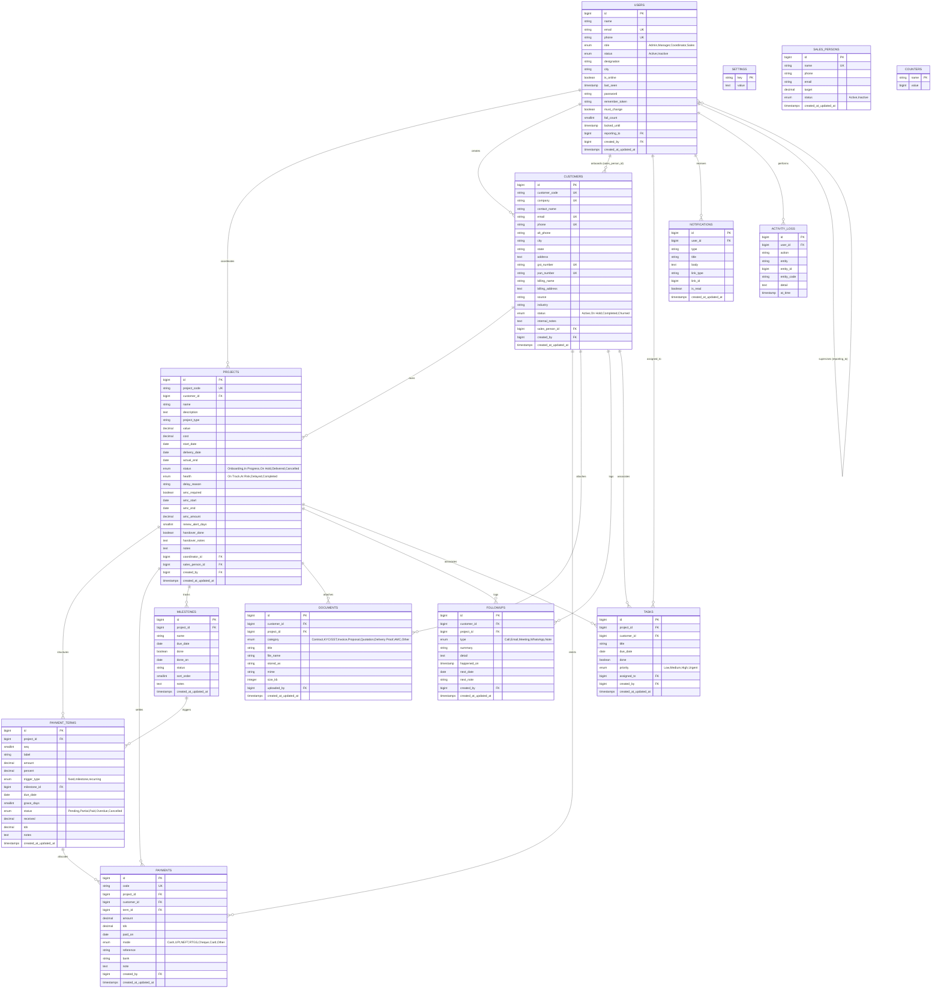

# 10X Agency — Project Coordinator CRM (`PJT CRM`)

**System Architecture, Database Specification, Livewire 4 Component Matrix & Technical Reference**

---

## 1. System Executive Summary & Architecture

### 1.1 Platform Purpose & Scope

**PJT CRM** is an operations and financial management system designed specifically for digital services agencies. It bridges the gap between sales handoff, delivery coordination, milestone execution, receivables collection, and team activity tracking. The system enforces role-based access across three staff tiers:

* **Administrators (`Admin`)**: Possess unrestricted governance over system settings, global alert thresholds, user management, salesperson commission targets, and destructive entity cascades (customer and project deletion).
* **Managers (`Manager`)**: Supervise delivery operations across assigned and downline coordinator teams via hierarchical query scoping (`reporting_to` and `getDownlineUserIds()`).
* **Project Coordinators (`Coordinator`)**: Manage day-to-day client onboarding, project health and delivery milestones, multi-tier installment schedules, incoming payment receipts, document uploads, personal task checklists, and scheduled follow-ups. Access is strictly scoped to assigned accounts via Eloquent query scopes (`scopeForUser()`).
* **Sales Representatives (`Sales`)**: Attribution tier for client onboarding commissions, target monitoring, and sales-wise revenue tracking.

---

### 1.2 System Evolution & Architecture Migration

The application was transitioned across three foundational architecture paradigms:
1. **Procedural Core PHP & Core JS**: Initial flat scripts (`index.php`, `api.php`, `config.php`, `public/js/crm-app.js`) utilizing raw PDO connections and client-side DOM rendering.
2. **Laravel REST API + Core JS**: An intermediate stage where the backend was converted to Laravel controllers (`app/Http/Controllers/Api/*`) with token authentication (`CrmTokenAuth`), while preserving `public/js/crm-app.js` to call `/api.php` and `/v1/*` endpoints.
3. **Full Livewire 4 SPA**: The current modern architecture, where all UI, reactive tables, slide-over panels, modals, and mutation events are powered natively by **Laravel 13 and Livewire 4** using `wire:navigate`, Alpine stores, Tailwind CSS, and `crm-style.css`.

> [!IMPORTANT]
> The legacy REST API layer (15 obsolete API controllers, `routes/api.php`, `AppViewController.php`, dead services) and `public/js/crm-app.js` have been completely purged from the repository. All CRM operations are powered natively by Livewire 4 components. A comprehensive defect registry and cleanup audit is maintained in [**`issues.md`**](file:///c:/wamp64/www/project-manager/issues.md).

---

### 1.3 System Architecture Diagram

```mermaid
graph TD
    subgraph Client Layer [Client Layer (Browser SPA)]
        UI["Livewire 4 Reactive Views & Blade Components"]
        ModalGuard["Alpine.js Modal Component & Unsaved Changes Guard (isDirty)"]
        AlpineStore["Alpine.js Stores ($store.currency, $store.notifications, Sidebar State)"]
        DesktopNotif["Native Desktop Browser Notifier (Alpine browserNotifier, 30s Polling)"]
        LocalStorage["LocalStorage (pjt_cur, pjt_sidebar_collapsed, crm_last_seen_notif)"]
        UI <--> ModalGuard
        UI <--> AlpineStore
        AlpineStore <--> LocalStorage
        DesktopNotif <--> LocalStorage
    end

    subgraph Entry Points [HTTP Routing & Middleware]
        WebRoute["routes/web.php<br/>(Livewire Full-Page Component Routing with wire:navigate)"]
        AuthMiddleware["Middleware: auth, verified, EnsurePasswordIsChanged"]
        PollRoute["GET /api/notifications/poll<br/>(NotificationPollController)"]
        RoleScope["Eloquent Query Scope: scopeForUser()"]
        WebRoute --> AuthMiddleware --> RoleScope
        DesktopNotif -.->|Fetch 30s Poll| PollRoute
    end

    subgraph Livewire Component Layer
        NavComponents["Navigation & System Components<br/>(GlobalSearch, NotificationBell, NotificationDrawer)"]
        OverviewModules["Overview Modules<br/>(DashboardIndex, TodayWorkIndex)"]
        CustomerModules["Customer Modules<br/>(CustomerIndex, CustomerDetail, CustomerModal, CustomerImportModal)"]
        ProjectModules["Project Modules<br/>(ProjectIndex, ProjectDetail, ProjectModal, ScheduleModal, RecurringModal, MilestoneModal)"]
        MoneyModules["Money Modules<br/>(PaymentIndex, PaymentModal, ScheduleIndex, ReportIndex)"]
        RecordModules["Record Modules<br/>(DocumentIndex, DocumentUploadModal, DocumentPreviewModal, FollowupIndex, SalesIndex, SalesModal)"]
        SystemModules["System Modules<br/>(NotificationIndex, NotificationDetail, AuditIndex, SettingIndex, UserModal, ProfileController)"]
        AuthModules["Security & Auth<br/>(ForcePasswordChange at /change-password)"]
    end

    subgraph Domain Services Layer
        MoneyService["MoneyCalculationService<br/>(Financial Aggregations & Status Automations)"]
        CodeService["CodeGeneratorService<br/>(Atomic Row-Locking Sequence Engine)"]
        CurrencyService["CurrencyRateService<br/>(USD / INR Conversion Rates)"]
    end

    subgraph Persistence Layer
        Eloquent["Eloquent ORM Models (Relationships, Casts & Scopes)"]
        MySQL[("MySQL 8.0+ Database (17 Migrated Tables)")]
        DiskStorage[("Local Public Disk Storage (storage/app/public)")]
    end

    UI -->|Livewire Requests & wire:navigate| WebRoute
    RoleScope --> NavComponents & OverviewModules & CustomerModules & ProjectModules & MoneyModules & RecordModules & SystemModules
    AuthMiddleware --> AuthModules

    CustomerModules & ProjectModules & MoneyModules & OverviewModules --> MoneyService
    CustomerModules & ProjectModules & MoneyModules --> CodeService
    NavComponents --> CurrencyService

    MoneyService & CodeService --> Eloquent
    RecordModules --> DiskStorage
    Eloquent --> MySQL
```

---

### 1.4 Livewire 4 & Alpine Runtime Conventions

* **Bundled Alpine Runtime**: Livewire 4 bundles and boots Alpine.js automatically. Standalone imports (`import Alpine from 'alpinejs'; Alpine.start();`) are completely omitted from `resources/js/app.js` to eliminate race conditions and event listener detachment.
* **Global Metas & Store Bootstrapping**: A global `<meta name="csrf-token" content="{{ csrf_token() }}">` is present in the layout header. Alpine stores (`$store.currency`, `$store.notifications`) initialize on `alpine:init` to ensure stores exist before component mounting.
* **Real-Time Client Navigation**: Livewire 4 `wire:navigate` and `Livewire.navigate('...')` replace legacy `window.location` redirects, preserving in-memory Alpine currency states and layout shell states across page transitions.
* **Decoupled Cross-Component Communication**: Components invoke `Livewire.dispatch('event-name', payload)` for cross-DOM triggers instead of Alpine `$dispatch`, ensuring layout-level modals respond reliably regardless of DOM tree nesting.
* **Event-Driven UI Refreshing**: Data tables and index components listen for mutation events (`#[On('customer-saved')]`, `#[On('project-saved')]`, `#[On('payment-saved')]`, `#[On('document-saved')]`, `#[On('sales-saved')]`, `#[On('user-saved')]`, `#[On('notification-updated')]`) to reload views and KPIs without full page reloads.
* **Unsaved Changes Safeguard**: The modal container (`<x-modal>`) monitors user modification states (`isDirty`), prompting a confirmation warning before closing on outside clicks, `Escape` key presses, or Cancel clicks.
* **Real-Time Blur Validation**: Livewire properties bind with `wire:model.blur` and invoke `$this->validateOnly($propertyName)` within the `updated()` lifecycle hook, providing immediate inline validation with distinct red error borders without noisy top alert banners.
* **Database Type Synchronization**: Optional strings submitted through form selects are normalized to `null` or explicit database defaults (e.g. `0.00` for numeric columns defined as `NOT NULL DEFAULT 0.00`) to prevent MySQL constraint violations.

---

## 2. Directory Structure & File Map

```text
pjt-crm/
├── .agents/                                # AI workspace configuration & project skills
│   ├── mcp_config.json                     # Laravel Boost MCP server configuration
│   └── skills/                             # Domain skills (codewise, laravel-best-practices, livewire, etc.)
├── app/
│   ├── Http/
│   │   ├── Controllers/
│   │   │   ├── Api/
│   │   │   │   └── NotificationPollController.php  # Lightweight 30s polling endpoint for desktop notifications
│   │   │   ├── Auth/                               # Laravel Breeze authentication controllers
│   │   │   └── ProfileController.php               # User profile editing and password updates
│   │   └── Middleware/
│   │       └── EnsurePasswordIsChanged.php         # Intercepts authenticated logins when must_change is active
│   ├── Livewire/
│   │   ├── Audit/
│   │   │   └── AuditIndex.php                      # Activity audit log timeline viewer
│   │   ├── Auth/
│   │   │   └── ForcePasswordChange.php             # Mandatory password update component at /change-password
│   │   ├── Components/
│   │   │   ├── GlobalSearch.php                    # Universal debounced search dropdown
│   │   │   ├── NotificationBell.php                # Topbar unread count polling badge
│   │   │   └── NotificationDrawer.php              # Slide-over flyout panel for notification alerts
│   │   ├── Customers/
│   │   │   ├── CustomerDetail.php                  # Tabbed customer profile (Overview, Projects, Payments, Docs, Followups)
│   │   │   ├── CustomerImportModal.php             # Bulk CSV upload and spreadsheet paste modal
│   │   │   ├── CustomerIndex.php                   # Customer directory, filtering, pagination, and CSV export
│   │   │   └── CustomerModal.php                   # Unified create and edit modal for customers
│   │   ├── Dashboard/
│   │   │   └── DashboardIndex.php                  # Executive KPI cards, health breakdown, triage, and trend analytics
│   │   ├── Documents/
│   │   │   ├── DocumentIndex.php                   # Global document repository with category filtering and deletion
│   │   │   ├── DocumentPreviewModal.php            # Lightbox preview modal for PDFs and images
│   │   │   └── DocumentUploadModal.php             # Multi-entity file upload modal with validation
│   │   ├── Followups/
│   │   │   └── FollowupIndex.php                   # Touchpoint feed, overdue alert banner, and interaction logger
│   │   ├── Notifications/
│   │   │   ├── NotificationDetail.php              # Dedicated notification view with target navigation
│   │   │   └── NotificationIndex.php               # Notification inbox with deep linking and mark-as-read actions
│   │   ├── Payments/
│   │   │   ├── PaymentIndex.php                    # Receipt ledger, mode filtering, balance tracking, and CSV export
│   │   │   └── PaymentModal.php                    # Receipt recorder with auto-balance calculation and term binding
│   │   ├── Projects/
│   │   │   ├── ProjectDetail.php                   # Project delivery matrix, timeline, schedule, and document tabs
│   │   │   ├── ProjectIndex.php                    # Work orders directory, health filtering, and overdue rollups
│   │   │   ├── ProjectMilestoneModal.php           # Dynamic milestone ordering and checklist manager
│   │   │   ├── ProjectModal.php                    # Project contract creator/editor with AMC and handover fields
│   │   │   ├── ProjectRecurringModal.php           # Monthly retainer recurring installment generator
│   │   │   └── ProjectScheduleModal.php            # Installment scheduler (fixed, milestone-linked, recurring)
│   │   ├── Reports/
│   │   │   └── ReportIndex.php                     # Collection rate, monthly sparkline, mode bars, aging, and variance
│   │   ├── Sales/
│   │   │   ├── SalesIndex.php                      # Salesperson revenue attribution, targets, and comparative table
│   │   │   └── SalesModal.php                      # Sales representative registration and quota manager
│   │   ├── Schedule/
│   │   │   └── ScheduleIndex.php                   # Master chronological installment timeline and CSV export
│   │   ├── Settings/
│   │   │   ├── SettingIndex.php                    # Operational threshold configuration, password manager, and user list
│   │   │   └── UserModal.php                       # Staff account creator/editor with temporary password generator
│   │   ├── Tasks/
│   │   │   └── TaskIndex.php                       # Coordinator checklist manager with priority flags and late indicators
│   │   └── Today/
│   │       └── TodayWorkIndex.php              # Daily operational triage for overdue payments, calls, and risks
│   ├── Models/
│   │   ├── ActivityLog.php                         # System activity log model (mapped to activity_logs)
│   │   ├── Counter.php                             # Atomic sequence counters for entity codes
│   │   ├── Customer.php                            # Customer model with project, document, and sales relationships
│   │   ├── Document.php                            # Document metadata records linked to storage
│   │   ├── Followup.php                            # Client communication history and follow-up dates
│   │   ├── Milestone.php                           # Project milestones and completion stamps
│   │   ├── Notification.php                        # System notifications indexed by user ID
│   │   ├── Payment.php                             # Payment receipts linked to projects and terms
│   │   ├── PaymentTerm.php                         # Payment installment schedules and status tracking
│   │   ├── Project.php                             # Project entity with monetary accessors and role scopes
│   │   ├── SalesPerson.php                         # Sales registry for onboarding attribution
│   │   ├── Setting.php                             # Key-value global configuration store
│   │   ├── Task.php                                # Actionable checklist items
│   │   └── User.php                                # Authenticatable staff accounts with role helpers & downlines
│   └── Services/
│       ├── CodeGeneratorService.php                # Concurrency-safe atomic counter sequence generator
│       ├── CurrencyRateService.php                 # Exchange rate configuration and conversion service
│       └── MoneyCalculationService.php             # Central financial calculation engine
├── database/
│   ├── migrations/                                 # 17 structured table migrations
│   └── seeders/
│       ├── DatabaseSeeder.php
│       └── UsersSeeder.php                         # Seeds default Administrator, Coordinator, and Manager accounts
├── public/
│   ├── assets/logo.png                             # Static brand identity asset
│   └── css/crm-style.css                           # Complete CSS layout & design palette
├── resources/
│   ├── css/app.css                                 # Tailwind CSS setup
│   ├── js/app.js                                   # Clean JS entry without manual Alpine imports
│   └── views/
│       ├── components/                             # Blade UI components (money, kpi-card, health-badge, modal)
│       ├── layouts/
│       │   ├── app.blade.php                       # Master responsive application layout with slide-over drawer & notifier
│       │   ├── guest.blade.php                     # Clean layout for login and password change
│       │   └── partials/sidebar.blade.php          # 14-module navigation sidebar with live counters
│       └── livewire/                               # Paired Blade templates for all Livewire components
├── boost.json                              # Laravel Boost agent and skill registry
├── issues.md                               # Local defect registry & audit scratchpad (gitignored)
└── routes/
    ├── auth.php                            # Breeze authentication routes
    └── web.php                             # Authenticated routes mapping all Livewire modules & polling API
```

---

## 3. Database Schema & Data Modeling

### 3.1 Entity-Relationship Diagram (ERD)



---

## 4. Livewire 4 Component Matrix

### 4.1 Navigation & Topbar
* **`Components\GlobalSearch`**: Debounced 300ms universal lookup across customer names, contact info, and project names.
* **`Components\NotificationBell`**: Topbar icon with dynamic unread badge count synchronized with Alpine store `$store.notifications`.
* **`Components\NotificationDrawer`**: Slide-over panel featuring unread filtering, individual mark-as-read, and bulk clear.

### 4.2 Overview Modules
* **`Dashboard\DashboardIndex`**: Executive KPIs (Receivables, Aging Buckets, Sparkline Trends, Triage Queue, AMC and Handover alerts). Listens to `#[On('payment-saved')]`, `#[On('project-saved')]`, `#[On('customer-saved')]`.
* **`Today\TodayWorkIndex`**: Actionable daily queue showing overdue payments, today's client calls, and at-risk delivery deadlines.

### 4.3 Customer Management
* **`Customers\CustomerIndex`**: Paginated customer table with status, city, salesperson, and payment state filters, plus Excel-compatible UTF-8 BOM CSV streaming.
* **`Customers\CustomerDetail`**: Tabbed profile showing associated projects, payment history, stored documents, and logged touchpoints.
* **`Customers\CustomerModal`**: Create/edit modal generating atomic codes (`CUS-XXXX`) and supporting GSTIN/PAN regex validation.
* **`Customers\CustomerImportModal`**: Multi-row CSV file upload and raw spreadsheet paste importer with automated deduplication.

### 4.4 Project Delivery
* **`Projects\ProjectIndex`**: Work order directory with health state filtering (`On Track`, `At Risk`, `Delayed`, `Completed`).
* **`Projects\ProjectDetail`**: Project hub with delivery timeline, milestone checklist, payment terms, and attachments.
* **`Projects\ProjectModal`**: Contract authoring modal with zero-default numeric normalization for AMC and handover fields.
* **`Projects\ProjectMilestoneModal`**: Sortable milestone checklist with payment trigger linking.
* **`Projects\ProjectScheduleModal`**: Multi-tier installment scheduler.
* **`Projects\ProjectRecurringModal`**: Single-click monthly retainer generator.

### 4.5 Financial Receivables
* **`Payments\PaymentIndex`**: Detailed receipt ledger with mode filtering, TDS accounting, and CSV export.
* **`Payments\PaymentModal`**: Receipt logger with auto-balance calculation, term status updating, and atomic receipt codes (`RCP-XXXX`).
* **`Schedule\ScheduleIndex`**: Master installment schedule tracking fixed dates, milestone-linked triggers, and recurring terms.
* **`Reports\ReportIndex`**: Financial analytics including collection rates, trailing 6-month revenue, payment mode breakdowns, and aging buckets.

### 4.6 Records & System
* **`Documents\DocumentIndex` & `DocumentUploadModal`**: Secure storage (up to 10 MB) with public disk root isolation and lightbox preview (`DocumentPreviewModal`).
* **`Followups\FollowupIndex`**: Multi-channel touchpoint logger (`Call`, `Email`, `Meeting`, `WhatsApp`, `Note`).
* **`Sales\SalesIndex` & `SalesModal`**: Salesperson quota manager and performance attribution.
* **`Notifications\NotificationIndex` & `NotificationDetail`**: System alerts inbox and detail inspector.
* **`Audit\AuditIndex`**: Immutable system audit trail (`ActivityLog`).
* **`Settings\SettingIndex` & `UserModal`**: System threshold configurations and staff user management.
* **`Auth\ForcePasswordChange`**: Mandatory password change screen for initial logins and administrative resets.

---

## 5. Domain Services & Financial Mathematics Layer

Financial calculations are centralized in `App\Services\MoneyCalculationService`:

1. **Total Scheduled Value**:
   $$\text{Scheduled Gross} = \sum_{t \in \text{Terms}, \, t.\text{status} \neq \text{'Cancelled'}} t.\text{amount}$$

2. **Net Cash Collected**:
   $$\text{Cash Received} = \sum_{p \in \text{Payments}} p.\text{amount}$$

3. **Tax Deducted at Source (TDS)**:
   $$\text{Withheld TDS} = \sum_{p \in \text{Payments}} p.\text{tds}$$

4. **Remaining Balance Due**:
   $$\text{Balance Due} = \max\left(0.00, \; \text{Scheduled Gross} - \text{Cash Received} - \text{Withheld TDS}\right)$$

5. **Overdue Balance**:
   $$\text{Overdue Amount} = \sum_{t \in \text{Terms}, \, t.\text{status} = \text{'Overdue'}} \max\left(0.00, \; t.\text{amount} - t.\text{received} - t.\text{tds}\right)$$

6. **Automatic Overdue Synchronization (`refreshOverdueStatus`)**:
   An installment transitions to `Overdue` when:
   $$\text{CurrentDate} > \text{DueDate} + \text{GraceDays} \quad \text{AND} \quad (\text{Received} + \text{TDS}) < \text{Amount} - 0.01$$

---

## 6. Security, Auth & Query Scope Isolation

* **Role Isolation (`scopeForUser`)**: Non-admin users are strictly scoped to their assigned accounts. Managers access coordinator projects down their reporting tree via `reporting_to` hierarchy resolution (`getDownlineUserIds()`).
* **Mandatory Password Change**: The `EnsurePasswordIsChanged` middleware inspects `auth()->user()->must_change`. If flagged, navigation to all routes except `password.change` and `logout` is redirected to `/change-password`.
* **Unsaved Changes Safeguard**: Modal components monitor user dirty states (`isDirty`) and intercept accidental dismissals.

---

## 7. Known Defects & Legacy Cleanup Runbook

For complete line-by-line defect reports, column mismatch corrections, and the audit of the purged legacy files, refer to:
📄 [**`issues.md` — Project Issues, Defect Registry & Unused Code Audit**](file:///c:/wamp64/www/project-manager/issues.md)
